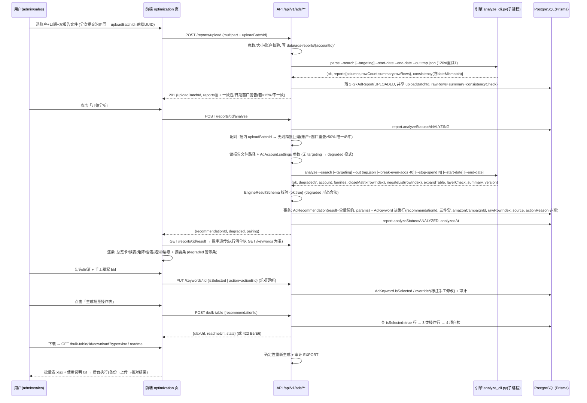

# Trade ERP 亚马逊广告优化管理（M1）架构设计

> 文档编号：TRADE-ERP-ADS-M1-ARCH-v2.0
> 状态：**v2（BA 审查修订版，2026-08-29）** | 日期：2026-08-29
> 架构师：Hermes Agent（独立产出，基于对现有代码的实地探索，非对既有草稿的复述）
> 上游文档：`docs/advertising-domain-m1-requirements.md`（501 行，**唯一需求基准**，REQ-ADS-001~011 + §4 v20 规则 + §5 权限 + §7 验收；已按审查修正 3 处引用/口径问题）
> 修订依据：`docs/advertising-domain-m1-arch-review.md`（跨阶段 BA 审查：7 项必改项 + 10 项内部矛盾 + 过度设计 O-1 裁剪；修订明细见 §13 修订记录）
> 参考草稿：`docs/advertising-domain-m1-arch.md`（已逐条核对，错误修正见 §12）
> 代码探索依据：prisma/schema.prisma、src/lib/permissions.ts、src/lib/api-response.ts、src/lib/api-validation.ts、src/lib/crypto-utils.ts、src/lib/auth-unified.ts、src/components/Sidebar/Sidebar.tsx、src/components/providers.tsx、src/hooks/use-orders.ts、src/app/api/upload/route.ts、src/app/api/v1/competitors/route.ts、src/app/api/permissions/init/route.ts、src/middleware.ts、Dockerfile、package.json、~/clawd/amazon-ads-optimizer（v20 引擎）

---

## 目录

1. [架构总览](#一架构总览)
2. [Prisma 数据模型（5 张新表 + 1 张辅助表）](#二prisma-数据模型5-张新表--1-张辅助表)
3. [权限设计](#三权限设计)
4. [API 详细设计](#四api-详细设计)
5. [Python 引擎集成](#五python-引擎集成servicesamazon-ads-engine)
6. [批量表生成（Bulk Operations 33 列）](#六批量表生成bulk-operations-33-列)
7. [前端架构](#七前端架构)
8. [数据流时序](#八数据流时序)
9. [安全设计](#九安全设计)
10. [目录/文件清单（按开发顺序）](#十目录文件清单按开发顺序)
11. [技术风险与缓解](#十一技术风险与缓解)
12. [草稿纠错（advertising-domain-m1-arch.md 的问题与修正）](#十二草稿纠错)
13. [修订记录（v2：BA 审查修订版）](#十三修订记录v2ba-审查修订版)

---

## 一、架构总览

### 1.1 分层架构

```
┌─────────────────────────────────────────────────────────────────┐
│ 前端层  src/app/ads/* + src/components/ads/* + src/hooks/use-ads.ts │
│   React Query（@tanstack/react-query）· shadcn/ui · 骨架屏 · Toast │
├─────────────────────────────────────────────────────────────────┤
│ API 层  src/app/api/v1/ads/**（Route Handlers）                    │
│   认证 getUserFromRequest · 权限 hasPermission('ads:*')            │
│   Zod 校验 validateOrReturn · successResponse/listResponse 包装   │
├─────────────────────────────────────────────────────────────────┤
│ 服务/解析层  src/lib/ads/*（engine-client.ts / bulk-table.ts）      │
│   src/services/base/BaseService 风格（会话+权限注入，可选继承）      │
├─────────────────────────────────────────────────────────────────┤
│ 数据获取层  ReportFetcher 抽象（REQ-ADS-007）                      │
│   M1: ManualFetcher（上传文件→AdReport）                           │
│   M2 预留: ApiFetcher（Ads API 拉取，接口签名先定）                 │
├─────────────────────────────────────────────────────────────────┤
│ 决策引擎（外部进程） services/amazon-ads-engine/                    │
│   analyze_cli.py（适配层，零重写）→ report_analyzer.py（v20 复制）    │
│   Node 子进程 execFile + JSON 文件交换，120s 超时，失败重试 1 次      │
└─────────────────────────────────────────────────────────────────┘
```

### 1.2 关键架构决策（对应需求）

| # | 决策 | 依据 |
|---|------|------|
| AD-1 | **零重写引擎**：`services/amazon-ads-engine/` 复制 v20 的 `report_analyzer.py`（557 行，纯标准库 zipfile/xml 解析），新增 `analyze_cli.py` 薄适配层（参数归一 + 契约映射 + JSON 输出），**不触碰任何决策逻辑** | REQ-ADS-002、D2、§10 范围外 |
| AD-2 | **数据获取层抽象**：`ReportFetcher` 接口先行，业务层只依赖接口；M1 仅注册 `ManualFetcher`，M2 换 `ApiFetcher` 业务层零改动 | REQ-ADS-007 |
| AD-3 | **引擎输出单一事实源**：`AdRecommendation.result` Json 原样存引擎契约输出（account/families/closeMatrix/negateList/expandTable/layerCheck/summary/version），前端**禁止二次聚合**，杜绝 v17 数字打架 | §3.4 口径约束、R4、AC-1 |
| AD-4 | **解析归属引擎**：列名探测/数值清洗/xlsx inlineStr 解析全部在引擎内完成（v20 已验证），Node 侧不复制解析逻辑；上传时调用引擎 `parse` 模式产出 rawRows+summary，跑批时调用 `analyze` 模式 | REQ-ADS-001-3、R5、AC-1 |
| AD-5 | **Json 大字段**：rawRows/familyTable 等存 Json（只读快照），避免大宽表 | D3、REQ-ADS-001-4 |
| AD-6 | **文件私有化**：上传文件存 `data/ads-reports/`（非 public），下载走鉴权接口 | §9.2、R3 |
| AD-7 | **状态机落表**：AdReport.analyzeStatus = UPLOADED→ANALYZING→ANALYZED / ANALYZE_FAILED | §6.1、E2 |
| AD-8 | **执行清单单一数据源**：关闭矩阵/否定清单/拓词/层级核对各表的展示与勾选一律读 AdKeyword 表（GET /keywords，含 isSelected/override）；result 快照仅作数字透传与 AC-1 对照，不承载勾选状态 | 必改项 7、I-5、REQ-ADS-003-3/004 |
| AD-9 | **上传配对 batchId 前端生成**：uploadBatchId 由前端生成 UUID 传入 multipart，分次提交可延续同一 batchId 完成配对；analyze 批内配对失败时按 (adAccountId, reportType, 日期窗口重叠) 跨批回退 | 必改项 2、G-2、REQ-ADS-001-1 |
| AD-10 | **search-only degraded 模式**：analyze CLI 的 --targeting 改为可选；无 Targeting 报告时引擎输出 search-only 契约（degraded=true，无 bid/层级/僵尸词结论，只出否定/提炼/拓词 + 待核对清单） | 必改项 1、I-1、E3 |
| AD-11 | **行级可追溯**：决策行携带 rawRowIndex（→ AdReport.rawRows 数组下标），前端可精确定位原始报告行（AC-10/R5） | 必改项 6、I-6 |

### 1.3 数据获取层抽象（REQ-ADS-007）

```typescript
// src/lib/ads/fetchers/report-fetcher.ts —— 仅类型契约（M1 不实现 ApiFetcher 逻辑）
export interface FetchedReport {
  adAccountId: string;
  reportType: 'SEARCH_TERM' | 'TARGETING';
  startDate: Date;
  endDate: Date;
  filePath: string;      // 服务器私有目录归档路径
  rawRows: unknown[];    // 引擎 parse 归一化后的行
  summary: unknown;      // 账户总览
  source: 'MANUAL_UPLOAD' | 'API';
}

export interface ReportFetcher {
  fetchReport(input: { accountId: string; reportType: 'SEARCH_TERM' | 'TARGETING'; dateRange: { start: Date; end: Date }; files?: File[] }): Promise<FetchedReport[]>;
  fetchSettings(): Promise<{ bids: Record<string, number>; states: Record<string, string> }>; // M2: GET /sp/keywords 实时读；M1: 空实现
  // M2 预留写回接口（REQ-ADS-007-3，审查 P1-1/G-1）：签名先行，M1 不实现（业务层挂接位）
  applyChanges?(input: { accountId: string; dryRun: boolean;
    actions: { entity: 'keyword' | 'negativeKeyword'; campaignId: string; adGroupId?: string;
               id?: string; keywordText?: string; matchType?: string; bid?: number; state?: string;
               action: 'update' | 'create' }[] }): Promise<{ accepted: number; rejected: { item: unknown; reason: string }[] }>;
  // 语义（M2 实现时）：dry-run 默认 true + 二次确认 + 单批上限 50（超限 rejected）
}

// M1 实现 ManualFetcher：读取上传文件 → 引擎 parse → 落 AdReport(source=MANUAL_UPLOAD)
// M2 预留 ApiFetcher：POST /reporting/reports 异步建报告 → 轮询 → 下载 → 落同一 AdReport(source=API)
// 预留配置位：AdAccount.credentials 已含 clientId/clientSecret/refreshToken（M2 使用）
```

业务层（analyze/result/bulk 服务）只面向 `ReportFetcher` 接口与 `AdReport` 模型编程；`source` 字段贯穿展示与筛选（REQ-007-4）。

---

## 二、Prisma 数据模型（5 张新表 + 1 张辅助表）

> 风格对齐现有 schema：cuid 主键、snake_case `@@map`、外键显式关系、`onDelete: Cascade`、索引覆盖查询路径。
> **决策说明（偏离 enum 习惯的原因）**：`reportType/source/action/matchType/state` 等字段**不用 Prisma enum**，用 String + 文档化枚举值 + API 层 Zod enum 校验。理由：R8「引擎升级不破坏」——v21 若新增动作类型（如 `REALLOCATE`），String 列零迁移，enum 列需 ALTER TYPE；引擎驱动的字段演进频率高于系统字段。
> **金额精度说明**：引擎输出的花费/销售/bid 用 `Float`（非 Decimal）。理由：AC-1 要求与引擎输出**逐字段一致、误差为 0**，Decimal 会引入格式重排；展示层只做格式化不做二次运算（R4）。系统自产金额（无）才用 Decimal。

```prisma
// ════════════════════════════════════════════════════════════════
// 广告域（M1）— 亚马逊投流优化中心 + 站点管理
// 依据：docs/advertising-domain-m1-requirements.md §3.4
// ════════════════════════════════════════════════════════════════

// 站点（marketplace）配置 —— REQ-ADS-006-1（P0 默认集 + CRUD）
// 注：需求 §3.4 的"5 张表"不含站点表，但 REQ-006-1 要求站点可增删改，
//     故新增本辅助表承载 marketplace 预设（US/CA/BR/UK/DE/FR/ES/IT/JP）
model AdMarketplace {
  id            String   @id @default(cuid())
  code          String   @unique // US / CA / BR / UK / DE / FR / ES / IT / JP
  name          String // 显示名，如 "美国站"
  marketplaceId String   @unique // ATVPDKIKX0DER (US)
  currency      String   @default("USD")
  adEndpoint    String // advertising-api.amazon.com / -eu / -fe
  isActive      Boolean  @default(true)
  accounts      AdAccount[]
  createdAt     DateTime @default(now())
  updatedAt     DateTime @updatedAt

  @@index([isActive])
  @@map("ad_marketplaces")
}

// 广告账户 —— REQ-ADS-006-2/3/4、D6
model AdAccount {
  id            String   @id @default(cuid())
  platformCode  String   @default("amazon") // 与 PlatformSyncConfig.platformCode 同风格
  marketplaceId String // → AdMarketplace.marketplaceId
  name          String // 账户名（展示用）
  externalId    String? // Ads profileId（M2 API 用）
  // ── 广告 API 凭据（独立于订单域 PlatformAccount，REQ-006-2；AES 加密存储 §9）──
  clientId      String? // 加密
  clientSecret  String? // 加密
  refreshToken  String? // 加密
  // ── 关联与状态 ──
  platformAccountId String?  // 可选关联订单域 PlatformAccount（弱引用，不建 FK，避免跨域耦合）
  isActive          Boolean  @default(true)
  deletedAt         DateTime? // 软删除（保留报告/决策历史，R7）
  settings          Json     @default("{}") // D6 引擎参数：{ breakEvenAcos: 40, negateClicks: null, stopSpend: null }（null=动态计算）
  marketplace AdMarketplace? @relation(fields: [marketplaceId], references: [marketplaceId])
  campaigns   AdCampaign[]
  reports     AdReport[]
  recommendations AdRecommendation[]
  createdAt   DateTime @default(now())
  updatedAt   DateTime @updatedAt

  @@unique([platformCode, marketplaceId]) // REQ-006-4
  @@index([marketplaceId])
  @@index([isActive])
  @@map("ad_accounts")
}

// 广告活动 —— REQ-ADS-006、§3.4
// M1：由 Targeting 报告行 upsert（campaignId 列）；M2 与 API campaignId 对齐零迁移
model AdCampaign {
  id          String  @id @default(cuid())
  adAccountId String
  externalId  String // = campaignId（Bulk 三件套之一 / API 对齐）
  name        String
  status      String  @default("ENABLED") // ENABLED / PAUSED / ARCHIVED
  dailyBudget Float?
  currency    String? @default("USD")
  adAccount   AdAccount @relation(fields: [adAccountId], references: [id], onDelete: Cascade)
  keywords    AdKeyword[]
  createdAt   DateTime @default(now())
  updatedAt   DateTime @updatedAt

  @@unique([adAccountId, externalId])
  @@index([adAccountId])
  @@map("ad_campaigns")
}

// 投放词/关键词决策 —— 核心资产（§3.4）
// 组合粒度 = 投放词 × 匹配类型；含 Bulk 三件套 + v20 决策字段 + 勾选/覆写字段
model AdKeyword {
  id            String   @id @default(cuid())
  adAccountId   String
  // ── Bulk 三件套（REQ-ADS-005-2/3，Targeting 报告自带）──
  campaignId    String?  // FK → AdCampaign.id（内部 cuid，仅关系查询用）
  amazonCampaignId String? // 亚马逊 campaignId 原文（冗余快照，落库时直接取自报告行；
                          //   批量表「Campaign ID」列与自检 #1 直接用本列，防内部 cuid 写入批量表——必改项 5/I-4）
  adGroupId     String?  // 亚马逊 Ad Group ID（外部原文）
  externalId    String?  // keywordId / productTargetingId（Target ID）
  // ── 投放词本体（Targeting 报告口径）──
  keywordText   String // 投放词（英文原文）
  matchType     String // EXACT / PHRASE / BROAD / TARGETING_EXPRESSION / TARGETING_EXPRESSION_PREDEFINED / close-match / loose-match / asin=
  state         String // ENABLED / PAUSED（Targeting 报告状态列，R6）
  bid           Float? // 当前目标竞价（Targeting"目标竞价"列；无 bid 数据时=null，禁止用 CPC 冒充，§4.7-7）
  // ── v20 决策字段（REQ-ADS-002-4）──
  familyL1      String? // L1 语义族（品类×诉求）
  duplicateOf   String? // L2 完全重复 → 主词 keywordText（或主词 id）
  action        String? // PAUSE / RAISE_BID / LOWER_BID / NEGATE / KEEP / EXPAND / HARVEST
  actionBid     Float? // 建议 bid（层级约束后的最终值，两位小数语义）
  actionReason  String   // 依据文字，**必填非空**（双标准/合规/重复/层级约束/僵尸词 + 关键数字，R1/R2）；
                        // 适配层映射缺依据时兜底写"待补充"（前端标黄提示人工核对），落库强校验非空——必改项 3/I-2
  // ── 行级可追溯（AC-10/R5，必改项 6/I-6）──
  rawRowIndex   Int?    // 指向 AdReport.rawRows 数组下标（本行决策依据的原始报告行；
                        // 关闭矩阵/层级警告行→Targeting 报告，否定清单行→搜索词报告；degraded 模式无原始行为 null）
  source        String   @default("CLOSE_MATRIX") // 决策行来源分区：CLOSE_MATRIX / LAYER_CHECK / EXPAND / NEGATE
                        // （I-7 冲突消解与前端分区展示用；同键多来源合并规则见 §4.6 步骤 8）
  acos          Float?
  orders        Int?
  spend         Float?
  clicks        Int?
  impressions   Int?
  ctr           Float?
  reportId      String? // 本次决策来自哪份 Targeting 报告（软引用 AdReport.id，可追溯）
  // ── 执行清单勾选/覆写（REQ-ADS-004）──
  isSelected    Boolean  @default(false) // 勾选持久化（004-3）
  overrideAction String? // 手工覆写动作（004-2，覆盖引擎建议）
  overrideBid    Float? // 手工覆写 bid 值
  overriddenBy   String? // 覆写人 userId
  overriddenAt   DateTime? // 覆写时间（非空 ⇒ 前端标注「手工修改」）
  // ── 归属 ──
  recommendationId String? // 产生本决策行的决策版本（选择状态按版本隔离）
  adAccount    AdAccount   @relation(fields: [adAccountId], references: [id], onDelete: Cascade)
  campaign     AdCampaign? @relation(fields: [campaignId], references: [id], onDelete: SetNull)
  recommendation AdRecommendation? @relation(fields: [recommendationId], references: [id], onDelete: Cascade)
  createdAt    DateTime @default(now())
  updatedAt    DateTime @updatedAt

  // 注意：唯一约束建在 (recommendationId, externalId) 而非 (adAccountId, externalId)—
  // 同一词每次跑批生成新决策行（REQ-002-6 不覆盖旧版），后者会冲突
  // 同键多来源（closeMatrix+layerCheck+expandTable）冲突 → 按 §4.6 步骤 8 来源优先级合并为一行（I-7）；
  // externalId=null 的 NEGATE/EXPAND 行：Postgres 唯一索引多 NULL 不冲突，可多条共存（业务键见 §4.6 步骤 8b/c）
  @@unique([recommendationId, externalId])
  @@index([adAccountId, familyL1])
  @@index([recommendationId, isSelected]) // 批量表生成主查询
  @@index([adAccountId, matchType])
  @@index([keywordText, matchType])
  @@map("ad_keywords")
}

// 报告快照 —— REQ-ADS-001-4/5、008、§6.1 状态机
model AdReport {
  id           String   @id @default(cuid())
  adAccountId  String
  uploadBatchId String // 配对批次号：前端生成 UUID 传入（必改项 2/G-2），同一次或分次上传的
                       // 搜索词+Targeting 两份报告填同一 batchId 即配对；缺省服务端生成 cuid 兼容旧调用
  reportType   String // SEARCH_TERM / TARGETING
  source       String   @default("MANUAL_UPLOAD") // MANUAL_UPLOAD / API（REQ-007-4）
  startDate    DateTime
  endDate      DateTime
  // ── 文件归档（私有目录 data/ads-reports/，§9）──
  originalName String? // 用户原始文件名
  fileName     String? // 归档文件名（uuid.ext）
  filePath     String? // 服务器私有绝对路径
  fileSize     Int?
  // ── 解析结果（引擎 parse 模式产出，D3）──
  summary      Json // 账户总览 {spend,sales,orders,clicks,acos,cvr,aov}（引擎口径，R4）
  rawRows      Json // 归一化原始行数组（前端逐行核对，R1/AC-10）
  rowCount     Int    @default(0)
  consistencyCheck Json? // 双报告口径一致性（E4）：{spendDiffPct, ordersDiffPct, dateMismatch, warning}
  // ── 分析状态机（§6.1）──
  analyzeStatus String @default("UPLOADED") // UPLOADED / ANALYZING / ANALYZED / ANALYZE_FAILED
  analyzeError  Json? // E2：{exitCode, stderr, attempts, durationMs}
  analyzedAt    DateTime?
  adAccount     AdAccount @relation(fields: [adAccountId], references: [id], onDelete: Cascade)
  recommendations AdRecommendation[]
  createdAt     DateTime @default(now())
  updatedAt     DateTime @updatedAt

  @@index([adAccountId, createdAt])
  @@index([uploadBatchId])
  @@index([adAccountId, reportType])
  @@index([analyzeStatus])
  @@map("ad_reports")
}

// 决策快照 —— REQ-ADS-002-3/6、009（历史对比/复盘/引擎升级重跑）
model AdRecommendation {
  id          String   @id @default(cuid())
  adReportId  String // 主报告（Targeting；批内无 Targeting 时为搜索词报告，E3）
  adAccountId String
  version     String // 引擎版本 "v20"（E7/R8）
  // ── 引擎输出全量快照（REQ-ADS-002-3 契约，单一事实源，R4/AC-1）──
  // 键名与引擎契约一一对应：account / families / closeMatrix / negateList /
  // expandTable / layerCheck / summary（注：需求 §3.4 的"familyTable"即契约键 families，
  // 为避免 AC-1 逐字段 diff 失真，不重命名）
  result      Json
  params      Json   @default("{}") // 本次跑批参数 {breakEvenAcos, negateClicks, stopSpend}（可追溯）
  adAccount   AdAccount @relation(fields: [adAccountId], references: [id], onDelete: Cascade)
  report      AdReport  @relation(fields: [adReportId], references: [id], onDelete: Cascade)
  keywords    AdKeyword[]
  createdAt   DateTime @default(now())

  @@index([adReportId])
  @@index([adAccountId, createdAt])
  @@map("ad_recommendations")
}
```

### 2.1 关系与级联删除汇总

| 关系 | 级联 | 说明 |
|------|------|------|
| AdAccount → AdCampaign / AdReport / AdRecommendation | Cascade | 删账户（软删，deletedAt）不真正触发；硬删时级联 |
| AdAccount → AdKeyword | Cascade | 同上 |
| AdReport → AdRecommendation | Cascade | 删报告即删其决策版本（admin 显式删除，R7） |
| AdRecommendation → AdKeyword | Cascade | 删决策版本即删其决策行（重新分析生成新版本，旧版保留） |
| AdCampaign → AdKeyword | SetNull | 活动删除后关键词行保留（决策历史可追溯） |
| AdMarketplace → AdAccount | 无（marketplaceId 为业务键弱引用） | 站点禁用不断链 |

### 2.2 种子数据（AdMarketplace 预设 9 站点，REQ-ADS-006-1）

| code | marketplaceId | currency | adEndpoint |
|------|---------------|----------|------------|
| US | ATVPDKIKX0DER | USD | advertising-api.amazon.com |
| CA | A2EUQ1WTGCTBG2 | CAD | advertising-api.amazon.com |
| BR | A2Q3Y263D00KWC | BRL | advertising-api.amazon.com |
| UK | A1F83G8C2ARO7P | GBP | advertising-api-eu.amazon.com |
| DE | A1PA6795UKMFR9 | EUR | advertising-api-eu.amazon.com |
| FR | A13V1IB3VIYZZH | EUR | advertising-api-eu.amazon.com |
| ES | A1RKKUPIHCS9HS | EUR | advertising-api-eu.amazon.com |
| IT | APJ6JRA9NG5V4 | EUR | advertising-api-eu.amazon.com |
| JP | A1VC38T7YXB528 | JPY | advertising-api-fe.amazon.com |

种子写入方式：`prisma/seed.ts`（或等价脚本）内 upsert，幂等；与 `/api/permissions/init` 的初始化模式对齐。

---

## 三、权限设计

### 3.1 权限点注册（REQ-ADS §5.1）

**重要：权限种子存在两处**（探索确认），必须同步修改：

1. `src/lib/permissions.ts` → `initDefaultPermissions()` 的 `defaultPermissions` 数组追加：
```typescript
{ name: 'ads:view',  code: 'ads:view',  displayName: '查看广告数据', module: 'ads', description: '查看广告数据与决策结果' },
{ name: 'ads:edit',  code: 'ads:edit',  displayName: '操作广告优化', module: 'ads', description: '上传报告/触发分析/勾选覆写/下载批量表（含 view）' },
{ name: 'ads:admin', code: 'ads:admin', displayName: '管理广告账户', module: 'ads', description: '站点/账户/凭据 CRUD、删除报告决策（含 edit）' },
```
2. `src/app/api/permissions/init/route.ts` → `defaultPermissions` 数组同步追加同 3 条（该文件维护独立列表，漏加会导致生产初始化缺权限点）。

### 3.2 角色权限矩阵（§5.2）

| 权限点 | admin | sales | viewer | purchasing / warehouse |
|--------|:-----:|:-----:|:------:|:----------------------:|
| ads:view | ✅ | ✅ | ❌（D1：默认不授予，菜单隐藏） | ❌ |
| ads:edit | ✅ | ✅ | ❌ | ❌ |
| ads:admin | ✅ | ❌ | ❌ | ❌ |

### 3.3 角色授权落库（幂等接线）

`initDefaultPermissions()` 末尾追加幂等接线函数（与 `/api/permissions/init` 的 `rolePermission.createMany` 模式一致，`skipDuplicates` 防重）：

```
seedAdsRolePermissions():
  1. role admin  ← ads:view + ads:edit + ads:admin
  2. role sales  ← ads:view + ads:edit
  3. viewer/purchasing/warehouse ← 不接线（默认无）
说明：lib/permissions.ts 的 hasPermission 对 legacy role='admin'/'super-admin' 有 '*' 快速路径，
     但 UserRole 体系的 admin 用户依赖 RolePermission 行，故 admin 也显式接线，保证两套体系一致。
```

### 3.4 API 校验点（REQ-ADS §5.3「前端隐藏不等于安全」）

- 认证：`getUserFromRequest(request)`（@/lib/auth-unified），失败 401 `UNAUTHORIZED`。
- 权限：`hasPermission(userId, 'ads:view'|'ads:edit'|'ads:admin')`（@/lib/permissions，DB+缓存），失败 403 `FORBIDDEN`。
- 每端点校验矩阵见 §4.1 表；凭据读写端点一律 `ads:admin`。
- 前端 Sidebar 菜单 `roles: ['admin','sales']`（viewer 不可见菜单）；页面内 AuthGuard 二次门禁（复用 `src/components/AuthGuard.tsx` 模式）。
- CSRF：`src/middleware.ts` 已对 /api/** 非 GET 请求统一 Origin/Referer 校验，ads 路由自动覆盖，无需新增。

### 3.5 凭据脱敏

- 接口输出统一经 `maskCredential()`：非空 → `****` + 后 4 位；空 → `''`。写入后**任何角色**（含 admin）不可回读明文（REQ-006-3、AC-7）。
- 解密仅在 M2 的 ApiFetcher 内部进行（M1 无解密路径）。

---

## 四、API 详细设计

### 4.0 通用约定（对齐现有代码）

- 前缀 `/api/v1/ads/`；认证 `getUserFromRequest`；权限 `hasPermission`（§3.4）。
- 响应包装：`successResponse(data)` / `listResponse(items, pagination)` / `createdResponse` / `errorResponse(msg, code, status)` / `notFoundResponse` / `forbiddenResponse`（@/lib/api-response）。
- **前端读取约定（已探索确认）**：hooks 的 fetcher 返回 `res.json()` 的 `.data`（`data.data` 解包，见 src/hooks/use-orders.ts）；列表读 `data.items` + `data.pagination`。
- Zod：`validateOrReturn(schema, body)`（@/lib/api-validation，返回 `{success, data, response}`）；查询参数用 `z.coerce.number().int().min(1).default(1)`（复用 `PaginationSchema`，@/lib/api-schemas）；**引擎 JSON 校验**用 `z.coerce.number().nullable().catch(null)` 容忍 null/缺字段（Zod v4 支持 `.catch()`，api-response.ts 已按 Zod v4 `issues` 处理）。
- 错误码风格：`UNAUTHORIZED/401`、`FORBIDDEN/403`、`NOT_FOUND/404`、`VALIDATION_ERROR/422`、`CONFLICT/409` + 业务码（`FILE_TOO_LARGE`、`INVALID_TYPE`、`CONSISTENCY_MISMATCH` 等，对齐 /api/upload 的 `INVALID_TYPE` 风格）。
- 审计：写操作后 `prisma.auditLog.create`（action/entityType/entityId/userId/details/ipAddress/userAgent），细节见 §9.4。

### 4.1 端点清单（权限矩阵）

| 方法 | 路径 | 功能 | 权限 | REQ |
|------|------|------|------|-----|
| GET | /api/v1/ads/accounts | 账户列表（凭据脱敏，含 marketplace） | ads:view | 006 |
| POST | /api/v1/ads/accounts | 创建账户（凭据加密） | ads:admin | 006-2 |
| PUT | /api/v1/ads/accounts/:id | 更新账户（部分字段，重加密） | ads:admin | 006 |
| DELETE | /api/v1/ads/accounts/:id | 软删除账户 | ads:admin | 006-1 |
| GET | /api/v1/ads/marketplaces | 站点列表 | ads:view | 006-1 |
| POST / PUT / DELETE | /api/v1/ads/marketplaces(/:id) | 站点 CRUD | ads:admin | 006-1 |
| POST | /api/v1/ads/reports/upload | 上传双报告（multipart，可分次提交沿用同一 batchId）→ 落 1~2 条 AdReport | ads:edit | 001 |
| GET | /api/v1/ads/reports | 报告历史（筛账户/类型/来源/分页） | ads:view | 008-1 |
| GET | /api/v1/ads/reports/:id/result | 最新决策结果（5 区数据） | ads:view | 003 |
| GET | /api/v1/ads/reports/:id/file | 下载原始报告归档（鉴权流） | ads:view | 008-1 |
| DELETE | /api/v1/ads/reports/:id | 删除报告及其决策（admin 显式） | ads:admin | R7/9.2 |
| POST | /api/v1/ads/reports/:id/analyze | 触发 v20 引擎跑批 | ads:edit | 002 |
| GET | /api/v1/ads/keywords | 决策行列表（筛账户/族/动作/勾选/分页） | ads:view | 003/004 |
| PUT | /api/v1/ads/keywords/:id | 勾选 / 手工覆写（标注手工修改） | ads:edit | 004 |
| POST | /api/v1/ads/bulk-table | 校验并生成批量表（返回鉴权下载 URL） | ads:edit | 005 |
| GET | /api/v1/ads/bulk-table/:recommendationId/download | 下载 xlsx / readme.txt（type 参数） | ads:edit | 005 |
| GET | /api/v1/ads/recommendations | 决策历史列表（P1，可后置） | ads:view | 009-1 |

### 4.2 GET+POST `/api/v1/ads/accounts`

**GET** — 查询：`page/limit/search/active`（`PaginationSchema` 复用）。
响应 `listResponse(items, pagination)`；items 项：
```json
{ "id": "cuid", "platformCode": "amazon", "marketplaceId": "ATVPDKIKX0DER",
  "marketplace": {"code":"US","currency":"USD","adEndpoint":"..."},
  "name": "美国站主账户", "externalId": "profile-123",
  "clientId": "****ABCD", "clientSecret": "", "refreshToken": "****WXYZ",
  "isActive": true, "settings": {"breakEvenAcos": 40}, "createdAt": "..." }
```
凭据字段一律 `maskCredential()`（§3.5），**select 时不查凭据列再加 mask 双保险**。

**POST** — Body（Zod schema `CreateAdAccountSchema`）：
```typescript
{
  marketplaceId: z.string().min(1),
  name: z.string().min(1).max(100),
  externalId: z.string().optional().nullable(),
  clientId: z.string().optional().nullable(),     // 非空即加密
  clientSecret: z.string().optional().nullable(),
  refreshToken: z.string().optional().nullable(),
  platformAccountId: z.string().optional().nullable(),
  isActive: z.boolean().default(true),
  settings: z.object({ breakEvenAcos: z.coerce.number().min(0).max(100).catch(40),
    negateClicks: z.coerce.number().int().min(0).nullable().catch(null),
    stopSpend: z.coerce.number().min(0).nullable().catch(null) }).default({})
}
```
逻辑：校验 marketplaceId 存在 → 凭据字段 `encrypt()`（crypto-utils，非空才加密）→ `createdResponse(account-masked)`。
错误：`VALIDATION_ERROR/422`（marketplaceId 不存在 → `NOT_FOUND/404`）、唯一冲突（platformCode+marketplaceId）→ `CONFLICT/409`。

### 4.3 PUT `/api/v1/ads/accounts/:id`

Body：`UpdateAdAccountSchema = CreateAdAccountSchema.partial()`（凭据字段语义：**缺省=保持不变，提供=重新加密**；不允许传空串覆盖）。
逻辑：查存在（deletedAt=null）→ 加密新凭据 → update → 审计（§9.4）→ `successResponse(masked)`。
权限：`ads:admin`（非 edit）。

### 4.4 POST `/api/v1/ads/reports/upload`（multipart，E1/E9）

请求：`FormData`（模式对齐 `/api/upload` 的 `request.formData()`）：
- `accountId`（string，必填，须为 isActive 账户）
- `startDate` / `endDate`（ISO 日期，必填；透传引擎做 dateMismatch 校验，必改项 4/I-3）
- `uploadBatchId`（string，可选，**前端生成 UUID**：搜索词与 Targeting 分次提交时两次传同一 batchId 即配对；
  缺省服务端生成 cuid 兼容旧调用——必改项 2/G-2）
- `searchFile`（可选，xlsx/csv，≤50MB）
- `targetingFile`（可选，xlsx/csv，≤50MB；**至少一份**，否则 422 `NO_FILE`）
- 扩展名白名单：`.xlsx/.csv`；MIME 检查 + 魔数校验（xlsx = zip 头 `PK\x03\x04`，复用 /api/upload 的魔数思路；csv 检查 UTF-8 可解码）。超限 → 400 `FILE_TOO_LARGE`。

流程（伪代码级）：
```
1. 校验 → uploadBatchId = 请求字段 ?? cuid()（前端传 UUID 则沿用，实现分次提交配对，必改项 2/G-2）
2. 文件写入私有目录 data/ads-reports/{accountId}/{uuid}.{ext}
3. 调用引擎 parse 模式（engine-client.runParse，§5.3）：
   analyze_cli.py parse --search <searchPath> [--targeting <targetingPath>]
       --start-date <YYYY-MM-DD> --end-date <YYYY-MM-DD> --out <tmp.json>
   → { ok, reports: { search: {columns,rowCount,summary,rawRows}, targeting: {...} },
       consistency: {spendDiffPct, ordersDiffPct, dateMismatch, warning} }
4. E1（列名探测失败/必填列缺失/行数=0）→ 删除已写文件，422 PARSE_FAILED（errors 数组指明哪个文件缺哪列，
   附列名风险提示文案，不落库）
5. 落 1~2 条 AdReport（reportType=SEARCH_TERM/TARGETING，source=MANUAL_UPLOAD，共享 uploadBatchId，
   rawRows/summary/rowCount 来自 parse 输出，consistencyCheck 落库）
6. 001-2 日期窗口不一致：dateMismatch = 引擎比对「用户填 startDate/endDate」与「报告内数据窗口」，
   true → consistencyCheck.dateMismatch=true（warning，不阻断）
7. E4 口径偏差>15%：consistencyCheck.warning=true（上传成功；analyze 时阻断，见 4.6）
8. 审计（UPLOAD）→ createdResponse({ uploadBatchId, reports: [ {id, reportType, rowCount}, ... ] })
```

### 4.5 GET `/api/v1/ads/reports`

查询：`accountId/reportType/source/page/limit`（PaginationSchema + 可选筛）。
响应 `listResponse(items, pagination)`：`{id, accountId, accountName, reportType, source, startDate, endDate, originalName, rowCount, analyzeStatus, analyzedAt, createdAt, latestRecommendation: {id, version, createdAt} | null}`（**不含 rawRows/summary 大字段**，列表轻量；latestRecommendation = 关联决策版本，REQ-008-1/审查 G-3，子查询取最新一条）。

### 4.6 POST `/api/v1/ads/reports/:id/analyze`（E2/E3/E4/E7/E8）

Body：`{}`（**已裁剪 force 参数**——审查 O-1/C-2：E4 阻断后按需求字面「确认窗口/账户一致后重传」，不提供绕过阻断的强制分析）。
逻辑：
```
1. 取 report；配对（必改项 2/G-2）：先经 uploadBatchId 找批内另一份报告（search+targeting）；
   批内无配对 → 跨批回退：按 (adAccountId, reportType 互补, 日期窗口重叠) 查最近一份互补报告，
   回退仅在「同账户 + 窗口重叠天数 ≥ 50% + 唯一命中」时启用，响应返回 pairing={mode: batch|fallback, reportId} 供前端提示
2. E3（无 targeting 报告，含回退后仍无）→ 允许分析，**search-only degraded 模式**（必改项 1/I-1）：
   analyze_cli.py 缺省 --targeting 参数，引擎只读搜索词报告，输出 degraded=true 契约
   （无 bid/层级/僵尸词结论：closeMatrix=[ ]、summary.needsBidAdjust=false、layerCheck.bidUnavailable=true，
   只出否定/提炼/拓词 + 「需用户从后台核对 bid/状态」待核对清单）；result.degraded=true，前端警示条
3. E4：consistencyCheck.warning → 422 CONSISTENCY_MISMATCH（返回两报告花费/订单差异明细；
   无 force 跳过，用户修正日期窗口/账户后重传）
4. 状态 UPLOADED→ANALYZING（report.update），审计（ANALYZE）
5. 参数：AdAccount.settings（breakEvenAcos 等）+ 默认动态计算 → analyzeParams
6. engine-client.runAdsEngine(searchPath, targetingPath?, params)：
   execFile python3 services/amazon-ads-engine/analyze_cli.py
     analyze --search <path> [--targeting <path>] --out <tmp>
             [--break-even-acos N] [--negate-clicks N] [--stop-spend N] [--start-date <d>] [--end-date <d>]   # I-9：参数示例统一
   120s 超时，失败重试 1 次（E2：stderr/exitCode 全量记 analyzeError，状态→ANALYZE_FAILED，可重试）
7. 输出校验：EngineResultSchema（§5.4）逐字段 {ok:true} 才落库；{ok:false}/校验失败 → E2/E7
8. 事务落库：
   - AdRecommendation { adReportId=targetingId||reportId, adAccountId, version=result.version,
                       result=全量契约（含 degraded 标记）, params }
   - AdKeyword 批量 upsert（decisionRows：closeMatrix+negateList+expandTable 增量+layerCheck 警告行；
     recommendationId/reportId/三件套/amazonCampaignId/rawRowIndex/source/v20 决策字段/actionReason）
     **冲突消解（I-7）**：
     a) 同一词（recommendationId, externalId）多来源出现 → 仅保留一条，按来源优先级合并：
        CLOSE_MATRIX（关闭判定）> LAYER_CHECK（改价/层级警告）> EXPAND（增量拓词）> NEGATE（搜索词维度，独立行空间）；
        高优先级行的 action/actionBid/actionReason 覆盖低优先级（关闭优先于改价，杜绝「已关仍建议改价」矛盾行）
     b) NEGATE 行：否定对象为搜索词，无 keywordId → externalId=null，业务键=(campaignId, keywordText, matchType)，
        Postgres 唯一索引多 NULL 不冲突可多条共存；state=ENABLED、action=NEGATE、bid=null
     c) EXPAND 行：新建精准候选，无 keywordId → externalId=null，活动/广告组上下文取所属族主词（引擎契约提供）
     d) actionReason **非空强校验**（必改项 3/I-2）：空/缺省 → 写兜底值"待补充"并计 warning（前端标黄），禁止空串落库
9. 状态→ANALYZED，analyzedAt=now → successResponse({ recommendationId, degraded, pairing })
```

### 4.7 GET `/api/v1/ads/reports/:id/result`

逻辑：取批内最新 `AdRecommendation`（analyzeStatus=ANALYZED）→ 读 `result` Json 按区返回；closeMatrix/negateList 服务端分页（page/limit 查询参数，内存切片，避免 MB 级响应）。
**数据源边界（必改项 7/I-5）**：本接口仅提供**数字透传**（账户/族级/摘要/层级）与 AC-1 对照；**执行清单各表（关闭矩阵/否定清单/拓词/层级核对）的展示与勾选一律以 GET /keywords（AdKeyword 决策行）为唯一数据源**——closeMatrix/negateList 的 items 只作快照冗余与一致性核对，前端不据其渲染可勾选行（避免两表勾选状态不一致）。行级匹配键 = (recommendationId, externalId, rawRowIndex)。
响应 `successResponse`：
```json
{ "recommendation": { "id": "...", "version": "v20", "createdAt": "...", "params": {...} },
  "account": {...}, "families": [...], "expandTable": [...], "layerCheck": {...},
  "summary": {...}, "closeMatrix": { "items": [...], "pagination": {...} },
  "negateList": { "items": [...], "pagination": {...} },
  "degraded": false, "pairing": { "mode": "batch" } }
```
数字**直接透传引擎 Json 原值**，禁止任何换算（R4/AC-1）。closeMatrix/negateList 行携带 `rowIndex`（必改项 6/I-6：原始行下钻索引，对应 AdReport.rawRows 数组下标；前端点击「查看原始行」按 rowIndex 取数，degraded 模式行为 null）。

### 4.8 GET `/api/v1/ads/keywords` + PUT `/api/v1/ads/keywords/:id`（覆写）

**GET** 查询：`recommendationId`（必填，缺省 422）/`accountId`/`familyL1`/`action`/`matchType`/`isSelected`/`source`/`search`/`page`/`limit`。
响应 `listResponse`：行 = AdKeyword 全字段（含 amazonCampaignId/rawRowIndex/source）+ `isManualOverride: overriddenAt != null`（前端标注「手工修改」）+ `reasonPending: actionReason == "待补充"`（前端标黄提示人工核对，必改项 3）。
**数据源声明（必改项 7/I-5）**：本接口是执行清单各表的**唯一数据源**（含 closeMatrix 全量落库行）；result.closeMatrix 仅兜底/一致性核对。

**PUT** Body（`UpdateKeywordSchema`）：
```typescript
{
  isSelected: z.boolean().optional(),
  action: z.enum(['PAUSE','RAISE_BID','LOWER_BID','NEGATE','KEEP','EXPAND','HARVEST']).optional(),
  actionBid: z.coerce.number().min(0.2).max(999).optional().nullable(),
  actionReason: z.string().min(1).max(1000).optional() // 覆写时建议填写；填写须非空（模型层 String 必填，必改项 3）
}
```
逻辑：`isSelected` 单独变更 → 只更新勾选（无覆写标记）；action/actionBid 变更 → 置 `overrideAction/overrideBid/overriddenBy/overriddenAt`（标注手工修改，004-2）；批量表以其覆写值为准（004-2）。审计（UPDATE，details 含前后值对比）→ `successResponse`。
权限：**ads:edit**（勾选/覆写 = sales 可做，§5.2；草稿误标 admin，已修正，见 §12）。

### 4.9 POST `/api/v1/ads/bulk-table`（E5/E6）

Body：`{ recommendationId: z.string().min(1), confirmEmpty: z.boolean().default(false) }`。
流程：
```
1. 取该 recommendation 的 isSelected=true 的 AdKeyword 行（**唯一数据源**，必改项 7/I-5）
2. E6：行数=0 且 !confirmEmpty → 422 NO_ACTIONS（提示"执行清单为空，确认生成空表？"）
3. 组装 3 类操作行（§6.2；Campaign ID 列取 amazonCampaignId——必改项 5/I-4）→ 4 项自检（§6.3）
4. E5：任一非 0 → 422 BULK_SELF_CHECK_FAILED（errors 列出具体缺 ID 的行）
5. 审计（EXPORT）→ successResponse({
     xlsxUrl: "/api/v1/ads/bulk-table/{recommendationId}/download?type=xlsx",
     readmeUrl: "/api/v1/ads/bulk-table/{recommendationId}/download?type=readme",
     stats: { close: n, bidChange: n, negate: n, create: n } })
```
**GET download**（`ads:edit`）：按 recommendationId **确定性重新生成**（同输入同输出，无状态，无需持久化文件），type=xlsx → `application/vnd.openxmlformats-officedocument.spreadsheetml.sheet` 流式返回；type=readme → `text/plain` 返回使用说明 txt（§6.5）。每次生成重新执行自检与审计。

### 4.10 P1 预留端点（M1 可实现或后置）

- `GET /api/v1/ads/recommendations?accountId=&page=`：决策历史（009-1）。
- `GET /api/v1/ads/recommendations/compare?a=&b=`：两次决策对比（009-2，返回账户指标差异 + 处置差异，服务端对比避免前端二次聚合）。
- `GET /api/v1/ads/reports/:id/file`：归档下载（008-1，鉴权流，`ads:view`）。

---

## 五、Python 引擎集成（services/amazon-ads-engine/）

### 5.1 目录结构（D2 复制方案）

```
services/amazon-ads-engine/
├─ analyze_cli.py        # 新增：适配层（参数归一 + parse/analyze 两模式 + 契约映射 + JSON 输出）★唯一新增代码
├─ report_analyzer.py    # 复制自 ~/clawd/amazon-ads-optimizer/modules/report_analyzer.py（557 行，原样，零改动）
├─ modules/              # 可选：decisions.py 等（analyze 路径依赖时才复制，保持 v20 内部 import 结构）
│   └─ ...               # 复制时同步 main.py 的 sys.path 处理（Path(__file__).parent 入 path）
├─ VERSION               # 内容 "v20"（与 AdRecommendation.version 对齐，E7）
└─ README.md             # 说明复制来源 commit + 升级步骤（R8）
```

引擎**只依赖 Python 标准库**（zipfile/xml.etree/re/collections/dataclasses —— 已实地核对 report_analyzer.py 头 25 行），**无 pip 依赖**。复制后立即 `python3 analyze_cli.py analyze --help` 冒烟。

### 5.2 analyze_cli.py 接口契约（REQ-ADS-002-2/3）

```
用法：
  analyze_cli.py parse    --search <f> [--targeting <f>] --out <json>       # 上传时：解析+归一化（含一致性检查）
                          [--start-date <YYYY-MM-DD>] [--end-date <YYYY-MM-DD>]   # 必改项4/I-3：透传用户填的日期窗口供 dateMismatch 比对
  analyze_cli.py analyze  --search <f> [--targeting <f>] --out <json>       # 跑批：v20 全流程；--targeting 可选（必改项1/I-1/E3）
                          [--break-even-acos 40] [--negate-clicks 34] [--stop-spend 23.76]  # 白名单数值参数（D6 透传）
                          [--start-date <YYYY-MM-DD>] [--end-date <YYYY-MM-DD>]            # 白名单日期参数（dateMismatch/配对回退）
退出码：0=成功（--out 已写）；1=业务失败（--out 写 {ok:false, error}）；2=参数错误；124=超时（Node 侧 kill）
```

**search-only degraded 模式（必改项 1/I-1，E3）**：`--targeting` 缺省时引擎只读搜索词报告，输出契约顶层增加 `"degraded": true`：
- `closeMatrix: []`（无投放组合维度，不产出关闭/改价结论）
- `layerCheck.bidUnavailable = true`，仅含提示；`summary.needsBidAdjust = false`（无 bid 数据，禁止用 CPC 冒充——口径铁律 2）
- 仅产出：`negateList`（合规风险词 + 按搜索词口径可判定的否定项）、`expandTable`（出单词提炼候选，新词 bid=null → 待核对）、
  `account/summary`（搜索词报告口径；summary 内附 `bidPendingList` 待核对清单：无 bid/状态的词清单）
- `degraded: false` 时输出完整契约（含 closeMatrix 全量、bid/层级/僵尸词结论）

**analyze 输出契约（固定 UTF-8，REQ-002-3）**：
```json
{
  "ok": true,
  "degraded": false,
  "account":   {"spend": 0, "sales": 0, "orders": 0, "clicks": 0, "acos": 0, "cvr": 0, "aov": 0},
  "families":  [{"family": "", "spend": 0, "orders": 0, "acos": 0, "verdict": "", "members": []}],
  "closeMatrix": [{"keywordText": "", "matchType": "", "clicks": 0, "spend": 0, "ctr": 0, "cpa": 0,
                   "bid": 0, "state": "", "basis": "", "action": "", "rowIndex": 0}],
  "negateList": [{"term": "", "reason": "", "rowIndex": 0}],
  "expandTable": [{"family": "", "verdict": "", "incremental": []}],
  "layerCheck": {"ladderWarnings": [], "coefficientAudit": [{"family": "", "match": "", "bid": 0, "exactBid": 0, "ratio": 0}],
                 "bidUnavailable": false},
  "summary":   {"closeCount": 0, "closeSpendPct": 0, "projectedAcos": 0, "needsBidAdjust": false, "needsListingFix": false},
  "version":   "v20"
}
```

**契约映射规则（适配层职责，纯改名/字段搬运，零判定逻辑）**：analyze_cli.py 调用 `report_analyzer.analyze_report(search, targeting_report_path=..., cfg=...)`（与 v20 main.py `cmd_analyze` 完全同一代码路径），再把返回字典 `R` 按键名映射到上述契约：
- `account ← R['account']`（原样）
- `families ← R['families']`（原样；**verdict 组装归属明确——I-8 解决**：由适配层按固定映射表从 R 既有字段搬运（族成员 action/花费/ACoS → 处置结论文案），属「字段组装」而非新判定逻辑；若 v20 输出缺 verdict 所需中间字段 → 输出 `''`（前端显示「待补充」，不自行推导），开发第一周与 v20 作者核对补齐（§11 R4）。**前端保持纯透传，禁止二次聚合**（AD-3 不变））
- `closeMatrix ← R['combos']` 改名（字段补 ctr/cpa/bid/state/basis/action，均来自 R 既有字段；`rowIndex` = 该组合行在 parse 后 Targeting rawRows 中的数组下标，映射时保留原始行序——必改项 6/I-6）
- `negateList ← R['neg_list']`、`expandTable ← R['expansion_space']`（verdict 原样；`negateList.rowIndex` = 搜索词行在 parse 后搜索词 rawRows 中的下标）
- `layerCheck ← { ladderWarnings: R['bid_ladder_warnings'], coefficientAudit: 由 families 数据组装 }`
- `summary ← 由 R['stop_spend'/'negate_clicks'/'break_even_acos'] + 关闭预演字段组装`
- `version ← VERSION 文件内容`；`degraded ← (targeting 报告缺失)`
- `actionReason` 兜底：R 行缺依据文字时输出 `"待补充"`（必改项 3/I-2；值仍非空，Node 侧校验非空后才落库）

**parse 输出契约**：`{ ok, reports: { search: {columns, rowCount, summary, rawRows}, targeting: {...} }, consistency: {spendDiffPct, ordersDiffPct, dateMismatch, warning} }`；rawRows 每行 = 归一化列名映射（REQ-001-3：投放=targeting、匹配类型=matchType、客户搜索词=customerSearchTerm、花费=spend、7天总销售额=attributedSales7d、7天总订单数=attributedUnitsOrdered7d、目标竞价=bid、投放状态=state、Campaign ID=campaignId、Ad Group ID=adGroupId、关键词/商品定向 ID=externalId）。
**dateMismatch（必改项 4/I-3）**：引擎以 `--start-date/--end-date` 与报告内数据窗口（rawRows 日期列 min/max）比对，不一致 → true（warning，不阻断）；未传日期参数时该检查跳过（兼容 CLI 直跑场景）。
**行序稳定性（必改项 6/I-6）**：rawRows 保持文件原始行序，analyze 输出的 rowIndex 即指向该数组下标，保证 AC-10 下钻精确。
**否定原因口径（I-10 附注）**：negateList.reason 为通用字符串，兼容需求 §4.4「两类原因」与 003-4「三类原因」两种口径（审查 N-2：待需求侧澄清，非架构缺陷）。

### 5.3 Node 侧封装 `src/lib/ads/engine-client.ts`

```typescript
export interface EngineOptions {
  breakEvenAcos?: number;   // 白名单数值参数，仅此 3 个可透传（I-9：文档统一含 --stop-spend）
  negateClicks?: number;
  stopSpend?: number;
  startDate?: string;       // 白名单日期参数（YYYY-MM-DD）：dateMismatch 校验 / 配对回退（必改项 4/I-3）
  endDate?: string;
}
export async function runParse(input: { searchPath?: string; targetingPath?: string; startDate?: string; endDate?: string }): Promise<ParseResult>;
export async function runAdsEngine(input: { searchPath: string; targetingPath?: string; opts: EngineOptions }): Promise<EngineResult>; // targetingPath 可选 = degraded 模式（必改项 1）
export async function runEngineCli(args: string[], opts: EngineOptions): Promise<{ exitCode, stdout, stderr, outJson? }>;
```

实现要点：
- `execFile('python3', [ENGINE_DIR + '/analyze_cli.py', ...args, '--out', tmpJson], { timeout: 120_000, cwd: ENGINE_DIR, env: {...process.env, PYTHONIOENCODING: 'utf-8'} })` —— **数组传参，无 shell 拼接，天然防注入**。
- **白名单参数校验**（双保险）：仅 `--break-even-acos/--negate-clicks/--stop-spend/--start-date/--end-date` 允许透传；数值必须匹配 `/^\d+(\.\d+)?$/` 且范围校验（acos 0–100、clicks 0–100000、stopSpend 0–100000），日期必须匹配 `/^\d{4}-\d{2}-\d{2}$/` 且为合法日历日，不合法即 422 不发起进程。**文件路径绝不接受用户输入**——全部为系统生成的归档路径。
- 超时 `timeout: 120_000`：超时 → `child.kill()` → 记 `ETIMEDOUT` → **自动重试 1 次**（同一命令）→ 仍失败抛 `EngineError { exitCode, stderr, attempts }`（E2）。
- 重试前清理 tmp；`--out` 指向 `data/ads-engine/tmp-<uuid>.json`（读后删除）。
- 并发闸门：进程内信号量 `concurrency = 2`（§9.1：2 个分析并行，超出排队——简单 Promise 队列即可，单机 standalone 单进程语义成立）。
- 日志：每次调用记 `{ args(白名单可见), durationMs, exitCode, stderrTail }` 到 console + AuditLog 可选（R7 引擎调用可观测性）。

### 5.4 引擎输出 JSON 校验（E7 契约防漂移）

`src/lib/ads/engine-schema.ts`（Zod v4）：
```typescript
const EngineResultSchema = z.object({
  ok: z.literal(true),
  degraded: z.boolean().catch(false), // search-only 模式标记（必改项 1/I-1）
  account: z.object({ spend: z.coerce.number().catch(0), sales: z.coerce.number().catch(0),
    orders: z.coerce.number().catch(0), clicks: z.coerce.number().catch(0),
    acos: z.coerce.number().nullable().catch(null), cvr: z.coerce.number().nullable().catch(null),
    aov: z.coerce.number().nullable().catch(null) }),
  families: z.array(z.object({ family: z.string(), spend: z.coerce.number().catch(0),
    orders: z.coerce.number().catch(0), acos: z.coerce.number().nullable().catch(null),
    verdict: z.string().catch(''), members: z.array(z.unknown()).catch([]) })).catch([]),
  closeMatrix: z.array(CloseMatrixRowSchema /* 行含 rowIndex: z.coerce.number().nullable().catch(null)，必改项 6 */).catch([]),
  negateList: z.array(z.object({ term: z.string(), reason: z.string(),
    rowIndex: z.coerce.number().nullable().catch(null) })).catch([]),
  expandTable: z.array(ExpandRowSchema).catch([]),
  layerCheck: LayerCheckSchema.catch({ ladderWarnings: [], coefficientAudit: [], bidUnavailable: false }),
  summary: SummarySchema.catch({}),
  version: z.string().catch('unknown'),
});
```
校验失败（`{ok:false}` 或字段级失败）→ 按 E2/E7 处理：状态置 ANALYZE_FAILED、错误详情含 version 与失败字段，提示「引擎版本与契约不符，请联系管理员」。
degraded 形态合法判定：`closeMatrix=[]` 且 `layerCheck.bidUnavailable=true` 为 search-only 模式的合法输出（不按「缺行」判失败）；`bidPendingList` 为 degraded 特有字段，Schema 以 catch 容错。

---

## 六、批量表生成（Bulk Operations 33 列）

### 6.1 依赖

**`exceljs` 未安装**（package.json 已核对：仅有 xlsx/papaparse）→ 开发第 1 步 `npm i exceljs`（npm 镜像用项目现有 .npmrc 配置）。csv 解析已由 papaparse 提供（上传解析实际走引擎，Node 侧 papaparse 仅备用）。

### 6.2 行生成规则（REQ-ADS-005-2/3，v18.1 已验证格式）

| 操作 | Product | Entity | Operation | 关键列 |
|------|---------|--------|-----------|--------|
| 关闭 | Sponsored Products | Keyword / Product Targeting（按 005-3 Entity 判定） | Update | Campaign ID + Ad Group ID + Keyword/Product Targeting ID（三件套）+ **State=paused**（禁止同时填 Bid） |
| 改价 | Sponsored Products | Keyword / Product Targeting | Update | 三件套 + **State=enabled** + **Bid=层级约束后的最终值**（两位小数，§4.7 约束值非纯 ACoS 值） |
| 否定 | Sponsored Products | Campaign Negative Keyword | Create | Campaign ID + Keyword Text + **Match Type=negativeExact** + State=enabled |

**三件套取值来源（必改项 5/I-4）**：`Campaign ID` 列 = `AdKeyword.amazonCampaignId`（亚马逊 campaignId 原文，冗余快照列；**严禁写内部 cuid campaignId**）；`Ad Group ID` 列 = `adGroupId`；`Keyword/Product Targeting ID` 列 = `externalId`。取值全部来自 AdKeyword 行本身，无需 join（活动被删 SetNull 后仍可正确生成批量表）。
- Entity 判定（005-3）：matchType ∈ {EXACT/PHRASE/BROAD} → Keyword（Match Type 列小写 exact/phrase/broad）；`TARGETING_EXPRESSION_PREDEFINED`/`TARGETING_EXPRESSION` → Product Targeting（Match Type 列填该值，Product Targeting ID 用 externalId）。
- 合规风险词（§4.5）：**输出两行**——关闭（paused）+ 活动级否定（negativeExact）。
- 数据源：recommendationId 下 `isSelected=true` 的 AdKeyword 行（**唯一数据源**，必改项 7/I-5）；改价行 Bid 取 `overrideBid ?? actionBid`；动作取 `overrideAction ?? action`（004-2 覆写优先）。
- 列头：33 列**以用户后台「批量操作」模板为准**（R3 铁律：交付前必须让用户先下载后台模板核对，中文列名/列序不同则按用户模板重排）。`src/lib/ads/bulk-table.ts` 内置「基线列头数组」（含 11 个业务关键列：Product/Entity/Operation/Campaign ID/Ad Group ID/Keyword ID/Product Targeting ID/Keyword Text/Match Type/State/Bid），生成前与用户模板 diff，不一致给出核对提示（不阻断生成，但使用说明中强调）。

### 6.3 生成前自检（REQ-ADS-005-4，4 项必须全为 0）

```
1. Update 行缺 Campaign ID（amazonCampaignId 为空）或 Ad Group ID 的行数 = 0
2. Entity=Keyword 缺 Keyword ID（externalId）的行数 = 0
3. State 值非 paused/enabled 的行数 = 0
4. State=paused 与 Bid 并存的行数 = 0
任一非 0 → 拒绝生成，422 BULK_SELF_CHECK_FAILED + 缺 ID 行明细（E5）
```

### 6.4 输出文件

- Sheet 名固定：`Sponsored Products Campaigns`；Product 列固定 `Sponsored Products`（005-1）。
- `批量表使用说明.txt`（005-5/6、R3）：①先下载后台现有表格作**回滚备份**；②核对列名（中文列名/列序按用户模板重排后再交付）；③上传步骤与预期效果；④回滚方法（备份表原样上传）；⑤中文投放词加否定被拒风险（美国站单行失败不影响整表，上传后下载处理结果核对成功行数）。
- 下载按钮旁 UI 提示：先下载后台模板核对（R3）。

### 6.5 文件结构

`src/lib/ads/bulk-table.ts`：`buildBulkWorkbook(rows: BulkRow[]): Promise<ExcelJS.Workbook>`（exceljs 内存生成，不落盘）+ `buildReadmeText(recommendation, stats): string` + `runBulkSelfCheck(rows): { ok, errors[] }`。生成 ≤10s（200 行内，§9.1）。

---

## 七、前端架构

### 7.1 状态管理方案（已探索确认：**@tanstack/react-query**，非 SWR）

项目已全局配置 `QueryClientProvider`（src/components/providers.tsx：staleTime 60s、refetchOnWindowFocus=false），hooks 范式见 src/hooks/use-orders.ts（fetcher 返回 `data.data`）。**M1 沿用此范式**，不引入 SWR：

`src/hooks/use-ads.ts`：
- `useAdsAccounts()` / `useAdsMarketplaces()`（列表）
- `useAdsReportResult(reportId)`（result 5 区数据，enabled: !!reportId）
- `useAdsKeywords(query)`（queryKey 含序列化筛选）
- `useAdsReports(query)`（历史）
- `useUploadReports()`（mutation，FormData，onSuccess invalidate ['ads-reports','ads-accounts']）
- `useAnalyzeReport(id)`（mutation，onSuccess invalidate ['ads-reports','ads-recommendations']；轮询 ANALYZING→ANALYZED：`refetchInterval` 条件开启，或简单 setInterval 拉 result 直到非 ANALYZING）
- `useUpdateKeyword()`（勾选/覆写，**乐观更新**：onMutate 缓存回滚 + onSuccess invalidate ['ads-keywords']，004-3 刷新不丢失）
- `useGenerateBulkTable()`（mutation → 拿下载 URL → window.open 触发下载）

本地 UI 状态（useState）：Tabs 激活区、族展开行、分页页码、勾选中的行（勾选即调 useUpdateKeyword 持久化，不依赖本地暂存）。

### 7.2 页面路由（src/app/ads/）

| 路由 | 页面 | 权限（roles 数组 + AuthGuard） | 说明 |
|------|------|------|------|
| /ads/optimization | 投流优化中心 | admin/sales | M1 主页面（§7.3 布局） |
| /ads/sites | 站点管理 | admin/sales（写操作按 ads:admin） | marketplace CRUD + 账户绑定（凭据脱敏回显）；页面注明「API 凭据用于 M2 自动拉取，当前阶段仅手动上传报告」（006-5/P1-7） |
| /ads/inventory | 库存管理 | admin/sales | P2 占位页（「M3 FBA 库存对接」说明） |
| /ads/replenishment | 补货管理 | admin/sales | P2 占位页（「M4 补货计划」说明） |
| /ads/dashboard | 数据看板 | admin/sales | P2 占位页（「M6 跨域看板」说明） |

Sidebar：`menuConfig` 追加**第 9 组** `{ group: '亚马逊运营', items: [投流优化中心 /ads/optimization, 站点管理 /ads/sites, 库存管理 /ads/inventory, 补货管理 /ads/replenishment, 数据看板 /ads/dashboard] }`，roles 均 `['admin','sales']`（viewer 按 D1 隐藏）。图标：TrendingUp/Megaphone/Globe 等 lucide 现有图标。

### 7.3 投流优化中心布局（自上而下，REQ-ADS-003）

```
┌─ 账户切换器（REQ-011-1：下拉全部账户，切换后全页按账户过滤）──────┐
├─ ReportUploadCard ─ 双文件上传 + 账户 + 日期 + 一致性警告展示 ─────┤
├─ AccountSummaryCards ─ 花费/销售/订单/ACoS(vs平衡点,超红)/CVR/客单价 ┤
├─ FamilyOverviewTable ─ Tabs(全部/出单族/风险族/待关闭)+徽章，族行可展开 ┤
├─ Tabs: CloseMatrixTable | NegateListTable | ExpandTable | LayerCheckPanel ┤
│    （数据源=GET /keywords 决策行；分页表格；Checkbox+覆写编辑；依据文字；AC-10 下钻按 rowIndex） │
├─ ExecutionSummaryBar ─ 关闭X个/关闭X%花费/ACoS预演/需叠加调价或修listing ┤
└─ BulkTableButton ─ 生成批量表（E6 空清单确认弹窗）+ R3 模板核对提示 ───┘
```

### 7.4 组件树（src/components/ads/，9 个文件）

> 注：任务书列「8 个组件」但实际列出 9 个名字，本设计**全部实现**（缺一不可）。

```
src/components/ads/
├─ FileUpload.tsx          通用文件选择（input file + accept + 拖拽 + 大小校验，供双报告复用）
│                          ※ 已搜索确认项目无现成 FileUpload 组件，本组件为新建通用件
├─ ReportUploadCard.tsx    双报告上传（FileUpload ×2 + 账户下拉 + 日期 + 提交/一致性警告）
├─ AccountSummaryCards.tsx 账户总览指标卡（ACoS 超平衡点标红）
├─ FamilyOverviewTable.tsx 族级总览（Tabs + 徽章 + 展开成员 + 每族处置结论必显，003-2）
├─ CloseMatrixTable.tsx    关闭矩阵（分页 + 勾选 + 覆写编辑 + 依据文字 + 原始行下钻，003-3/AC-10）
├─ NegateListTable.tsx     否定清单（原因：合规风险/双标准/相关性，003-4）
├─ ExpandTable.tsx         拓词结论（每族一行 + 增量词明细 + 当前由谁捕获，003-5）
├─ LayerCheckPanel.tsx     层级核对（倒挂警告列表 + 系数体检表 + 复核结果，003-6）
├─ ExecutionSummaryBar.tsx 执行摘要条 + 已勾选分类计数（004-4）
└─ BulkTableButton.tsx     生成批量表下载按钮（E6 确认弹窗 + R3 提示）
```

UI 铁律（003-8/9.3）：CSS 变量、骨架屏（Skeleton/loading.tsx）、Toast、Pagination、fade-in、Dialog 带 key prop、Select value 非空串、移动端 table-auto+nowrap+truncate；数字一律渲染引擎 Json 原值（R4），格式化（$、%）仅在展示层。

---

## 八、数据流时序



**状态流转**：`UPLOADED → ANALYZING → ANALYZED`；失败 `→ ANALYZE_FAILED`（可重试）；批量表每次生成记操作日志（§6.1）。

---

## 九、安全设计

### 9.1 凭据加密（REQ-006-2/3、§9.2）

- 复用 `src/lib/crypto-utils.ts`（AES-256-GCM，`encrypt()/decrypt()`，密钥 `ENCRYPTION_KEY`，hex(iv+ciphertext+authTag)）。
- AdAccount.clientId/clientSecret/refreshToken 写入前 `encrypt()`，**禁止明文落库**；输出经 `maskCredential()`（§3.5）。
- 注意 crypto-utils 存在「未设 ENCRYPTION_KEY 降级 base64」路径——**生产环境必须配置 ENCRYPTION_KEY**，架构要求部署检查项（dev/prod env 文件核对，部署文档新增一条）。

### 9.2 文件安全（§9.2）

- 上传目录 `data/ads-reports/{accountId}/`（**私有**，非 public/uploads；next.config 不暴露该目录）。
- 归档下载仅走 `GET /reports/:id/file` 与 `GET /bulk-table/:recommendationId/download`（鉴权 + 权限点校验），不生成静态 URL。
- 文件大小 ≤50MB（E9）；扩展名/MIME/魔数校验（E1）。

### 9.3 注入防护（§9.2）

- 引擎子进程 `execFile` **数组参数**（无 shell）；参数白名单 = 3 个数值 + 2 个日期（格式/范围正则校验，§5.3）；文件路径全部系统生成，不接受用户输入拼接。
- CSRF 由 `src/middleware.ts` 统一覆盖（非 GET /api/** 强制同源校验）。
- Zod 校验所有请求体（`validateOrReturn`），杜绝类型注入。

### 9.4 审计日志点（R7、§9.2）

统一 `prisma.auditLog.create({ action, entityType, entityId, userId, details, ipAddress, userAgent })`（现有 AuditLog 表，实体 User 软关联 SetNull）：

| 时机 | action | entityType | details 要点 |
|------|--------|------------|--------------|
| 创建/更新/删除账户（含凭据变更） | CREATE/UPDATE/DELETE | AdAccount | 变更前后字段（凭据只记「已更新」不记明文） |
| 站点 CRUD | CREATE/UPDATE/DELETE | AdMarketplace | 变更字段 |
| 报告上传 | UPLOAD | AdReport | batchId、文件清单、rowCount、一致性警告 |
| 触发分析（含引擎失败） | ANALYZE | AdReport | 参数、degraded 标记、pairing 模式、attempts、exitCode、stderrTail、耗时 |
| 决策行勾选/覆写 | UPDATE | AdKeyword | 前后 action/bid/isSelected |
| 批量表生成/下载 | EXPORT | AdRecommendation | stats、自检结果、行数 |
| 删除报告/决策 | DELETE | AdReport/AdRecommendation | 删除对象元数据 |

### 9.5 权限校验点

- 读接口：`ads:view`；写接口：`ads:edit`；账户/凭据/删除：`ads:admin`（§4.1 矩阵）。
- 前端隐藏菜单 ≠ 安全：每个接口独立 `hasPermission`（AC-7 用三种角色逐接口 curl 验收）。

---

## 十、目录/文件清单（按开发顺序）

> 顺序即依赖顺序：模型→依赖→引擎→底层库→API→前端→接线。

| # | 文件/操作 | 内容 | 验收 |
|---|-----------|------|------|
| 0 | `npm i exceljs` | 批量表生成依赖（当前未安装） | package.json 出现 exceljs |
| 1 | `prisma/schema.prisma` | 追加 5+1 模型（§2）+ 索引/@@map | `prisma validate` 通过 |
| 2 | `prisma/seed.ts`（或现有 seed 脚本） | AdMarketplace 9 站点幂等 upsert | 种子运行后 9 行 |
| 3 | `prisma db push`（或 migrate） | 建表；**先 kill dev 再 generate 再重启**（防 Unknown field 500） | 表存在、无报错 |
| 4 | `services/amazon-ads-engine/report_analyzer.py` | 复制 v20 模块（原样） | `python3 -c "import ast; ast.parse(...)"` |
| 5 | `services/amazon-ads-engine/analyze_cli.py` | 适配层（parse/analyze、**--targeting 可选 degraded 模式**、**日期透传 dateMismatch**、**rowIndex 契约映射**、JSON 输出） | 真实报告冒烟：输出 {ok:true} 且与 v20 数值一致；单报告 degraded 冒烟 |
| 6 | `services/amazon-ads-engine/VERSION` + README | 版本标记 + 复制来源说明 | — |
| 7 | `src/lib/ads/engine-schema.ts` | 引擎输出 Zod 校验（§5.4） | 单元测试坏 JSON 拒绝 |
| 8 | `src/lib/ads/engine-client.ts` | execFile 封装（超时/重试/白名单/并发闸门，§5.3） | 冒烟：跑真实报告 ≤30s |
| 9 | `src/lib/ads/mask.ts` | `maskCredential()` | 单测 |
| 10 | `src/lib/ads/bulk-table.ts` | exceljs 批量表 + 自检 + 使用说明（§6） | 读回校验列头/行内容（AC-5） |
| 11 | `src/lib/ads/fetchers/report-fetcher.ts` | ReportFetcher 接口 + ManualFetcher（§1.3） | 类型编译通过 |
| 12 | `src/lib/permissions.ts` | 3 权限点 + seedAdsRolePermissions 接线（§3.1/3.3） | 调 init 后权限表/角色接线存在 |
| 13 | `src/app/api/permissions/init/route.ts` | defaultPermissions 同步追加 3 条（§3.1） | 生产初始化含 ads:* |
| 14 | `src/types/ads.ts` | 共享类型（AdAccountDTO/EngineResult/KeywordRow…） | — |
| 15 | `src/app/api/v1/ads/marketplaces/route.ts` + `[id]/route.ts` | 站点 CRUD（§4.1） | curl AC-7 |
| 16 | `src/app/api/v1/ads/accounts/route.ts` + `[id]/route.ts` | 账户 CRUD（加密/脱敏，§4.2/4.3） | curl：凭据脱敏（AC-7） |
| 17 | `src/app/api/v1/ads/reports/upload/route.ts` | 上传落库 + 前端 batchId 延续配对 + 日期透传（§4.4） | E1/E9、分次提交配对演练（AC-9） |
| 18 | `src/app/api/v1/ads/reports/route.ts` | 报告历史（§4.5） | AC-8 按账户隔离 |
| 19 | `src/app/api/v1/ads/reports/[id]/analyze/route.ts` | 引擎跑批 + degraded 模式 + 跨批配对回退（§4.6） | E2/E3/E4/E7/E8 演练（E3=单报告 degraded）；AC-1 diff |
| 20 | `src/app/api/v1/ads/reports/[id]/result/route.ts` | 结果读取（§4.7） | AC-6 5 区渲染 |
| 21 | `src/app/api/v1/ads/reports/[id]/file/route.ts` | 归档下载（§4.10） | 鉴权校验 |
| 22 | `src/app/api/v1/ads/keywords/route.ts` + `[id]/route.ts` | 列表/勾选/覆写；执行清单唯一数据源（§4.8） | AC-10 下钻（rawRowIndex）、R7 审计 |
| 23 | `src/app/api/v1/ads/bulk-table/route.ts` + `[recommendationId]/download/route.ts` | 批量表（§4.9） | E5/E6 演练（AC-9） |
| 24 | `src/app/api/v1/ads/recommendations/route.ts` + `compare/route.ts` | 决策历史/对比（P1，§4.10） | AC 009 可后置 |
| 25 | `src/hooks/use-ads.ts` | React Query hooks（§7.1） | — |
| 26 | `src/components/ads/FileUpload.tsx` | 通用上传件（§7.4） | — |
| 27 | `src/components/ads/ReportUploadCard.tsx` 等 9 组件 | 组件树（§7.4） | AC-6 |
| 28 | `src/app/ads/optimization/page.tsx` | 投流优化中心（§7.3） | AC-6 全流程 |
| 29 | `src/app/ads/sites/page.tsx` | 站点管理 | AC-8 |
| 30 | `src/app/ads/{inventory,replenishment,dashboard}/page.tsx` | 3 个占位页 | — |
| 31 | `src/components/Sidebar/Sidebar.tsx` | 第 9 组「亚马逊运营」（§7.2） | viewer 不可见 |
| 32 | `Dockerfile` | **必改**：`apk add --no-cache python3` + `RUN cp -r services .next/standalone/services/` + 运行期 `mkdir -p data/ads-reports`（§11 风险 R2） | 镜像内引擎冒烟 |
| 33 | 部署文档（DEPLOYMENT.md 追加） | ENCRYPTION_KEY 必配、data/ 卷挂载、引擎目录说明 | — |
| 34 | AC-1 回归脚本（tests/ads-ac1-diff.*） | analyze_cli.py 直跑（**对比基准 CLI，与 main.py analyze 输出同源，需求 AC-1 已明确**）vs 系统存储结果逐字段 diff | AC-1 通过 |

---

## 十一、技术风险与缓解

| # | 风险 | 影响 | 缓解 |
|---|------|------|------|
| R1 | **exceljs 未安装**（package.json 无此依赖，仅 xlsx/papaparse） | 批量表无法生成（AC-5/6 阻塞） | 开发第 1 步 `npm i exceljs`（步骤 0）；若 npm 源受限用项目 .npmrc 镜像 |
| R2 | **Docker 运行环境无 python3**（Dockerfile = node:20-alpine，未装 Python）；且 standalone 输出不含 services/ 目录 | prod 镜像 analyze 必失败 | Dockerfile 必改：`apk add --no-cache python3` + standalone 手工复制 services/ + 运行期 mkdir data/；dev 环境依赖 macOS 自带 python3（冒烟先行） |
| R3 | **引擎跨语言调用失败**（ENOENT python3/超时/exit 非 0/{ok:false}/契约漂移） | E2/E7 链路 | execFile + 120s 超时 + 重试 1 次 + stderr 全量落 analyzeError + 状态机 ANALYZE_FAILED 可重试 + EngineResultSchema 契约校验 + VERSION 版本比对 |
| R4 | **族级 verdict 等契约字段 v20 输出可能未直接提供**（报告 v20 输出键为 families/combos/expansion_space 等，与 REQ 契约键名不同） | AC-1 逐字段一致受影响 | analyze_cli.py 仅做**纯改名/字段搬运映射**（§5.2 映射表）；verdict 组装归属适配层（I-8 已定：固定映射表搬运，前端纯透传）；若 v20 输出缺 verdict 所需中间字段 → 输出 `''`（前端显示「待补充」），开发第一周与引擎作者核对补齐，**禁止新写判定逻辑** |
| R5 | **Targeting 列名随站点/语言变化**（REQ-ADS-001-3/§8 R3；原「016」为需求笔误 N-1，需求侧已修正，架构引用同步） | 解析失败/列错位 | 列名探测+映射保留在引擎内（v20 已验证）；探测失败返回明确错误 + 列名风险提示（E1）；新增列名映射走引擎升级（R8 流程） |
| R6 | **result/rawRows Json 过大**（rawRows 可能数千行 × 15 列） | 响应超限/首屏慢 | result 接口 closeMatrix/negateList 服务端分页；列表接口不返回大字段；rawRows 前端按需分页读（AC-10 下钻才取） |
| R7 | **并发分析超限**（§9.1：2 并行 + 排队） | 引擎子进程资源竞争 | engine-client 进程内信号量（并发 2 + Promise 队列）；120s 超时兜底 |
| R8 | **引擎升级破坏快照**（v20→v21） | 历史决策不可读（R8） | AdRecommendation.result 全量快照 + version 字段；契约校验失败不覆盖旧版；引擎只升级 services/ 目录 |
| R9 | **Excel 列头与用户后台模板不一致**（R3 铁律） | 批量表上传失败 | 使用说明强制「先下载后台模板核对列名」；bulk-table.ts 基线列头与用户模板 diff 提示；UI 下载按钮旁提示 |
| R10 | **xlsx 解析兼容**（亚马逊 xlsx 用 inlineStr） | 上传解析失败 | 解析全在引擎（v20 用 zipfile+xml 直接读 inlineStr，已 10 轮验证）；Node 侧不复制解析 |
| R11 | **ENCRYPTION_KEY 未配置**（crypto-utils 降级 base64） | 凭据非真加密 | 部署检查项：生产必须配置；站点管理页保存时提示 |
| R12 | **子进程路径/参数注入** | 安全 | execFile 数组参数 + 白名单 3 参数 + 正则校验 + 路径系统生成（§9.3） |
| R13 | **CSV 编码（BOM/中文）** | 解析乱码 | 引擎以 UTF-8 读取并剥 BOM（v20 已处理中文导出）；parse 冒烟覆盖中文列名 CSV |
| R14 | **前端 8/9 组件清单不一致**（任务书列 8 实际 9 个） | 遗漏组件 | 按 9 个实现（§7.4 全表） |
| R15 | **next 版本**（package.json 实际 next@16.1.6，非任务描述 15） | Route Handler 差异 | 按现有 /api/v1 路由范式开发即可（已兼容验证），无需特殊处理 |
| R16 | **degraded 模式数据不完整**（无 Targeting 报告时只有搜索词维度，双标准/层级/僵尸词结论缺失） | 误产出 bid/层级结论（违反口径铁律 2/3） | degraded=true 契约显式禁用（closeMatrix=[ ]、needsBidAdjust=false、bidUnavailable=true）+ 前端警示条 + 待核对清单（§5.2/§4.6）；AC-9 E3 演练以该路径为准 |
| R17 | **跨批配对回退误配**（日期窗口重叠的另一份报告被当成配对报告） | 口径不一致分析（E4 兜底） | 回退仅同账户 + 窗口重叠≥50% + 唯一命中时启用；响应返回 pairing.mode 供前端提示；E4 校验仍阻断（§4.6 步骤 1/3） |

---

## 十二、草稿纠错（advertising-domain-m1-arch.md 的问题与修正）

| # | 草稿问题 | 修正（本文档） |
|---|----------|----------------|
| 1 | AdReport 缺分析状态机字段 | 补 `analyzeStatus/analyzeError/analyzedAt`（§6.1 状态流转），§2 |
| 2 | 双报告无法配对 | 补 `uploadBatchId`（同批两份报告共享），analyze 按批配对，§2/§4.6 |
| 3 | 缺双报告口径一致性（E4）落库 | 补 `consistencyCheck Json`（spendDiffPct/ordersDiffPct/dateMismatch），analyze 阻断，§2/§4.4/§4.6 |
| 4 | PUT /keywords/:id 权限标 admin | **应为 ads:edit**（§5.2 勾选/覆写 = sales），已改，§4.8/§12 |
| 5 | 只提一处权限注册（lib/permissions.ts） | 实际还有 `/api/permissions/init` 的独立列表，两处同步，§3.1 |
| 6 | 无角色接线设计（admin/sales/viewer 矩阵如何落库） | 补 `seedAdsRolePermissions()` 幂等接线，§3.3 |
| 7 | exceljs 未装未提 | 标注 `npm i exceljs`（步骤 0），§6.1/§11 R1 |
| 8 | Dockerfile 无 python3、standalone 不含 services/ | 补 Dockerfile 必改 3 处，§10 步骤 32/§11 R2 |
| 9 | 引擎 CLI 形态与 REQ 契约不符（草稿直接写 `analyze_cli.py --search...`，未说明与 v20 main.py `analyze` 子命令的关系） | 明确 analyze_cli.py 为**适配层**（参数归一 + 契约映射 + parse 模式），零重写，§5.1/§5.2 |
| 10 | AdKeyword 缺勾选/覆写字段（REQ-004） | 补 `isSelected/overrideAction/overrideBid/overriddenBy/overriddenAt` + `recommendationId`，§2 |
| 11 | AdKeyword 唯一约束隐患（草稿未给；若建 (adAccountId, externalId) 会因多版本冲突） | 唯一约束建 `(recommendationId, externalId)`，§2 |
| 12 | AdAccount 缺 D6 引擎参数位 | 补 `settings Json`（breakEvenAcos 等），§2 |
| 13 | 缺站点（marketplace）承载表（REQ-006-1 CRUD） | 新增 `AdMarketplace` 表 + 9 站点种子，§2.2 |
| 14 | 批量表"返回下载 URL"指向 public | 改为私有目录 + 鉴权下载端点（GET bulk-table/:id/download），§4.9/§9.2 |
| 15 | 上传文件存 public/uploads 惯例 | ads 报告走私有 `data/ads-reports/`，§4.4/§9.2 |
| 16 | 前端状态管理未定 | 探索确认项目用 @tanstack/react-query（providers.tsx + use-orders.ts 模式），据此设计 hooks，§7.1 |
| 17 | 「FileUpload 复用」但项目无此组件 | 新建通用 `src/components/ads/FileUpload.tsx`，§7.4 |
| 18 | 组件清单 8 vs 9 个名字 | 按 9 个全部实现，§7.4/§11 R14 |
| 19 | 引擎输出与需求 §3.4「familyTable」命名冲突 | 统一存契约键 `families`，文档明确映射（保 AC-1 diff 不失真），§2 注释/§5.2 |
| 20 | 无前端「勾选后下载」的状态一致性说明 | 勾选即持久化（PUT），批量表按 recommendationId+isSelected 确定性生成，§4.8/§4.9 |

---

## 十三、修订记录（v2：BA 审查修订版）

> 修订依据：`docs/advertising-domain-m1-arch-review.md`（跨阶段 BA 审查，2026-08-29）。编号沿用审查报告：P0-x = 必改项、I-x = 内部矛盾、O-x = 过度设计裁剪、P1-x = 建议项落实。

### 13.1 必改项（P0，7 项全部解决）

| 编号 | 问题 | 解决方案（v2） | 涉及章节 |
|------|------|---------------|----------|
| P0-1（E3/I-1/AC-9） | E3 无 Targeting 分析无法实现：§4.6 声称允许 degraded 分析，但 §5.2 analyze CLI 的 --targeting 为必填 | analyze_cli.py 的 `--targeting` 改为**可选**；缺省时引擎进入 **search-only degraded 模式**：输出 `degraded=true` 契约（closeMatrix=[ ]、layerCheck.bidUnavailable=true、summary.needsBidAdjust=false，只出否定/提炼/拓词 + bid/状态待核对清单），Node 侧透传并落 AdRecommendation.result，前端警示条；EngineResultSchema 增加 degraded 容错字段 | §1.2 AD-10、§4.6 步骤 2、§5.2、§5.3、§5.4、§8、§10 步骤 5/19、§11 R16 |
| P0-2（001-1/G-2） | 分次提交无法配对：uploadBatchId 由单请求生成，两次独立上传永远两个 batchId | uploadBatchId 改为**前端生成 UUID** 经 multipart 传入，分次提交沿用同一 batchId 即配对（缺省服务端 cuid 兼容）；analyze 批内配对失败时**跨批回退**（同账户 + 互补报告类型 + 日期窗口重叠≥50% + 唯一命中），响应返回 pairing 模式供前端提示 | §1.2 AD-9、§2 AdReport、§4.4、§4.6 步骤 1、§8、§11 R17 |
| P0-3（I-2/§3.4/R1/R2） | actionReason 必填未强制：需求 §3.4 明文必填，模型为 String? | AdKeyword.actionReason 改 **String 非空**；适配层映射缺依据时兜底写 `"待补充"`（前端标黄提示人工核对），落库强校验非空 + 测试断言；PUT 覆写 z.string().min(1) | §2 AdKeyword、§4.6 步骤 8d、§4.8、§5.2 映射规则 |
| P0-4（001-2/I-3） | dateMismatch 校验无数据通路：parse CLI 未透传用户填的 startDate/endDate | parse 与 analyze 均增加 `--start-date/--end-date`（白名单日期参数，YYYY-MM-DD 正则校验）；引擎比对「用户窗口」vs「报告内数据窗口」产出 dateMismatch；未传日期时跳过（兼容 CLI 直跑） | §4.4 步骤 3/6、§5.2 用法与 parse 契约、§5.3 EngineOptions、§9.3 |
| P0-5（I-4/005-2/AC-5） | 批量表 Campaign ID 取值歧义：AdKeyword.campaignId 是内部 cuid（FK），批量表需亚马逊 externalId | AdKeyword 新增冗余快照列 `amazonCampaignId`（落库时直接取自报告行原文）；批量表「Campaign ID」列与自检 #1 一律用本列，**严禁写内部 cuid**；取值无需 join（活动被删 SetNull 后仍可正确生成批量表） | §2 AdKeyword、§4.9 步骤 3、§6.2、§6.3 |
| P0-6（I-6/AC-10/R1/R5） | AC-10 原始行下钻引用缺失：无 rawRowIndex 行级引用 | 契约 closeMatrix/negateList 行增加 `rowIndex`；AdKeyword 增加 `rawRowIndex Int?`（→ AdReport.rawRows 数组下标）；parse 保持 rawRows 文件原始行序，引擎映射保留行序，前端按 rowIndex 精确定位原始行（degraded 行为 null） | §2 AdKeyword、§4.6 步骤 8、§4.7、§4.8、§5.2 契约与映射、§7.3 |
| P0-7（I-5/003-3/004-3） | 关闭矩阵数据源/勾选合并策略未定义：result 快照无 isSelected，与 /keywords 表两源不一致 | 定义**单一数据源**：执行清单各表（关闭矩阵/否定/拓词/层级核对）展示+勾选一律读 GET /keywords（AdKeyword 决策行，closeMatrix 全量落库）；result.closeMatrix/negateList 仅数字透传与 AC-1 对照，不承载勾选；行级匹配键 = (recommendationId, externalId, rawRowIndex) | §1.2 AD-8、§4.7、§4.8、§4.9 步骤 1、§6.2、§7.3 |

### 13.2 内部矛盾（I-1~I-10，全部解决）

| 编号 | 问题 | 解决方案（v2） | 涉及章节 |
|------|------|---------------|----------|
| I-1 | E3 无 Targeting 分析 vs analyze CLI 必填 --targeting | 同 P0-1：--targeting 可选 + degraded 契约 | §5.2、§4.6 |
| I-2 | actionReason 必填 vs 模型 String? | 同 P0-3：模型改 String 非空 + 兜底"待补充" + 强校验 | §2、§4.6 |
| I-3 | dateMismatch 校验无数据通路 | 同 P0-4：--start-date/--end-date 透传 | §5.2、§4.4 |
| I-4 | 批量表 Campaign ID 取值歧义 | 同 P0-5：冗余 amazonCampaignId 快照列 | §6.2、§2 |
| I-5 | 关闭矩阵数据源/勾选合并策略未定义 | 同 P0-7：AdKeyword 单一数据源 + result 快照仅对照 | §4.7、§4.8 |
| I-6 | AC-10 原始行下钻引用缺失 | 同 P0-6：rowIndex/rawRowIndex 行级引用 + 行序稳定 | §5.2、§2 |
| I-7 | AdKeyword upsert 冲突消解未定义 | 决策行按来源优先级合并为一行：CLOSE_MATRIX > LAYER_CHECK > EXPAND > NEGATE（关闭优先于改价，杜绝「已关仍建议改价」）；NEGATE/EXPAND 行 externalId=null 语义与业务键明确（Postgres 唯一索引多 NULL 不冲突）；同键同源重复 → upsert 覆盖 + 测试断言 | §2 唯一约束注释、§4.6 步骤 8 |
| I-8 | verdict「派生 vs 前端展示」策略含糊 | 派生归属明确为 **analyze_cli.py 适配层**：按固定映射表从 R 既有字段搬运（字段组装，非新判定逻辑）；v20 缺中间字段 → 输出 `''` + 前端显示「待补充」，开发第一周与引擎作者核对；前端保持纯透传（AD-3 不变） | §5.2 映射规则、§11 R4 |
| I-9 | analyze 参数示例缺 --stop-spend | §4.6 步骤 6 CLI 示例与 §5.3 白名单统一为「3 数值参数 + 2 日期参数」 | §4.6、§5.3 |
| I-10 | 需求 §4.4 vs 003-4 否定原因口径（需求侧问题） | 架构侧声明 negateList.reason 为通用字符串可兼容两类/三类口径；附注提示需求澄清（审查 N-2），非架构缺陷 | §5.2 parse 契约附注 |

### 13.3 过度设计裁剪

| 编号 | 问题 | 解决方案（v2） | 涉及章节 |
|------|------|---------------|----------|
| O-1（C-2） | E4 一致性阻断的 force 跳过参数（需求外能力，需求字面为「重传」） | **裁剪 force**：analyze Body 仅 `{}`；E4 阻断后按需求字面「确认日期窗口/账户一致后重传」，不提供绕过阻断路径；AC-9 E4 演练以阻断路径为准 | §4.6、§11 R3 |

### 13.4 建议项落实（P1，顺带处理）

| 编号 | 问题 | 解决方案（v2） | 涉及章节 |
|------|------|---------------|----------|
| P1-1（G-1/007-3） | ApiFetcher 写回接口签名未预留 | ReportFetcher 增加可选 `applyChanges(actions, {dryRun}) → {accepted, rejected}` 签名，标注 dry-run 默认 + 二次确认 + 单批上限 50 | §1.3 |
| P1-2（G-3/008-1） | 报告历史列表缺「关联决策版本」 | 列表项增加 `latestRecommendation: {id, version, createdAt} | null` | §4.5 |
| P1-5（AC-1/N-3） | AC-1 对比基准 CLI 未明确 | 明确对比基准 CLI = `analyze_cli.py`（与 v20 main.py analyze 输出同源，需求 AC-1 原文已定义），写入 §10 步骤 34 与回归脚本说明 | §5.2、§10 步骤 34 |
| P1-7（006-5） | 站点管理页缺「凭据用于 M2」文案 | /ads/sites 页面注明「API 凭据用于 M2 自动拉取，当前阶段仅手动上传报告」 | §7.2 |
| N-1（需求侧） | 需求 001-3 引用 REQ-ADS-016 不存在 | 需求文档已修正；架构 §11 R5 引用同步改为 REQ-ADS-001-3/§8 R3 | §11 R5 |

---

*文档结束。本架构（v2）为 M1 开发、测试与验收的技术基准；与需求规格冲突时以 `advertising-domain-m1-requirements.md` 为准；与既有草稿冲突时以本文档为准（修正明细见 §12）；v2 修订明细见 §13 修订记录（BA 审查 7 项必改 + 10 项内部矛盾 + 过度设计 O-1 裁剪）。*
