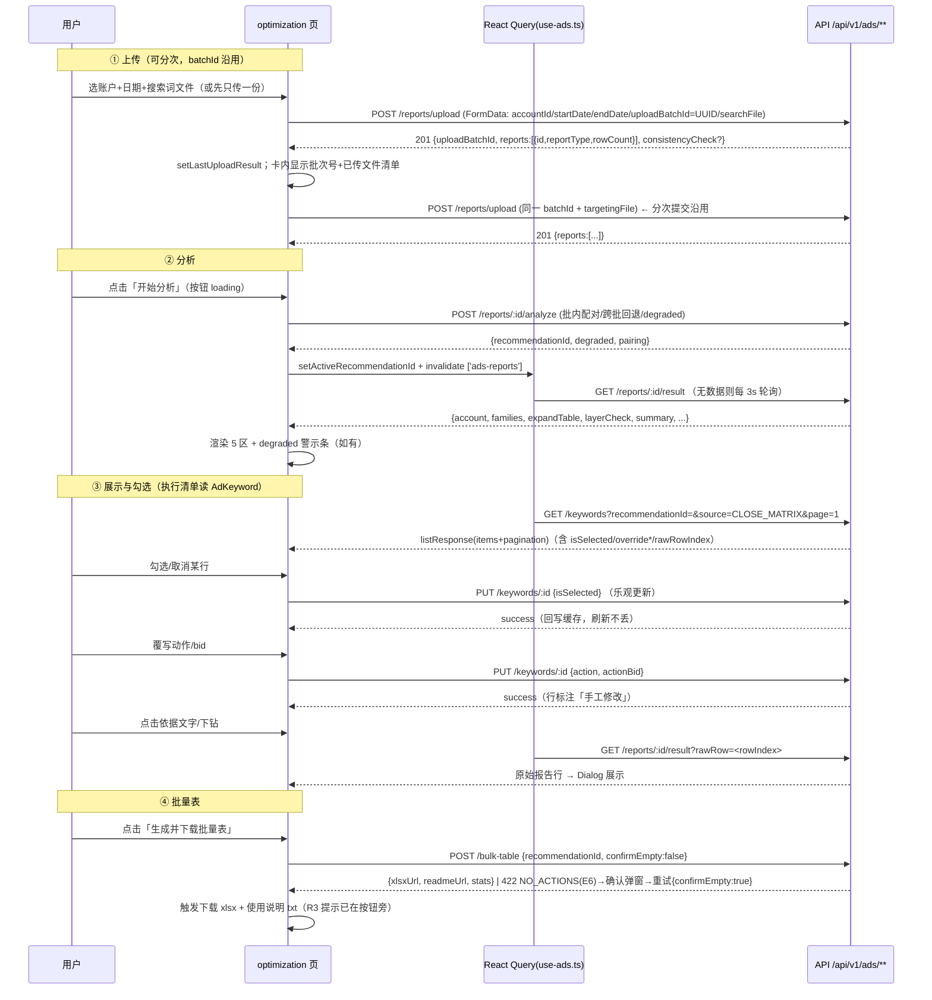

# Trade ERP 亚马逊广告优化管理（M1）前端详细设计

> 文档编号：TRADE-ERP-ADS-M1-FE-v1.0
> 状态：**前端详细设计（评审稿）** | 日期：2026-08-29
> 前端设计师（FE）：Hermes Agent（基于对现有代码的实地探索产出）
> 上游文档（权威基准）：
> - `docs/advertising-domain-m1-requirements.md`（501 行，REQ-ADS-001~011 + §4 v20 规则 + §5 权限 + §6 流程 + §7 验收 + §8 隐性需求）
> - `docs/advertising-domain-m1-architecture.md`（1045 行，v2，技术约束：数据模型/API 契约/组件树/hooks 清单）
> 代码探索依据（本次实地确认）：
> - `src/components/providers.tsx`（React Query 全局配置）
> - `src/hooks/use-orders.ts`（fetcher/data.data 解包/queryKey 范式）
> - `src/app/orders/page.tsx`、`src/app/products/page.tsx`（页面模式、hasPerm 前端权限、Toast/Confirm/Pagination 用法）
> - `src/components/Sidebar/Sidebar.tsx`（menuConfig 8 组 + roles 过滤）
> - `src/components/ui/`（pagination/skeleton-table/toast/confirmation-dialog/tabs/responsive-table/file-upload 等 37 个组件）
> - `src/lib/permissions.ts`（服务端 hasPermission；前端权限从 localStorage user.permissions 读取）
> - `src/app/globals.css`（shadcn oklch CSS 变量）

---

## 目录

1. [设计原则与现有约定（探索确认）](#一设计原则与现有约定探索确认)
2. [页面路由与布局](#二页面路由与布局)
3. [投流优化中心页面布局（核心）](#三投流优化中心页面布局核心)
4. [组件详细设计（src/components/ads/，10 个文件）](#四组件详细设计)
5. [状态管理：React Query hooks 与勾选/覆写状态](#五状态管理react-query-hooks-与勾选覆写状态)
6. [关键交互与时序](#六关键交互与时序)
7. [表单设计（站点管理）](#七表单设计站点管理)
8. [空态/加载态/错误态（E1~E9 用户可见反馈）](#八空态加载态错误态e1e9-用户可见反馈)
9. [权限：hasPerm 前端控制](#九权限hasperm-前端控制)
10. [UI 铁律清单](#十ui-铁律清单)
11. [与后端契约对齐（字段名对照表）](#十一与后端契约对齐字段名对照表)
12. [验收对应（AC 映射）与开发顺序](#十二验收对应ac-映射与开发顺序)
13. [开放问题（待后端/需求确认）](#十三开放问题待后端需求确认)

---

## 一、设计原则与现有约定（探索确认）

### 1.1 技术栈（已探索确认，与架构 v2 一致）

| 项 | 结论 | 证据 |
|----|------|------|
| 状态管理 | **@tanstack/react-query**（非 SWR） | providers.tsx：`QueryClientProvider` + `staleTime: 60_000` + `refetchOnWindowFocus: false` |
| 请求解包 | fetcher 返回 `res.json()` 的 `.data`（**data.data**）；列表读 `data.items` + `data.pagination` | use-orders.ts L14-22、L38-41 |
| 页面形态 | App Router + `'use client'` 页面组件 | orders/page.tsx、products/page.tsx |
| UI 组件 | shadcn/ui（ui/ 下 37 个：table/card/badge/checkbox/dialog/select/tabs/alert/input/label/switch…）+ 自制 Pagination/SkeletonTable/Toast/ConfirmationDialog/EmptyState | components/ui/ 目录 |
| 前端权限 | `hasPerm(p) = userPerms.includes(p) \|\| userPerms.includes('*')`，`userPerms` 来自 `localStorage.user.permissions` | products/page.tsx L370-374 |
| 菜单权限 | Sidebar `menuConfig` 按 `roles: UserRole[]` 过滤（filterMenuByRole） | Sidebar.tsx L357-365 |
| CSS | shadcn oklch 变量（--background/--card/--primary/--muted/--destructive/--border/--ring/--chart-*） | globals.css L51-70 |
| 动画 | tailwindcss-animate（shadcn 内置 `animate-in fade-in-0` 等类，dialog/sheet/select 已用） | ui/dialog.tsx 等 |
| 类型组织 | 每域一个 `src/types/<domain>.ts` | order.ts / purchase.ts / dashboard.ts / index.ts |
| API 前缀 | 新域走 `/api/v1/**`（Route Handler），响应包装 `successResponse/listResponse` | 架构 §4.0 |

### 1.2 设计原则（本域强制）

1. **R4 数字同源**：展示层只做格式化（$、%、小数位），**禁止二次聚合/换算**。账户总览/族表/摘要/层级核对读 `AdRecommendation.result` 引擎快照；执行清单四表读 `AdKeyword` 决策行（见 1.3 数据源边界）。
2. **勾选即持久化**：勾选/覆写变化立即 `PUT /keywords/:id`（乐观更新），不依赖本地暂存；刷新/重进不丢失（REQ-004-3）。
3. **执行清单单一数据源**（架构 AD-8/P0-7）：关闭矩阵/否定清单/拓词/层级核对四表的**展示与勾选一律读 `GET /keywords`**；`result.closeMatrix/negateList` 仅作 AC-1 对照冗余，前端不据其渲染可勾选行。
4. **全量可追溯（R1/R5/AC-10）**：每条建议行可「下钻」到依据文字 + 原始报告行（按 `rawRowIndex`），结论可被挑战。
5. **遵循现有组件与 hooks 范式**：不引入新库（不引入 SWR/新 UI 框架）；新组件只用现有 ui/ 组件组装。
6. **权限分层**：菜单（roles）→ 页面（AuthGuard）→ 按钮/操作（hasPerm）三层；前端隐藏不等于安全，接口必须校验（§5.3）。

### 1.3 数据源边界（组件分工的前提，架构 §4.7/§4.8 固化）

| 展示区 | 数据源 | 说明 |
|--------|--------|------|
| 账户总览卡片 / 族级总览 / 拓词结论 / 层级核对(系数+复核) / 执行摘要 | `GET /reports/:id/result`（AdRecommendation.result 引擎快照透传） | 数字零加工 |
| 关闭矩阵 / 否定清单 / 层级核对(倒挂警告行) / 拓词增量行（勾选+覆写） | `GET /keywords?recommendationId=`（AdKeyword 决策行） | 唯一勾选数据源；含 `isSelected/override*/rawRowIndex/source` |
| 原始报告行下钻 | `GET /reports/:id/result?rawRow=<index>`（按需单行，见 §6.5） | 避免 MB 级 rawRows 全量下发（架构 §11 R6） |
| 报告历史 / 决策历史 | `GET /reports`、`GET /recommendations` | P0 报告历史 / P1 决策历史 |

> **FE 补充建议（待后端确认，见 §13 O-1）**：`GET /reports/:id/result` 响应增加批内报告引用 `reports: { search: {id} | null, targeting: {id} | null }`，供下钻定位「该行原始行属于哪份 AdReport.rawRows」（关闭矩阵/层级行→Targeting 报告，否定行→搜索词报告）。

---

## 二、页面路由与布局

### 2.1 路由表（架构 §7.2）

| 路由 | 页面文件 | 页面 | 菜单 roles | AuthGuard requiredRoles | 说明 |
|------|----------|------|-----------|------------------------|------|
| /ads/optimization | `src/app/ads/optimization/page.tsx` | 投流优化中心 | admin/sales | admin/sales | M1 主页面（§3） |
| /ads/sites | `src/app/ads/sites/page.tsx` | 站点管理 | admin/sales | admin/sales | marketplace CRUD + 账户绑定；写操作按钮按 `hasPerm('ads:admin')` 显隐（sales 可见但只读） |
| /ads/inventory | `src/app/ads/inventory/page.tsx` | 库存管理 | admin/sales | admin/sales | P2 占位页 |
| /ads/replenishment | `src/app/ads/replenishment/page.tsx` | 补货管理 | admin/sales | admin/sales | P2 占位页 |
| /ads/dashboard | `src/app/ads/dashboard/page.tsx` | 数据看板 | admin/sales | admin/sales | P2 占位页 |

### 2.2 Sidebar 菜单接线（第 9 组「亚马逊运营」）

在 `src/components/Sidebar/Sidebar.tsx` 的 `menuConfig` 数组末尾追加：

```typescript
{
  group: '亚马逊运营',
  items: [
    { key: 'ads-optimization', label: '投流优化中心', icon: TrendingUp, href: '/ads/optimization', roles: ['admin', 'sales'] },
    { key: 'ads-sites',        label: '站点管理',     icon: Globe,       href: '/ads/sites',        roles: ['admin', 'sales'] },
    { key: 'ads-inventory',    label: '库存管理',     icon: Warehouse,   href: '/ads/inventory',    roles: ['admin', 'sales'] },
    { key: 'ads-replenishment',label: '补货管理',     icon: Package,     href: '/ads/replenishment',roles: ['admin', 'sales'] },
    { key: 'ads-dashboard',    label: '数据看板',     icon: BarChart3,   href: '/ads/dashboard',    roles: ['admin', 'sales'] },
  ],
}
```

- 图标全部复用现有 lucide-react import（TrendingUp/Globe/Warehouse/Package/BarChart3 均已存在于文件 import 列表）。
- **viewer 不可见**（D1：默认不授予 ads:view，菜单隐藏）；如业务需 viewer 查看，单独授予 `ads:view` 后再把 roles 加上——但 D1 建议默认隐藏，M1 按隐藏实现。
- 注意：现有 `/inventory` 是仓储域「库存管理」（roles: admin/warehouse），新增 `/ads/inventory` 是广告域占位，两者路径不同不冲突；Sidebar 高亮匹配按 `pathname.startsWith(item.href + '/')`，`/ads/inventory` 前缀不与 `/inventory` 冲突。

### 2.3 占位页模板（inventory/replenishment/dashboard 三页共用）

每页一个轻量 `'use client'` 页面：卡片 + EmptyState 风格占位说明，标注 M 期归属：

```
<Card><CardContent className="py-16 text-center">
  <Construction 图标（lucide） />
  <h2>库存管理</h2>
  <p className="text-muted-foreground">M3 FBA 库存对接规划中，本页为占位</p>
  <Badge variant="outline">P2 预留</Badge>
</CardContent></Card>
```

- 复用现有 `src/components/DevelopmentProgress.tsx`（如存在适用形态）或直接手写占位卡；保持与现有占位页风格一致（参照 `/reports` 等页面惯例）。
- 页面同样包 AuthGuard（roles: admin/sales）。

---

## 三、投流优化中心页面布局（核心）

### 3.1 页面文件与整体骨架

`src/app/ads/optimization/page.tsx`（'use client'）：

```
<AuthGuard requiredRoles={['admin','sales']}>
  <div className="space-y-6 p-4 md:p-6 animate-in fade-in-0">
    <页头：标题「投流优化中心」+ 版本徽章(v20) + 账户切换器（右上）>
    <DegradedBanner 警示条（degraded 模式时显示，见 §6.4）>
    <ConsistencyBanner 口径警告条（consistencyCheck.warning 时显示，见 §6.3）>
    <ReportUploadCard />                       ← 上传/分析驱动区
    <AccountSummaryCards />                    ← 账户总览（有结果才渲染）
    <FamilyOverviewTable />                    ← 族级总览（Tabs + 徽章）
    <Tabs 默认「关闭矩阵」>
      <TabsList> 关闭矩阵 | 否定清单 | 拓词结论 | 层级核对 </TabsList>
      <TabsContent value="close-matrix"><CloseMatrixTable /></TabsContent>
      <TabsContent value="negate-list"><NegateListTable /></TabsContent>
      <TabsContent value="expand"><ExpandTable /></TabsContent>
      <TabsContent value="layer-check"><LayerCheckPanel /></TabsContent>
    </Tabs>
    <ExecutionSummaryBar />                    ← 执行摘要 + 已勾选分类计数
    <BulkTableButton />                        ← 生成批量表 + 使用说明
  </div>
</AuthGuard>
```

### 3.2 页面状态（useState 本地 UI 状态，架构 §7.1）

```typescript
// 页面级（本地 UI 状态，不落库）：
const [selectedAccountId, setSelectedAccountId] = useState<string>('');  // 账户切换器（REQ-011-1）
const [activeRecommendationId, setActiveRecommendationId] = useState<string | null>(null);
//    ← 当前展示的决策版本（最新一次分析结果）；从 useAdsReportResult 的 recommendation.id 落位
const [familyTab, setFamilyTab] = useState<'all' | 'ordered' | 'risk' | 'close'>('all'); // 族级 Tabs
const [expandedFamilies, setExpandedFamilies] = useState<Set<string>>(new Set());        // 族行展开
const [detailTab, setDetailTab] = useState<'close-matrix' | 'negate-list' | 'expand' | 'layer-check'>('close-matrix');
const [rawRowDialog, setRawRowDialog] = useState<{ keywordId: string; rowIndex: number; reportType: 'TARGETING' | 'SEARCH_TERM' } | null>(null); // 下钻弹窗
```

### 3.3 区块渲染条件（自顶向下，数据驱动）

| 区块 | 渲染条件 | 空态 |
|------|----------|------|
| 账户切换器 | `useAdsAccounts()` 有数据 | 提示「请先到站点管理绑定广告账户」（带跳转链接） |
| ReportUploadCard | 恒显示 | — |
| AccountSummaryCards 及以下全部区块 | `activeRecommendationId != null`（即已成功分析过） | 未分析时显示 EmptyState「上传报告并点击开始分析后展示决策结果」 |
| degraded 警示条 | `result.degraded === true` | — |
| 一致性警告条 | 上传响应或 reports 列表含 `consistencyCheck.warning` | — |
| ExecutionSummaryBar / BulkTableButton | `activeRecommendationId != null` | 同 AccountSummaryCards |

### 3.4 账户切换器（页面内联，非独立组件）

- 位置：页头右侧，`Select` 组件，value = `selectedAccountId`（**非空串约定**：无选择时用占位值 `'__none__'`，SelectItem value 禁止空串，见 §10）。
- 数据：`useAdsAccounts({ active: true })`（只列启用账户）。
- 切换行为：`setSelectedAccountId(id)` → 联动 reset：清空 `activeRecommendationId`、族 Tabs、展开行、下钻弹窗；上传卡/历史查询按新账户过滤（REQ-011-1「选账户上传→按账户查询」P0 语义）。
- 无账户时：Select disabled + 下方 EmptyState 提示跳转 `/ads/sites`。

---

## 四、组件详细设计

### 4.0 文件清单（src/components/ads/，10 个文件）

> 架构 §7.4 列 9 个组件 + FileUpload 通用件（架构已确认项目现有 ui/file-upload.tsx 是图片上传语义，**不可复用**，见 §4.1 说明），合计 10 个文件，全部新建。

| # | 文件 | 职责 | 数据源 |
|---|------|------|--------|
| 1 | `FileUpload.tsx` | 通用文件选择（File 对象回传，非 URL） | — |
| 2 | `ReportUploadCard.tsx` | 双文件上传 + 账户 + 日期 + batchId 生成/沿用 + 分析触发 | useUploadReports / useAnalyzeReport |
| 3 | `AccountSummaryCards.tsx` | 账户总览 6 指标卡 | useAdsReportResult |
| 4 | `FamilyOverviewTable.tsx` | 族级总览（Tabs+徽章+展开成员） | useAdsReportResult |
| 5 | `CloseMatrixTable.tsx` | 关闭矩阵（分页+勾选+覆写+依据+下钻） | useAdsKeywords |
| 6 | `NegateListTable.tsx` | 否定清单 | useAdsKeywords |
| 7 | `ExpandTable.tsx` | 拓词结论 + 增量词明细 | useAdsKeywords / useAdsReportResult |
| 8 | `LayerCheckPanel.tsx` | 倒挂警告 + 系数体检 + 层级复核 | useAdsReportResult + useAdsKeywords |
| 9 | `ExecutionSummaryBar.tsx` | 执行摘要 + 已勾选分类计数 | useAdsReportResult + useAdsKeywords |
| 10 | `BulkTableButton.tsx` | 生成/下载批量表（E6 确认 + R3 提示） | useGenerateBulkTable |

### 4.1 FileUpload.tsx（通用文件选择件）

> **为什么新建**：现有 `src/components/ui/file-upload.tsx` 是「图片/证件上传」语义——单文件 ≤10MB、上传后回调 URL（走 /api/upload）。广告域需要：xlsx/csv 双文件、≤50MB、回调**原始 File 对象**（由 ReportUploadCard 组装 multipart 一次提交）。语义完全不同，复用会导致把报告传到错误端点。命名上避免与 ui/ 冲突：放 `src/components/ads/FileUpload.tsx`。

**Props**：

```typescript
interface AdsFileUploadProps {
  label: string;                        // 「搜索词报告」/「Targeting 报告」
  accept?: string;                      // 默认 '.xlsx,.csv'
  file: File | null;                    // 受控：当前选中文件
  onChange: (f: File | null) => void;
  maxSizeMB?: number;                   // 默认 50（E9）
  hint?: string;                        // 「xlsx/csv，≤50MB」
}
```

**行为**：
- 隐藏 `<input type="file" accept=".xlsx,.csv">` + 虚线拖拽区（点击触发）；拖放 onDrop 取 `dataTransfer.files[0]`。
- 客户端预校验（E1/E9 前置）：扩展名白名单 `.xlsx/.csv`；大小 ≤50MB 否则 `toast.error('文件超过 50MB，请压缩后重试（E9）')`；**不校验内容**（列名探测等由后端引擎 parse 完成，E1 由后端返回）。
- 选中后显示文件名 + 大小（KB/MB 格式化）+ 移除按钮；重复选择同一文件需先移除再选（input value 重置）。
- 只保留单文件（双报告各一个槽位，各持一个 FileUpload 实例）。

**伪代码（校验）**：

```typescript
function validateFile(f: File): string | null {
  const ext = f.name.split('.').pop()?.toLowerCase();
  if (ext !== 'xlsx' && ext !== 'csv') return '仅支持 xlsx/csv 格式';
  if (f.size > 50 * 1024 * 1024) return '文件不能超过 50MB';
  return null;
}
```

### 4.2 ReportUploadCard.tsx（上传 + 分析驱动，REQ-ADS-001/002）

**职责**：双报告选择、账户、日期窗口、batchId 生成与沿用、上传提交、一致性警告展示、开始分析（含 E2 重试）。

**状态**：

```typescript
const [searchFile, setSearchFile] = useState<File | null>(null);
const [targetingFile, setTargetingFile] = useState<File | null>(null);
const [startDate, setStartDate] = useState<string>('');          // YYYY-MM-DD（Calendar/Input date）
const [endDate, setEndDate] = useState<string>('');
// batchId：组件内生成一次，分次提交沿用；会话内固定，刷新后重新生成（服务端缺省兜底 cuid）
const [uploadBatchId] = useState<string>(() => crypto.randomUUID());
const [lastUploadResult, setLastUploadResult] = useState<UploadResult | null>(null); // {uploadBatchId, reports[]}
```

**batchId 生成与沿用（架构 AD-9，核心）**：
- 组件挂载时 `crypto.randomUUID()` 生成一次，存 useState；**首次提交与分次提交（先传搜索词、后传 Targeting）都带同一 batchId**，后端据此配对。
- 上传成功后在卡内显示「本批次号：`<code>{uploadBatchId}</code>（分次上传请保持此批次号）」+ 已上传文件清单（reportType/rowCount/文件名）——让用户明确知道配对状态。
- 若用户换账户或换日期范围，batchId **不重置**（后端配对以 accountId+报告类型+batchId 为准；跨批回退逻辑见架构 §4.6 步骤 1）。**重置场景**：页面刷新（新会话）→ 新 batchId，旧报告仍可按跨批回退配对（窗口重叠≥50% 唯一命中）。

**布局（卡片内两列）**：

```
┌ ReportUploadCard ─────────────────────────────────────────────┐
│ 账户 [Select: 账户列表(仅 isActive)]   日期 [start] ~ [end]     │
│ ┌ 搜索词报告 ────┐  ┌ Targeting 报告 ───┐                     │
│ │ FileUpload    │  │ FileUpload        │                     │
│ │ (xlsx/csv)    │  │ (xlsx/csv)        │                     │
│ └───────────────┘  └───────────────────┘                     │
│ [上传报告]  [开始分析(disabled until 报告已上传并解析)]           │
│ ⚠ 一致性警告区（consistencyCheck.warning / dateMismatch）      │
│ 已上传批次信息：batchId + 报告清单                              │
└───────────────────────────────────────────────────────────────┘
```

**提交逻辑（伪代码）**：

```typescript
const upload = useUploadReports();   // mutation
const analyze = useAnalyzeReport();  // mutation

async function handleUpload() {
  if (!searchFile && !targetingFile) return toast.warning('请至少选择一份报告');
  if (!selectedAccountId) return toast.warning('请选择广告账户');
  if (!startDate || !endDate) return toast.warning('请填写报告日期范围');
  if (endDate < startDate) return toast.error('结束日期不能早于开始日期');

  const fd = new FormData();
  fd.append('accountId', selectedAccountId);
  fd.append('startDate', startDate);
  fd.append('endDate', endDate);
  fd.append('uploadBatchId', uploadBatchId);
  if (searchFile)    fd.append('searchFile', searchFile);
  if (targetingFile) fd.append('targetingFile', targetingFile);

  await upload.mutateAsync(fd);   // 成功 → toast.success('上传解析成功，共 N 行')
}

async function handleAnalyze() {
  // 目标报告 = 本批已上传的任意一份（后端按批配对找互补报告）
  const targetReportId = lastUploadResult?.reports[0]?.id;
  if (!targetReportId) return toast.warning('请先上传报告');
  await analyze.mutateAsync(targetReportId);   // 成功后回调页面 setActiveRecommendationId
}
```

**关键交互点**：
- 上传与分析**分两步按钮**（REQ-001 上传解析落库 → REQ-002 引擎跑批），互不合并。
- 上传成功且 `consistencyCheck.warning === true`（E4 口径偏差 >15%）或 `dateMismatch === true`：卡片内 Alert（warning）展示后端返回的 `spendDiffPct/ordersDiffPct/dateMismatch` 明细，文案「两报告口径偏差 X%，请确认日期窗口与账户一致；偏差>15% 时分析将被阻断（E4）」。
- 分析按钮 loading 态：`Loader2 spin + 「引擎分析中（约 30s）…」`；分析期间上传卡禁用（防并发修改数据源）。
- analyze 失败（E2）：toast.error + 卡内展示 `analyzeError`（attempts/stderr 摘要）+ 「重试」按钮（复用 analyze mutation，原始报告文件保留可重新分析）。

### 4.3 AccountSummaryCards.tsx（账户总览，REQ-003-1）

**数据**：`useAdsReportResult(activeRecommendationId)` → `data.account`（引擎快照，零加工）。

**渲染**：Card 网格 `grid grid-cols-2 md:grid-cols-3 xl:grid-cols-6 gap-4`，6 张指标卡：

| 指标 | 取值 | 格式化 | 特殊态 |
|------|------|--------|--------|
| 花费 | account.spend | `$` 两位小数 | — |
| 销售 | account.sales | `$` 两位小数 | — |
| 订单 | account.orders | 整数 | — |
| ACoS | account.acos | `%` 一位小数 | **> 盈亏平衡点（settings.breakEvenAcos，默认 40%）标红**：数值 `text-destructive` + 卡边框 `border-destructive/50` + 小字「超盈亏平衡点」 |
| CVR | account.cvr | `%` 一位小数 | — |
| 客单价 | account.aov | `$` 两位小数 | — |

- ACoS 标红比较用 `account.acos > breakEvenAcos`（breakEvenAcos 从 `useAdsAccounts` 选中账户的 `settings.breakEvenAcos` 取；缺省 40）。
- `degraded` 模式：账户指标来自搜索词报告口径（无 bid 维度），卡下加一行小字说明「数据来源：搜索词报告（未上传 Targeting 报告，口径受限）」。

### 4.4 FamilyOverviewTable.tsx（族级总览，REQ-003-2）

**数据**：`useAdsReportResult` → `data.families`（引擎快照透传；**verdict 直接渲染引擎值，遇空字符串显示「待补充」黄色徽章，禁止前端推导**——架构 I-8/R4）。

**结构**：

```
<Card>
  <CardHeader>族级总览 <Tabs variant="line">
    <TabsList>
      <TabsTrigger value="all">    全部 <Badge>{families.length}</Badge></TabsTrigger>
      <TabsTrigger value="ordered">出单族 <Badge>{orders>0 族数}</Badge></TabsTrigger>
      <TabsTrigger value="risk">   风险族 <Badge>{风险 verdict 族数}</Badge></TabsTrigger>
      <TabsTrigger value="close">  待关闭 <Badge>{待关闭 verdict 族数}</Badge></TabsTrigger>
    </TabsList>
  </CardHeader>
  <Table> 族名 | 花费 | 订单 | ACoS | 处置结论（徽章） | 成员数 | 展开按钮 </Table>
  ← 行展开：渲染该族 members[] 子表（投放词/匹配/点击/花费/ACoS/动作）→
  <Pagination ... />
</Card>
```

**处置结论徽章映射（前端仅按 verdict 文案着色，不改文案）**：

| verdict 包含 | 徽章 |
|--------------|------|
| 加投 / 收割 / 开 BROAD | 绿色 `bg-green-100 text-green-700` |
| 收缩 / 重度收缩 | 黄色 `bg-yellow-100 text-yellow-700` |
| 关闭 / 整族关 / 风险 | 红色 `bg-red-100 text-red-700` |
| 待观察 / 样本不足 / 不拓 | 灰色 `bg-gray-100 text-gray-500` |
| 空串（待补充） | 黄色描边 + 「待补充」（reasonPending 风格） |

**Tabs 分组谓词（前端过滤，不影响数字）**：
- `ordered`：`orders > 0`
- `risk`：verdict 含「风险」或族内成员含合规风险词（引擎 verdict 已含，前端只按文案匹配）
- `close`：verdict 含「关闭」

**行展开**：`expandedFamilies: Set<family>`，点击 ChevronRight 旋转 90°；展开区渲染 `members[]` 子表（引擎契约 members 为数组，直接透传渲染，列 = 成员词/匹配/点击/花费/ACoS/动作）；成员数徽章显示 `members.length`。

**铁律**：每族必须有处置结论（引擎自检 #1），前端若发现某族 `verdict === ''` 渲染「待补充」并**不隐藏该行**（不得遗漏）。

### 4.5 CloseMatrixTable.tsx（关闭矩阵，REQ-003-3/004，全站最重组件）

**数据**：`useAdsKeywords({ recommendationId, source: 'CLOSE_MATRIX', page, limit })`（**AdKeyword 决策行**，架构 P0-7）。

**列定义**（Table，横向滚动）：

| 列 | 渲染 | 交互 |
|----|------|------|
| 勾选 | Checkbox（checked=isSelected） | onChange → useUpdateKeyword（乐观更新） |
| 投放词 | keywordText + L2 徽章（duplicateOf 非空 → 「L2重复→主词:xxx」tooltip） | — |
| 匹配类型 | Badge（EXACT=蓝/PHRASE=黄/BROAD=绿/其余=灰） | — |
| 点击/花费/CTR/CPA | 数字透传（格式化仅展示层） | — |
| 当前 bid | `$` 两位小数；null → 「—」+ 小字「需后台核对」（口径铁律 2，禁止用 CPC 冒充） | — |
| 状态 | Badge：ENABLED（绿）/PAUSED（灰），Targeting 报告口径（R6） | — |
| 依据文字 | 左对齐 max-w-[320px] `truncate` + title 全文；`reasonPending` 标黄 | 点击「详情」打开下钻 Dialog（见下） |
| 建议动作 | Badge：PAUSE=红/RAISE_BID=绿/LOWER_BID=黄/KEEP=灰/其余=蓝 + 建议 bid（actionBid） | — |
| 手工修改 | `overriddenAt != null` → Badge「手工修改」（橙） | — |
| 操作 | 「下钻」按钮（rawRowIndex != null 时可用） | 打开原始行 Dialog |

**分页**：`Pagination`（page/totalPages/total 来自 listResponse.pagination）；pageSize 20（默认）；翻页不重置勾选（勾选已持久化在服务端，翻页后重新拉取即含最新 isSelected）。

**勾选交互（核心，REQ-004-1）**：

```typescript
const updateKeyword = useUpdateKeyword();   // 乐观更新

function toggle(row: KeywordRow) {
  updateKeyword.mutate({
    id: row.id,
    data: { isSelected: !row.isSelected },
    // onMutate: 本地缓存把该行 isSelected 翻转（乐观）；onError: 回滚 + toast.error
  });
}
```

- **不设本地勾选暂存 Set**：勾选即持久化（架构 §7.1「勾选即调 useUpdateKeyword 持久化，不依赖本地暂存」），避免两处状态不同步。
- 行内 loading 态：勾选后该行 Checkbox disabled + 轻微透明度（乐观更新一般瞬时，onError 恢复并 toast）。

**覆写交互（REQ-004-2，需 ads:edit）**：
- 点击行内「覆写」→ 行切换为编辑态：动作 Select（PAUSE/RAISE_BID/LOWER_BID/KEEP/NEGATE + 原值）+ bid Input（number，min 0.2，两位小数）+ 依据 Input（可选，≥1 字）+ 「保存/取消」。
- 保存 → `PUT /keywords/:id { action, actionBid, actionReason }` → 成功 toast.success('已保存手工修改')，行显示「手工修改」Badge；批量表以 `overrideAction ?? action` / `overrideBid ?? actionBid` 为准（后端逻辑，前端无需自算）。
- **覆写后的颜色提示**：覆写值与引擎建议不同（`overrideBid !== actionBid`）时 bid 显示橙色。
- 无 `ads:edit` 权限：勾选 Checkbox disabled + 覆写按钮隐藏（viewer 场景兜底，见 §9）。

**原始行下钻（AC-10/R1，核心隐性需求）**：
- 点击「下钻」→ 打开 Dialog（**带 key prop**，见 §10）：`key={keywordId}` 保证每次打开重置内部状态。
- Dialog 内容：
  1. 依据文字全文（actionReason，只读大字）；
  2. 所属 L1 族（familyL1）+ 建议动作/建议 bid；
  3. 原始报告行表格：按 `rawRowIndex` 从 `GET /reports/:id/result?rawRow=<index>` 拉取（§6.5），渲染该行全部归一化字段（投放词/匹配/点击/花费/CPC/展示/订单/销售额/状态/bid…）；
  4. 关闭按钮 + 「复制依据」按钮（复制 actionReason 全文，便于用户贴到后台核对）。
- `rawRowIndex == null`（degraded 或无原始行）：下钻按钮 disabled + tooltip「无原始报告行（search-only 模式）」。
- **数字一致性**：Dialog 内数字与矩阵行同源（同一 AdKeyword 行 + 同一份 rawRows 快照），禁止二次计算。

### 4.6 NegateListTable.tsx（否定清单，REQ-003-4/004）

**数据**：`useAdsKeywords({ recommendationId, source: 'NEGATE', page, limit })`。

**列**：勾选 | 搜索词（term）| 原因 Badge（合规风险=红/双标准=黄/不相关=灰，按 reason 文案匹配着色，文案不改）| 依据文字（可展开/下钻）| 建议动作（NEGATE）| 操作（下钻）。

**要点**：
- 否定行 `keywordText = negateList.term`、`matchType` 语义为搜索词维度（后端已按 §4.6 步骤 8b 落库：state=ENABLED、action=NEGATE、bid=null）。
- 下钻目标 = **搜索词报告** rawRows（rowIndex 语义，§6.5）。
- 合规风险词行（原因含「合规」）加红色左边框 + 文案「账号安全优先：暂停 + 活动级否定，批量表输出两行」提示（§4.5）。
- 批量表生成提示：否定行若勾选，BulkTableButton 统计计入 `negate` 分类。

### 4.7 ExpandTable.tsx（拓词结论，REQ-003-5）

**数据**：结论主体（每族一行 verdict + 增量词明细 incremental）读 `useAdsReportResult` → `data.expandTable`（引擎快照透传，**只读不勾选**——拓词结论是族级结论，不是行级执行动作）；若需行级「新建精准」勾选（REQ-004-1 提到拓词可勾选），以 `useAdsKeywords({ source: 'EXPAND' })` 的决策行承载勾选（架构 §4.6 步骤 8c EXPAND 行落 AdKeyword）。

**结构**：

```
<Card>
  <Table> 族名 | 拓词结论（徽章：★开BROAD/★收割/换变体/小预算试探/样本不足/不拓） | 增量词数 | 展开 </Table>
  ← 行展开：incremental[] 明细表：增量搜索词 | 当前由谁捕获（来源投放词） | 点击 | 出单 →
</Card>
```

**徽章映射**（verdict 文案 → 颜色）：★开 BROAD=绿、★收割=绿、换变体策略=黄、小预算试探=蓝、样本不足=灰、不拓=灰、空=「待补充」黄。

**要点**：
- 每族必有一行（引擎自检 #5），前端不遗漏；verdict 空 → 「待补充」。
- 增量词明细列「当前由谁捕获」来自引擎 `incremental[]` 数据，前端只透传。
- 勾选区（如有 EXPAND 决策行）：独立小表「新建精准候选」列 = 候选词/建议 bid/捕获来源/勾选，复用 CloseMatrixTable 的勾选模式（useUpdateKeyword）。

### 4.8 LayerCheckPanel.tsx（层级核对，REQ-003-6）

**数据**：
- 倒挂警告列表：`useAdsKeywords({ recommendationId, source: 'LAYER_CHECK' })`（决策行，可勾选=执行「改价修正」）；行含 bid/actionBid/actionReason。
- 系数体检表 + 复核结果：`useAdsReportResult` → `data.layerCheck`（引擎快照：`ladderWarnings[]/coefficientAudit[]/bidUnavailable`）。

**三段布局**：

```
┌ LayerCheckPanel ──────────────────────────────────────────────┐
│ a) 竞价层级倒挂警告（EXACT≤PHRASE 或 PHRASE≤BROAD，用 bid 判断）  │
│    Table: 族 | 词 | 层级(EXACT/PHRASE/BROAD) | 当前 bid | 建议 bid | 依据文字 | 勾选(改价执行) | 下钻 │
│    （数据源 AdKeyword source=LAYER_CHECK；bid 为 null → 该行进「需核对清单」）│
│ b) 探索层系数体检表（引擎 layerCheck.coefficientAudit）          │
│    Table: 族 | 层级 | 实际 bid | EXACT bid | 实际系数(ratio) | 规范系数(0.75/0.50) | 对比 │
│    系数偏高（ratio > 规范 + 0.05）→ 行标红 + 文案「偏高，需逐轮收敛」│
│ c) 调价后层级复核：倒挂数 = 引擎 summary/layerCheck 校验值        │
│    0 → 绿色 Badge「复核通过（倒挂 0）」；>0 → 红色 Badge + 列表（理论上引擎保证 0，出现即 E7 兜底提示）│
└───────────────────────────────────────────────────────────────┘
```

**bidUnavailable / degraded 模式**（口径铁律 2/3，E3）：
- `layerCheck.bidUnavailable === true`（degraded）：整段渲染不可用态——`Alert` 提示「未上传 Targeting 报告，无法进行 bid 层级核对」+ 引擎 `bidPendingList` 待核对清单（只读列表：需从后台核对的词），**不渲染任何 bid 结论**。
- 行 bid 为 null（报告无 bid 列）：该行显示「需用户从后台核对」Badge + 小字说明，**禁止用 CPC 渲染层级**（铁律 2）。
- 系数体检行若无 EXACT 主词（exactBid null/0）：显示「—」不计算 ratio（避免除零）。

**勾选语义**：倒挂警告行勾选 = 执行「按建议 bid 改价」；勾选后计数计入执行摘要 `bidChange`。

### 4.9 ExecutionSummaryBar.tsx（执行摘要 + 已勾选分类计数，REQ-003-7/004-4）

**数据**：
- 摘要数字：`useAdsReportResult` → `data.summary`（引擎快照：closeCount/closeSpendPct/projectedAcos/needsBidAdjust/needsListingFix）。
- 已勾选分类计数：`useAdsKeywords({ recommendationId, isSelected: true, page:1, limit:1 })` → 只读 `pagination.total` 分类别查询，或**一次拉取 isSelected=true 全量行的前端分组计数**（决策见下）。

**设计决策（计数方式）**：分类计数（关闭 n/改价 n/否定 n/新建 n）与批量表行数必须一致（REQ-004-4）。为绝对一致，**复用批量表生成接口的 stats** 有延迟（需点击生成才知）；前端展示用**服务端计数查询**：4 次 `useAdsKeywords({ isSelected:true, source: X, page:1, limit:1 })` 只读 total 并发，或后端在 GET /keywords 支持 `countBySource` 汇总（**FE 建议，见 §13 O-2**）。M1 前端实现：4 个 query 并发（`Promise` 化 query 或 4 个 useQuery 实例，React Query 自动去重缓存），成本可控（limit=1 响应极小）。

**布局**：

```
<Card className="sticky bottom-4 z-10 bg-background/95 backdrop-blur">
  <div className="flex flex-wrap items-center gap-4">
    <Stat>关闭 {summary.closeCount} 个组合</Stat>
    <Stat>关闭 {summary.closeSpendPct}% 花费</Stat>
    <Stat>关闭后 ACoS 预演 {summary.projectedAcos}%</Stat>
    {summary.needsBidAdjust && <Badge variant="warning">仍需叠加调价</Badge>}
    {summary.needsListingFix && <Badge variant="warning">需先修 listing</Badge>}
    <Separator />
    <Stat>已勾选：关闭 {nClose} / 改价 {nBid} / 否定 {nNegate} / 新建 {nCreate}</Stat>
    <div className="ml-auto"><BulkTableButton /></div>
  </div>
</Card>
```

- sticky 底部条（内嵌 BulkTableButton，避免滚动到页尾才可生成）；移动端 `flex-col` 堆叠。
- 计数徽章：某分类 >0 时该 Stat 高亮（蓝字），与批量表 stats 期望一致。

### 4.10 BulkTableButton.tsx（生成批量表，REQ-005）

**职责**：调 `POST /bulk-table` 拿下载 URL → 触发 xlsx 下载；E6 空清单确认弹窗；R3 模板核对提示；下载使用说明 txt。

**状态与流程**：

```typescript
const generate = useGenerateBulkTable();   // mutation
const [confirmEmptyOpen, setConfirmEmptyOpen] = useState(false);

async function handleGenerate() {
  // 首次请求不传 confirmEmpty；后端 422 NO_ACTIONS（E6）→ 弹确认框
  try {
    const res = await generate.mutateAsync({ recommendationId, confirmEmpty: false });
    startDownload(res.xlsxUrl, res.readmeUrl);   // window.open / <a href download>
  } catch (e) {
    if (e instanceof NoActionsError) setConfirmEmptyOpen(true);   // E6
    // E5 BULK_SELF_CHECK_FAILED → toast.error + 错误详情 Dialog（缺 ID 行明细）
  }
}

// E6 确认框：ConfirmationDialog「执行清单为空，确认生成空表？」
//   onConfirm → generate.mutateAsync({ recommendationId, confirmEmpty: true }) → 正常下载
```

**R3 使用说明提示（下载按钮旁，铁律）**：
- 按钮下方常驻小字提示：`⚠ 执行前请先到亚马逊后台「批量操作」下载现有表格：(1) 作回滚备份 (2) 核对列名（中文列名/列序不同则按你的模板重排）——详见随表下载的《批量表使用说明.txt》`。
- 下载两个文件：xlsx（`<a href={xlsxUrl} download>` 触发）+ 使用说明 txt（readmeUrl，可选「同时下载」按钮，或一次性触发两个下载——浏览器多下载需用户允许，M1 采用**两个独立按钮**：主按钮「生成并下载批量表(xlsx)」+ 次按钮「下载使用说明.txt」）。

**生成中态**：按钮 loading「正在生成批量表…」（服务端 ≤10s）；成功后 toast.success(`批量表已生成：关闭 ${stats.close} / 改价 ${stats.bidChange} / 否定 ${stats.negate} / 新建 ${stats.create}`)。

**权限**：无 `ads:edit` → 按钮隐藏（viewer 兜底）。

---

## 五、状态管理：React Query hooks 与勾选/覆写状态

### 5.1 hooks 清单（`src/hooks/use-ads.ts`，架构 §7.1 对齐）

> 全部沿用 use-orders.ts 范式：fetcher 返回 `data.data`；queryKey 用 `[前缀, 序列化参数]`；mutation onSuccess invalidate。

```typescript
// ── Queries ──────────────────────────────────────────────────
// 账户列表（含 marketplace、脱敏凭据）
useAdsAccounts(query?: { page?: number; limit?: number; search?: string; active?: boolean })
  // queryKey: ['ads-accounts', JSON.stringify(query)]；staleTime 60s（全局默认）；列表页用

// 站点列表（marketplace CRUD 表单用）
useAdsMarketplaces()
  // queryKey: ['ads-marketplaces']；staleTime 5min（配置类数据可加长）

// 报告历史（P0 用于上传后状态轮询 + 历史页）
useAdsReports(query?: { accountId?: string; reportType?: string; source?: string; page?: number; limit?: number })
  // queryKey: ['ads-reports', JSON.stringify(query)]

// 最新决策结果（5 区数据 + 快照透传）
useAdsReportResult(reportId: string | null)
  // queryKey: ['ads-result', reportId]；enabled: !!reportId；staleTime 30s
  // 注意：本 hook 的 closeMatrix/negateList 快照仅对照，不承载勾选（架构 P0-7）

// 原始报告行（下钻单行，按需）
useRawReportRow(reportId: string | null, rowIndex: number | null)
  // queryKey: ['ads-raw-row', reportId, rowIndex]；enabled: !!reportId && rowIndex != null
  // 请求：GET /reports/:id/result?rawRow=<index>（FE 补充端点约定，§13 O-1）

// 决策行列表（执行清单四表唯一数据源）
useAdsKeywords(query: { recommendationId: string; source?: string; familyL1?: string;
                        action?: string; matchType?: string; isSelected?: boolean;
                        search?: string; page?: number; limit?: number })
  // queryKey: ['ads-keywords', JSON.stringify(query)]；enabled: !!recommendationId
  // 返回 { items, pagination }

// 决策历史（P1，可后置）
useAdsRecommendations(query?: { accountId?: string; page?: number; limit?: number })

// ── Mutations ────────────────────────────────────────────────
// 上传报告（multipart；分次提交沿用同一 uploadBatchId）
useUploadReports()
  // mutationFn: (fd: FormData) => POST /api/v1/ads/reports/upload
  // onSuccess: invalidate ['ads-reports']
  // 返回 { uploadBatchId, reports: [{id, reportType, rowCount}] , consistencyCheck? }

// 触发分析（含 E2 重试复用）
useAnalyzeReport()
  // mutationFn: (reportId: string) => POST /api/v1/ads/reports/:id/analyze
  // 返回 { recommendationId, degraded, pairing }
  // onSuccess: invalidate ['ads-reports', 'ads-keywords']

// 勾选/覆写（乐观更新，核心）
useUpdateKeyword()
  // mutationFn: ({ id, data }: { id: string; data: UpdateKeywordInput }) => PUT /api/v1/ads/keywords/:id
  // onMutate: 读 queryClient.getQueryData(['ads-keywords', key]) → 本地翻转/覆写该行 → setQueryData 乐观
  //           （记录 affectedQueryKeys 供回滚）
  // onError: 回滚全部 affected 缓存 + toast.error
  // onSuccess: invalidate ['ads-keywords']（保底一致性；乐观更新下通常静默）
  // 覆写触发条件（与后端一致）：仅传 isSelected → 纯勾选；传 action/actionBid → 服务端置 override*

// 生成批量表
useGenerateBulkTable()
  // mutationFn: ({ recommendationId, confirmEmpty }) => POST /api/v1/ads/bulk-table
  // onError: 识别 422 NO_ACTIONS（E6）/ BULK_SELF_CHECK_FAILED（E5）→ 抛结构化错误供组件分支处理

// 账户/站点 CRUD（站点管理页）
useCreateAdAccount() / useUpdateAdAccount() / useDeleteAdAccount()
useCreateMarketplace() / useUpdateMarketplace() / useDeleteMarketplace()
  // onSuccess: invalidate ['ads-accounts', 'ads-marketplaces']
```

**key 设计规范**：
- 前缀 `'ads-accounts' | 'ads-marketplaces' | 'ads-reports' | 'ads-result' | 'ads-raw-row' | 'ads-keywords' | 'ads-recommendations'`。
- 筛选参数 JSON 序列化进 key（对齐 use-orders 的 `searchParams.toString()` 风格，JSON.stringify 保序即可）。
- 乐观更新回滚要点：invalidate 整个 `['ads-keywords']` 前缀即可（React Query 前缀匹配），无需精确 key。

**staleTime 决策**：
- 全局默认 60s（providers.tsx 已设，不覆盖）。
- 配置类（marketplaces）：5min（`staleTime: 300_000`）。
- result 快照：30s（分析后频繁刷新窗口）；`refetchOnWindowFocus` 全局 false，result 依赖显式 refetch（分析完成后 invalidate）。
- keywords：默认 60s；勾选乐观更新即时生效，不依赖 refetch。

### 5.2 勾选/覆写状态模型（落 AdKeyword，REQ-004-3）

**状态流**（前端视角）：

```
引擎建议（action/actionBid/actionReason）──┐
                                          ├─→ AdKeyword 行（GET /keywords 渲染）
用户勾选（isSelected）  ──PUT──→ isSelected=true   ← 持久化，刷新不丢
用户覆写（action/actionBid）──PUT──→ overrideAction/overrideBid/overriddenBy/overriddenAt
                                          │          （overriddenAt 非空 ⇒ 前端标「手工修改」）
批量表取值（后端）：动作 = overrideAction ?? action；bid = overrideBid ?? actionBid
```

**前端渲染派生字段**（后端已返回，前端直接用）：
- `isManualOverride = overriddenAt != null` → 徽章「手工修改」。
- `reasonPending = actionReason === '待补充'` → 依据文字标黄 + tooltip「依据待补充，请人工核对」（架构 P0-3）。

**一致性保证**：
- 勾选状态**只存服务端**（AdKeyword.isSelected），前端不设影子 Set；翻页/切换 Tab/刷新后由 GET /keywords 还原。
- 勾选计数与批量表行数的一致性：计数读服务端（§4.9），生成时后端重算 stats，二者同源（recommendationId + isSelected=true）。

### 5.3 分析轮询（ANALYZING → ANALYZED）

- `useAnalyzeReport` onSuccess 后：页面 `setActiveRecommendationId(res.recommendationId)` 并触发 `useAdsReportResult(recommendationId)`。
- 若 analyze 返回后 result 尚未落库（异步窗口）：result query 首次 fetch 404/空 → 组件进入「分析中」状态（SkeletonTable + 顶部进度条），并用**条件轮询**：

```typescript
// 简化实现（对齐架构 §7.1「refetchInterval 条件开启」）：
useAdsReportResult(activeRecommendationId, {
  refetchInterval: (query) => (query.state.data ? false : 3000),  // 无数据时每 3s 轮询
});
```

- 兜底：`useAdsReports({ accountId, page:1, limit:1 })` 看最新报告 `analyzeStatus`；`ANALYZE_FAILED` 时展示 E2 错误卡（含重试按钮，复用 analyze mutation）。

---

## 六、关键交互与时序

### 6.1 全流程时序（上传→分析→展示→勾选→覆写→批量表）



### 6.2 分次上传 batchId 沿用（REQ-001-1，架构 AD-9）

- **生成**：ReportUploadCard 挂载时 `crypto.randomUUID()`。
- **沿用**：组件状态贯穿整个会话；搜索词与 Targeting 分两次点「上传报告」均带此 batchId。
- **展示**：上传成功后卡内显示「本批次号」+ 已上传清单；若只传了一份，提示「已上传搜索词报告，可继续上传 Targeting 报告（同一批次）完成配对」。
- **换账户/日期**：batchId 不重置（配对键含 accountId，跨账户同 batchId 不会串；后端落库按请求的 accountId 隔离）。
- **分析时配对**：后端优先批内（同 batchId）配对，无则跨批回退；`pairing.mode === 'fallback'` 时前端在分析成功后显示提示「本次分析与 {date} 上传的 {reportId} 报告配对（跨批次回退），请确认日期窗口一致」（R17 缓解）。

### 6.3 一致性警告（E4 前置 + 001-6）

- 上传响应 / 报告列表中 `consistencyCheck`：
  - `dateMismatch: true` → 卡内 Alert（warning）「上传日期与报告内数据窗口不一致，请核对」（不阻断，001-2）。
  - `spendDiffPct > 15` → 卡内 Alert（warning）「搜索词与 Targeting 报告口径偏差 X%（正常 5-15%），分析将被阻断；请确认两报告同账户同窗口」（E4 前置可见）。
- 点击「开始分析」时若后端返回 422 `CONSISTENCY_MISMATCH`（E4 阻断）：toast.error + Alert 展示差异明细（两报告花费/订单），**无跳过按钮**（架构 O-1 裁剪 force），指引「确认日期窗口/账户一致后重新上传」。

### 6.4 degraded 模式警示条（E3，架构 AD-10）

- 触发：`result.degraded === true`（未上传 Targeting 报告，或跨批回退后仍无）。
- 位置：页面顶部（AccountSummaryCards 之上）常驻 `Alert variant="destructive"`（或 warning 红边）：
  - 文案：「**未上传 Targeting 报告，当前为受限分析模式**。以下功能不可用：关闭矩阵、bid 层级核对、僵尸词体检、状态核对。仅展示：否定清单、拓词提炼、账户指标（搜索词报告口径）+ bid/状态待核对清单。请从后台导出 Targeting 报告上传后重新分析。」
- 区块级联动（组件内判断 `result.degraded`）：
  - CloseMatrixTable → 渲染 EmptyState「受限模式无关闭矩阵」（不渲染空表）；
  - LayerCheckPanel → bidUnavailable 段（§4.8）；
  - ExecutionSummaryBar → summary.needsBidAdjust 恒 false（引擎已保证），不显示调价徽章。
- 下钻：degraded 下 `rawRowIndex` 为 null → 下钻按钮禁用。

### 6.5 数据下钻（点击建议 → 原始报告行，AC-10/R5）

- 入口：CloseMatrixTable / NegateListTable / LayerCheckPanel 行的「下钻」按钮（`rawRowIndex != null`）。
- 数据：`useRawReportRow(reportId, rowIndex)`（GET /reports/:id/result?rawRow=N）。
  - reportId 选择：行 source 分区 → `CLOSE_MATRIX/LAYER_CHECK` 用批内 **Targeting** 报告 id；`NEGATE` 用批内 **SEARCH_TERM** 报告 id（依赖 §13 O-1 的 reports 引用；若后端未实现，前端退化为用 recommendation.adReportId + 行内 reportId 字段，NEGATE 行下钻暂不提供——**文档标注为后端契约补充点**）。
- 展示：Dialog（key=keywordId）+ 原始行全字段表格（归一化列名，见 §11 表）；无二次计算。
- 自证链（R5）：「依据文字 → 该词决策行 → 原始报告行 →（如质疑阈值）引擎动态阈值展示」：阈值（否定阈值/成本容忍值/盈亏平衡 ACoS）在 LayerCheckPanel 顶部小字展示本次跑批参数（`result.recommendation.params`，含 breakEvenAcos/negateClicks/stopSpend 实际值），用户可核对动态计算（AC-4）。

### 6.6 数字同源（R4/AC-1，前端纪律）

- **禁止**：前端对引擎数字做任何算术（求和/均值/换算/推导 verdict）。
- **允许**：展示格式化（`$`/`%`/千分位/小数位）——仅 `Intl.NumberFormat`/toFixed 于渲染层。
- **同源规则**：
  - 账户/族/拓词/层级/摘要 = 同一 `result` 快照（一次 GET /reports/:id/result，全组件共享 React Query 缓存）；
  - 执行清单四表 = 同一 GET /keywords 分页响应；
  - 勾选计数 = 服务端统计（§4.9）；
  - 下钻原始行 = 同一 AdReport.rawRows 快照（按 rowIndex 取）。
- 验收对照：AC-1 要求与引擎 CLI 逐字段一致，前端不引入第三份数字来源。

---

## 七、表单设计（站点管理）

### 7.1 页面结构（src/app/ads/sites/page.tsx）

```
<AuthGuard requiredRoles={['admin','sales']}>
  <div className="space-y-6 p-4 md:p-6 animate-in fade-in-0">
    <页头：标题「站点管理」+ 说明 Alert（006-5 文案）>
    <Card> 站点列表（AdMarketplace CRUD，仅 hasPerm('ads:admin') 可见操作按钮）</Card>
    <Card> 广告账户列表 + 「新建账户」按钮（hasPerm('ads:admin')）</Card>
    <AdAccountFormDialog />   ← 新建/编辑共用一个 Dialog（key prop 区分）
  </div>
</AuthGuard>
```

**006-5 说明文案（常驻 Alert）**：「API 凭据用于 M2 自动拉取报告，当前阶段（M1）仅手动上传报告；凭据加密存储，保存后不可回读明文。」

### 7.2 站点（marketplace）管理

- 列表列：code | 名称 | marketplaceId | 货币 | 广告端点 | 启用开关 | 操作（编辑/删除，仅 ads:admin）。
- 表单（Dialog，字段与 `AdMarketplace` 对齐）：code（Select 或 Input，唯一）、name、marketplaceId（唯一）、currency（默认 USD）、adEndpoint。
- 默认 9 站点种子（架构 §2.2）：US/CA/BR/UK/DE/FR/ES/IT/JP——首次进入从 `useAdsMarketplaces()` 加载展示，无需前端硬编码。
- 删除确认：ConfirmationDialog（destructive，文案「删除站点不影响已绑定账户的历史报告（弱引用）」）；禁用站点的账户不可用于上传（后端校验，前端 Select 过滤 isActive）。

### 7.3 广告账户表单（AdAccountFormDialog，REQ-006-2/3）

**字段（对齐 CreateAdAccountSchema，§4.2）**：

| 字段 | 控件 | 校验 | 说明 |
|------|------|------|------|
| 账户名 name | Input | 必填，≤100 字 | |
| 站点 marketplaceId | Select（数据 useAdsMarketplaces） | 必填；**value 非空串**（无选择时占位 `__none__`） | 选择后联动显示货币/端点 |
| Ads profileId externalId | Input | 可选 | M2 API 用 |
| clientId | Input（password 型或明文切换） | 可选；**新建时填写，编辑时脱敏回显** | 见 7.4 |
| clientSecret | 同上 | 同上 | |
| refreshToken | 同上 | 同上 | |
| 关联订单域账户 platformAccountId | Select（useCustomers 无关——应接订单域账户列表接口；M1 可选弱关联，无接口可隐藏该字段） | 可选 | 若订单域无现成账户列表接口，M1 该字段**不渲染**（标注后端契约补充点，见 §13 O-3） |
| 启用 isActive | Switch | 默认 true | |
| 引擎参数 settings.breakEvenAcos | Input number（0-100，默认 40） | 可选 | D6；显示为「盈亏平衡 ACoS（%）」 |
| settings.negateClicks / stopSpend | Input number | 可选，留空=动态计算 | 高级参数折叠区（Collapsible），默认收起 |

**7.4 凭据脱敏回显（REQ-006-3，核心安全交互）**：
- **新建**：三个凭据字段为空 Input，placeholder「留空可后续补充」。
- **编辑**：后端返回值为 `****ABCD`（maskCredential 后 4 位）——前端**原样渲染为只读展示**（Input disabled + 小字「已加密存储，仅显示后 4 位；如需更换请重新输入」）；**提供新值时**该字段切换为可写 Input，提交后后端重加密（缺省=保持不变，架构 §4.3）。
- 提交后**立即清空可写态**，刷新/重进只显示脱敏值（任何角色不可回读明文，AC-7）。
- 保存按钮旁提示 R11：「生产环境必须配置 ENCRYPTION_KEY，否则凭据加密降级」（仅当后端返回未配置标识时显示；M1 由后端配置检查决定，前端预留该提示位）。

**提交逻辑**：

```typescript
async function handleSubmit(values) {
  if (editing) await updateAccount.mutateAsync({ id, data: values });   // 缺省字段不传（partial）
  else await createAccount.mutateAsync(values);
  toast.success(editing ? '账户已更新' : '账户已创建');
  // onSuccess invalidate ['ads-accounts'] → 列表刷新脱敏值
}
```

**权限**：新建/编辑/删除按钮与 Dialog 提交按钮 `hasPerm('ads:admin')`；sales 进入页面只读（列表可见、凭据列脱敏、操作按钮隐藏）。

---

## 八、空态/加载态/错误态（E1~E9 用户可见反馈）

### 8.1 通用加载态

| 场景 | 表现 |
|------|------|
| 页面/列表首载 | `SkeletonTable rows=5 cols=6` 或 `Skeleton` 卡片组（对齐现有页面） |
| 账户总览卡加载 | 6 张 Skeleton 卡（`h-20 rounded-lg bg-muted animate-pulse`） |
| 分析进行中 | 上传卡内按钮 loading + 结果区 SkeletonTable + 顶部细进度条（`animate-pulse h-1 bg-primary/50`） |
| 批量表生成中 | 按钮 loading「正在生成批量表…」 |

### 8.2 空态

- 无账户：上传卡 Select 区 EmptyState「尚未绑定广告账户 → 前往站点管理」+ 链接按钮。
- 未分析：结果区 EmptyState「上传报告并点击开始分析后，这里将展示决策结果」。
- 分页表空（筛选无结果）：`EmptyState`（复用 ui/empty-state，标题「无匹配数据」+ 描述含当前筛选条件）。
- degraded 下关闭矩阵：EmptyState「受限模式无关闭矩阵（未上传 Targeting 报告）」。

### 8.3 错误态（E1~E9 → 用户可见反馈映射）

> 后端错误码与响应见架构 §4.0/§4.4/§4.6/§4.9；前端统一：**Toast（瞬时） + 就近错误卡/Alert（持久）**，错误详情可复制。

| 编号 | 异常 | 后端信号 | 前端反馈（位置 + 文案要点） |
|------|------|----------|------------------------------|
| E1 | 报告格式错误（损坏/列名探测失败/必填列缺失/0 行） | 422 `PARSE_FAILED` + errors 数组（缺哪列/哪个文件） | ReportUploadCard 内 Alert(destructive) 逐条列出 errors + **列名风险提示**：「不同站点模板列名可能不同，请确认导出的是『搜索词报告』/『Targeting（投放）报告』模板」；toast.error；**不落库不残留文件状态**（保留用户已选文件以便重选） |
| E2 | 引擎失败（exit 非 0 / {ok:false} / 超时 / 重试仍失败） | analyze 422/500 + analyzeError{exitCode,stderr,attempts} | 上传卡内错误卡：「分析失败（尝试 N 次）」+ stderr 摘要（collapsible 展开）+ **「重试」按钮**（复用 analyze mutation）+ toast.error；报告状态回 `ANALYZE_FAILED` 可见于报告历史 |
| E3 | 无投放报告（只传搜索词） | analyze 成功但 `degraded: true` | **顶部警示条**（§6.4）+ 各受限区块 EmptyState；**非错误态**，不弹错误 Toast |
| E4 | 口径偏差 >15%（分析阻断） | analyze 422 `CONSISTENCY_MISMATCH` + 差异明细 | toast.error + 上传卡 Alert 展示两报告花费/订单差异；**无跳过按钮**；指引重传 |
| E5 | 批量表自检失败（4 项任一非 0） | 422 `BULK_SELF_CHECK_FAILED` + 缺 ID 行明细 | BulkTableButton 旁 Dialog 列出缺 ID 行（campaignId/adGroupId/externalId 缺失明细，≤20 行）+ 「重新勾选或联系管理员」+ toast.error |
| E6 | 无勾选动作 | 422 `NO_ACTIONS` | **ConfirmationDialog「执行清单为空，确认生成空表？」**（确认后重发 confirmEmpty:true） |
| E7 | 引擎版本/契约不兼容 | 同 E2 + version 字段 | E2 错误卡 + 「引擎版本 {version} 与系统契约不符，请联系管理员」 |
| E8 | 重复分析（同报告二次分析） | 正常（新版本） | 非错误：分析成功后 toast.info「已生成新决策版本 v{N}，历史版本保留可对比」；决策历史可见多版本 |
| E9 | 上传超大文件 >50MB | 400 `FILE_TOO_LARGE` | FileUpload 客户端预校验 toast.error（前置）+ 后端兜底 toast.error（双保险） |

**网络层错误兜底**：所有 mutation onError 统一 `toast.error(e.message || '请求失败，请检查网络')`；result/keywords query 失败 → 结果区错误卡 + 「重试」按钮（`query.refetch()`）。

---

## 九、权限：hasPerm 前端控制

### 9.1 权限来源与工具（探索确认）

```typescript
// 页面组件内（对齐 products/page.tsx L370-374）：
const currentUser = (() => { try { return JSON.parse(localStorage.getItem('user') || 'null'); } catch { return null; } })();
const userPerms: string[] = currentUser?.permissions || [];
const hasPerm = (p: string) => userPerms.includes(p) || userPerms.includes('*');
```

> 注：若用户实体改为接口获取（后端 /api/auth/me 之类），前端权限来源跟随现有约定即可；M1 沿用 localStorage 模式（与现有页面一致）。

### 9.2 三层控制矩阵

| 层 | 机制 | 判定 | 位置 |
|----|------|------|------|
| 菜单 | Sidebar roles | `['admin','sales']` 可见「亚马逊运营」组 | Sidebar.tsx menuConfig |
| 页面 | AuthGuard requiredRoles | admin/sales | 5 个页面外层 |
| 按钮/操作 | hasPerm('ads:edit' / 'ads:admin') | 见下表 | 各组件内 |

### 9.3 操作级权限清单

| 操作 | 权限 | 前端表现（无权限时） |
|------|------|----------------------|
| 查看全部数据 | ads:view（隐含于菜单/页面角色） | 页面不可达（菜单隐藏） |
| 上传报告 / 开始分析 | ads:edit | 上传按钮 disabled + tooltip「无操作权限」 |
| 勾选执行清单 | ads:edit | Checkbox disabled + 行内「只读」标记 |
| 手工覆写（改动作/bid） | ads:edit | 覆写按钮隐藏 |
| 生成/下载批量表 | ads:edit | BulkTableButton 隐藏 |
| 站点/账户 CRUD、凭据管理 | ads:admin | 新建/编辑/删除按钮隐藏；表单 Dialog 不可打开 |
| 删除报告/决策 | ads:admin | 历史页删除按钮隐藏 |
| 凭据字段读取 | 接口已脱敏 | 任何角色仅见 `****后4位` |

- **兜底原则**：前端隐藏 ≠ 安全；每个接口后端独立 `hasPermission` 校验（AC-7 用 viewer/sales/admin 三角色逐接口 curl 验收）。
- 权限点注册：`src/lib/permissions.ts` 与 `src/app/api/permissions/init/route.ts` 两处同步追加 `ads:view/ads:edit/ads:admin` + `seedAdsRolePermissions()` 接线（架构 §3.1/3.3，前端不涉及，此处仅提醒联调时验证 localStorage user.permissions 已含新权限点——**权限初始化后需重新登录**刷新 localStorage 中的 permissions）。

---

## 十、UI 铁律清单

> 架构 §7.4/需求 003-8/9.3 固化，M1 全部遵守：

1. **CSS 变量**：颜色一律用 shadcn 语义变量（`bg-card text-foreground text-muted-foreground border-border bg-muted text-destructive` 等），禁止硬编码色值；ALERT 强调色用 `border-destructive/50 text-destructive`。
2. **骨架屏**：数据加载用 `Skeleton`/`SkeletonTable`/`loading.tsx`，禁止裸白屏。
3. **Toast**：统一 `useToast()`（success/error/warning/info 四型，默认 3s），成功/失败操作必给反馈。
4. **分页**：统一 `Pagination` 组件（page/totalPages/total/onPageChange），totalPages≤1 自动隐藏。
5. **fade-in**：页面与 Card 进入动画 `animate-in fade-in-0`（tailwindcss-animate，shadcn 已内置）；表格数据切换不重做整页动画（仅 Dialog/区块级）。
6. **Dialog key prop**：所有动态内容 Dialog（下钻原始行、账户表单、E5 错误明细）必须传 `key={唯一标识}`，保证每次打开重置内部状态（对齐现有 Dialog 复用惯例）。
7. **Select value 非空串**：所有 Select 的 value/SelectItem value 禁止空字符串；「未选择」用占位值 `'__none__'`（如账户选择、marketplace 选择），避免 Radix Select 空值崩溃（架构 §7.4 注）。
8. **移动端表格**：`table-auto w-full` + 表头/单元格 `whitespace-nowrap` + 长文本列 `max-w-[200px] truncate`（title 属性悬停全文）；外层 `overflow-x-auto`；宽表（关闭矩阵）移动端允许横向滚动，不硬切卡片（保持逐行核对能力）。
9. **数字渲染**：引擎数字零加工（R4），格式化仅 `Intl.NumberFormat('en-US', {style:'currency', currency})` / `%`；ACoS/CVR 一位小数，bid/金额两位小数。
10. **加载/禁用态**：提交按钮 loading（Loader2 spin）+ disabled；行级操作（勾选/覆写）乐观更新期间行内禁用。
11. **空态**：EmptyState 组件统一（icon+标题+描述+可选操作按钮）。
12. **可访问性**：图标按钮带 aria-label；表格 th 语义化；Dialog 用 DialogTitle（必有标题）。

---

## 十一、与后端契约对齐（字段名对照表）

> 前端组件使用的字段名**全部**来自架构 v2 API 契约，本表供 FE/BE 联调核对，字段不一致以架构为准（或按 §13 流程提补充）。

### 11.1 组件 → 字段依赖清单

| 组件 | 接口 | 使用的字段 |
|------|------|-----------|
| ReportUploadCard | POST upload / GET reports | uploadBatchId, reports[{id,reportType,rowCount}], consistencyCheck{spendDiffPct,ordersDiffPct,dateMismatch,warning}; analyze 返回 recommendationId/degraded/pairing{mode,reportId} |
| AccountSummaryCards | GET result | account{spend,sales,orders,acos,cvr,aov}, degraded |
| FamilyOverviewTable | GET result | families[{family,spend,orders,acos,verdict,members[]}] |
| CloseMatrixTable | GET keywords / PUT keywords / GET result?rawRow | items: keywordText,matchType,clicks,spend,ctr,cpa,bid,state,familyL1,duplicateOf,action,actionBid,actionReason,rawRowIndex,source,isSelected,overrideAction,overrideBid,isManualOverride,reasonPending,pagination |
| NegateListTable | GET keywords(source=NEGATE) | term→keywordText, reason→actionReason, rawRowIndex, isSelected |
| ExpandTable | GET result + GET keywords(source=EXPAND) | expandTable[{family,verdict,incremental[{term,来源,clicks,orders}]}] |
| LayerCheckPanel | GET result + GET keywords(source=LAYER_CHECK) | layerCheck{ladderWarnings[],coefficientAudit[{family,match,bid,exactBid,ratio}],bidUnavailable}, summary, params |
| ExecutionSummaryBar | GET result + GET keywords(isSelected) | summary{closeCount,closeSpendPct,projectedAcos,needsBidAdjust,needsListingFix}, 分类 total |
| BulkTableButton | POST bulk-table / GET download | xlsxUrl,readmeUrl,stats{close,bidChange,negate,create} |
| 站点管理 | GET/POST/PUT/DELETE accounts+marketplaces | id,platformCode,marketplaceId,marketplace{code,currency,adEndpoint},name,externalId,clientId(脱敏),clientSecret,refreshToken,isActive,settings{breakEvenAcos,negateClicks,stopSpend} |

### 11.2 动作/状态枚举（前端只透传不翻译，展示映射仅着色）

| 枚举 | 值 | 前端展示 |
|------|-----|----------|
| action | PAUSE / RAISE_BID / LOWER_BID / NEGATE / KEEP / EXPAND / HARVEST | 关闭/加价/降价/否定/维持/新建/收割（Badge 着色） |
| matchType | EXACT/PHRASE/BROAD/TARGETING_EXPRESSION/TARGETING_EXPRESSION_PREDEFINED/close-match/loose-match/asin= | Badge 着色 + tooltip 原文 |
| state | ENABLED / PAUSED | 绿/灰 Badge |
| analyzeStatus | UPLOADED/ANALYZING/ANALYZED/ANALYZE_FAILED | 历史页 Badge（灰/蓝/绿/红） |
| source（决策行） | CLOSE_MATRIX/LAYER_CHECK/EXPAND/NEGATE | 内部分区用，不直接展示 |

---

## 十二、验收对应（AC 映射）与开发顺序

### 12.1 AC → 前端关注点

| AC | 前端验收动作 |
|----|--------------|
| AC-1 | result 区数字与引擎 CLI 逐字段一致：**前端零换算**（代码审查：无二次聚合逻辑；浏览器实测数字与 Python CLI 输出对照） |
| AC-3 | LayerCheckPanel 渲染复核倒挂数=0 + 系数体检表逐族展开核对 |
| AC-6 | 全流程 1 次成功：上传→分析→5 区渲染→勾选→生成下载→exceljs 读回校验 |
| AC-7 | viewer 访问 /ads/* 菜单不可见；直接输 URL 被 AuthGuard 拦截；sales 站点管理页只读（按钮隐藏） |
| AC-8 | 账户切换器切换后全部列表按账户隔离（关键词/结果 queryKey 含 accountId 或后端过滤） |
| AC-9 | E1~E9 逐项演练有正确反馈（§8.3 表）且不产生脏数据 |
| AC-10 | 任取建议点「下钻」→ Dialog 显示依据文字 + 原始报告行 + L1 族 |

### 12.2 前端开发顺序（依赖后端契约）

```
1. src/types/ads.ts（DTO 类型，与架构 §2/§4 对齐）＋ src/hooks/use-ads.ts（fetcher 骨架）
2. src/components/ads/FileUpload.tsx（无依赖，先行）
3. 占位三页 + Sidebar 第 9 组接线（可先行验证菜单/权限）
4. ReportUploadCard（依赖 upload/analyze API）
5. AccountSummaryCards + FamilyOverviewTable（依赖 result API）
6. CloseMatrixTable（依赖 keywords API；最重，含乐观更新/覆写/下钻）
7. NegateListTable / ExpandTable / LayerCheckPanel（依赖 keywords+result）
8. ExecutionSummaryBar + BulkTableButton（依赖 keywords 计数 + bulk-table API）
9. 站点管理页（依赖 accounts/marketplaces API）
10. 错误态/空态/权限按钮收尾 + E1~E9 演练（AC-9）
```

### 12.3 前端文件清单

| 文件 | 类型 |
|------|------|
| src/types/ads.ts | 新建（AdAccountDTO/AdMarketplaceDTO/AdReportDTO/KeywordRow/EngineResult/AdsResultResponse…） |
| src/hooks/use-ads.ts | 新建（§5.1 全部 hooks） |
| src/components/ads/FileUpload.tsx | 新建 |
| src/components/ads/ReportUploadCard.tsx | 新建 |
| src/components/ads/AccountSummaryCards.tsx | 新建 |
| src/components/ads/FamilyOverviewTable.tsx | 新建 |
| src/components/ads/CloseMatrixTable.tsx | 新建 |
| src/components/ads/NegateListTable.tsx | 新建 |
| src/components/ads/ExpandTable.tsx | 新建 |
| src/components/ads/LayerCheckPanel.tsx | 新建 |
| src/components/ads/ExecutionSummaryBar.tsx | 新建 |
| src/components/ads/BulkTableButton.tsx | 新建 |
| src/app/ads/optimization/page.tsx | 新建 |
| src/app/ads/sites/page.tsx | 新建 |
| src/app/ads/{inventory,replenishment,dashboard}/page.tsx | 新建（占位） |
| src/components/Sidebar/Sidebar.tsx | 修改（第 9 组菜单） |

---

## 十三、开放问题（待后端/需求确认）

| # | 问题 | FE 建议 | 影响 |
|---|------|---------|------|
| O-1 | 原始行下钻的 rawRows 读取端点未在架构 §4.7 响应中定义 | result 接口增加可选 `?rawRow=<index>` 单行查询，且响应附 `reports: {search:{id}\|null, targeting:{id}\|null}` 批内报告引用（NEGATE 行下钻需要搜索词报告 id） | CloseMatrixTable/NegateListTable 下钻（AC-10） |
| O-2 | 已勾选分类计数（关闭 n/改价 n/否定 n/新建 n）的前端获取方式 | 4 次 GET /keywords（isSelected=true + source=X，limit=1 读 total）并发；或后端 keywords 接口加 `stats` 汇总参数 | ExecutionSummaryBar（REQ-004-4） |
| O-3 | 账户表单「关联订单域 PlatformAccount」下拉数据源未确认 | 订单域若无现成账户列表接口，M1 该字段不渲染（弱关联非 P0 闭环必需） | 站点管理表单 |
| O-4 | viewer 是否授予 ads:view（D1） | M1 按「不授予、菜单隐藏」实现；若授予需同步放开菜单 roles 与页面 AuthGuard | §2.2/§9 |

---

*文档结束。本前端详细设计以 `advertising-domain-m1-requirements.md`（需求基准）与 `advertising-domain-m1-architecture.md`（v2 技术约束）为上游；与上游冲突时以上游为准；本域组件/页面命名与字段名与架构 v2 保持一致，§13 开放问题为对架构的补充细化，需 FE/BE 联调确认。*
