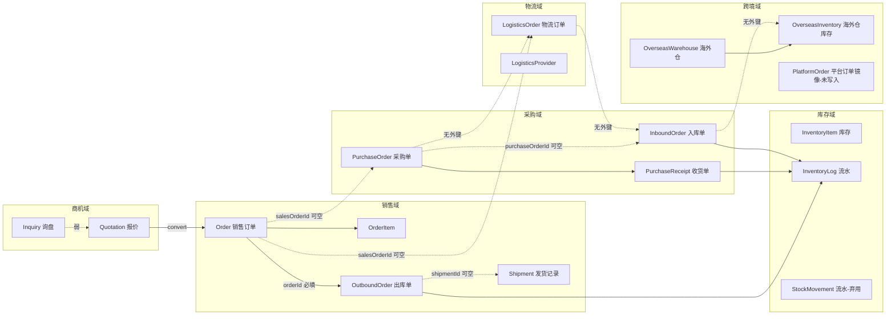
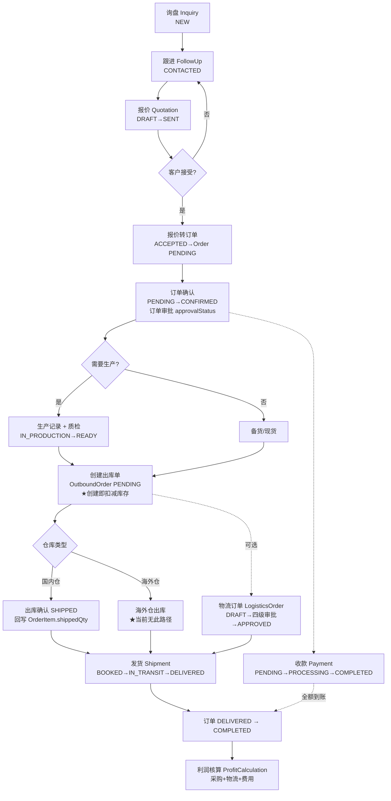
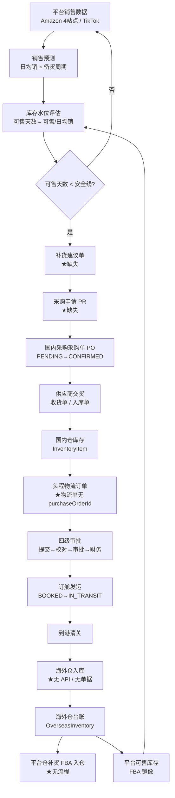
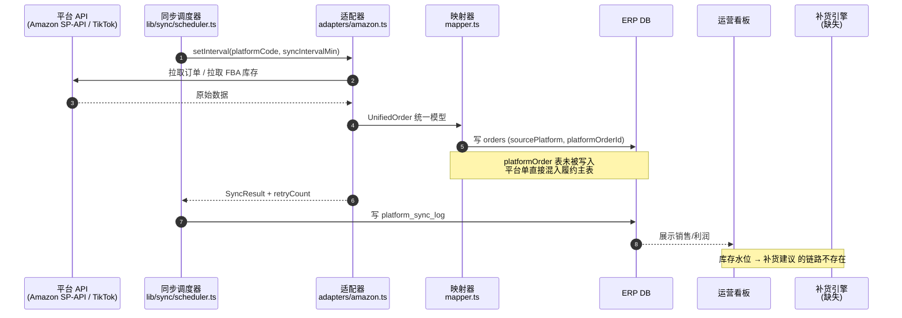
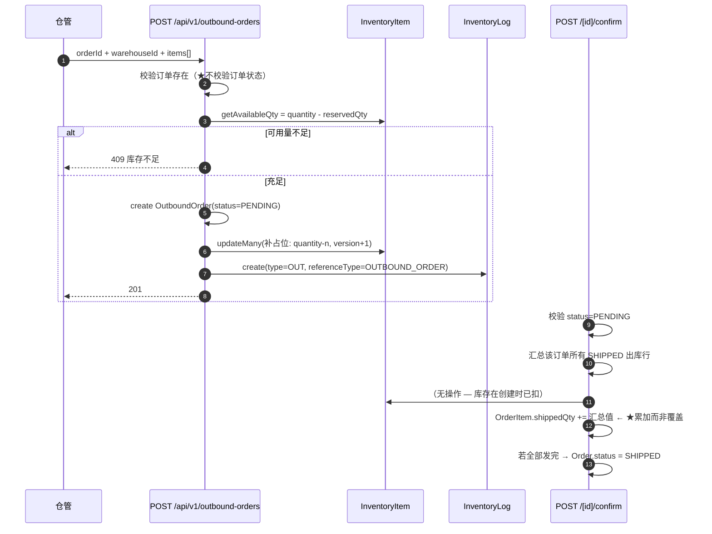
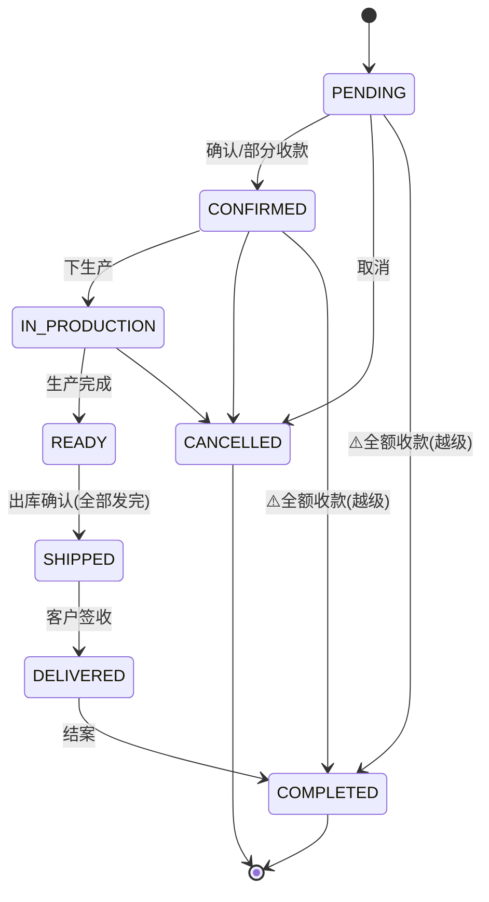
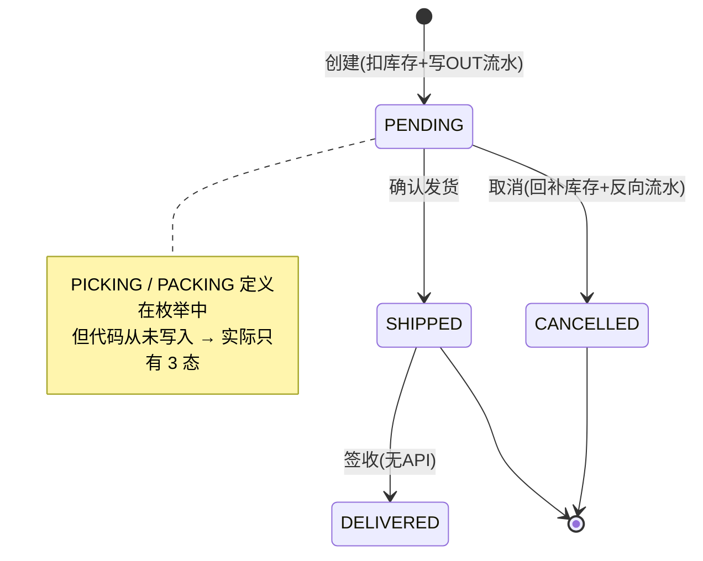
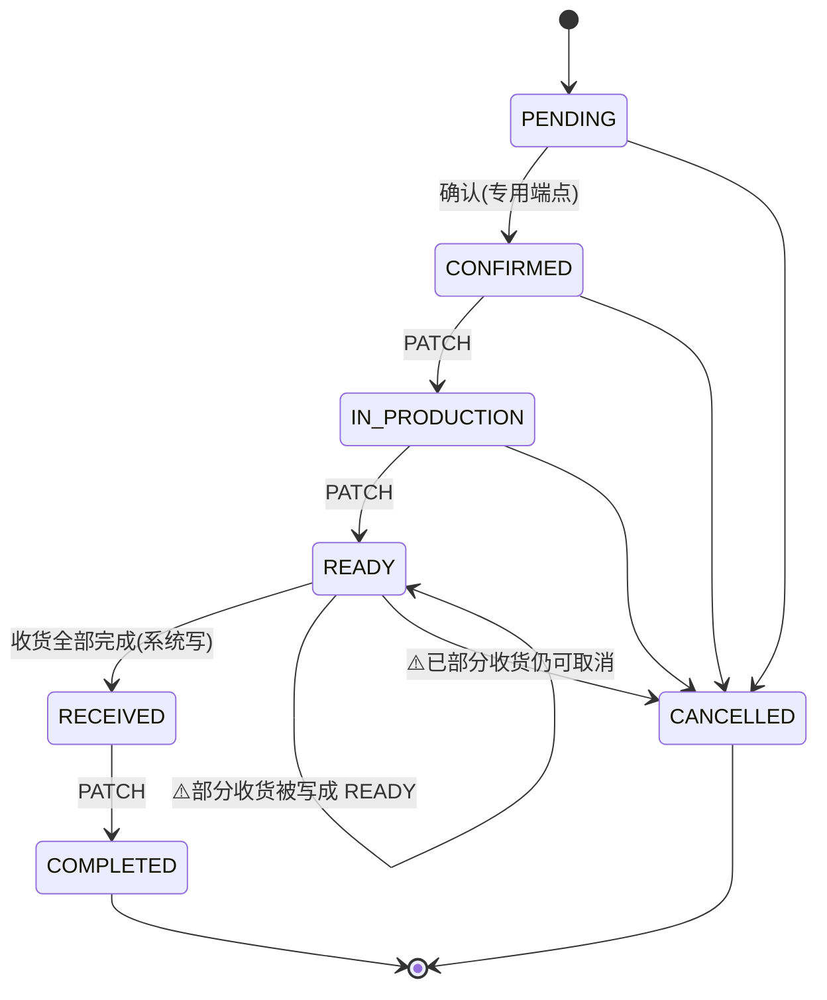
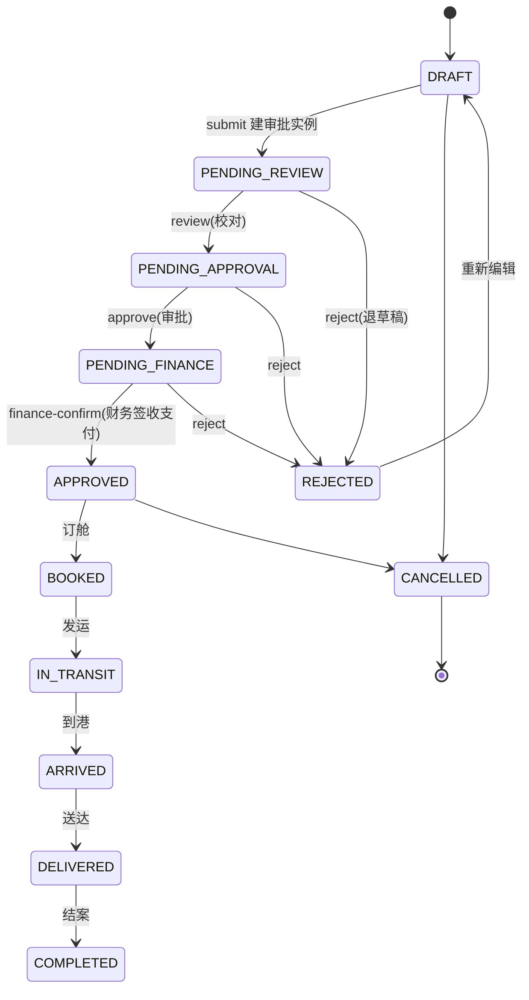
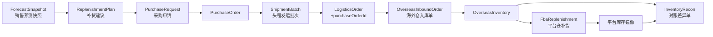

# 外贸中台 ERP（Trade ERP）业务流程分析

> **分析对象**：`/Users/apple/clawd/trade-erp`（v0.15.0，Next.js App Router + Prisma）
> **分析范围**：B2B 阿里国际站履约链、亚马逊 4 站点 + TikTok 自营备货链、平台数据回流、物流四级审批
> **方法**：只读代码勘查（`prisma/schema.prisma`、`src/app/api/**`、`src/lib/sync/**`、`src/lib/*status*`），以「成熟外贸/跨境电商 ERP 标准流程（领星、易仓、店小秘、NetSuite）」为基准做实现度对标
> **证据原则**：本文所有「已实现/缺失」判断均标注代码位置；不采信仓库内既有审计文档（`BUSINESS_PROCESS_AUDIT.md` 等已过期，其中「OutboundOrder.status 为 String」「缺 Invoice 模块」等结论与当前代码不符）

---

## 0. 结论摘要

| # | 业务流程 | 目标态（行业标准） | 现状 | 完成度 |
|---|---|---|---|---|
| 1 | 询盘 → 报价 → 销售订单 | 一键转化、状态机受控、报价有效期 | 转化有 API，状态无校验器，询盘不回写 | 🟡 70% |
| 2 | 销售订单 → 出库单 | 出库单必须挂订单、按订单剩余量出库、预占而非扣减 | 外键强制，但无状态校验、无剩余量校验、直接扣减 | 🟡 60% |
| 3 | 出库 → 库存扣减 → 发货 | 预占→拣货→复核→出库→流水→冲销 | 创建即扣减，确认不回写流水，取消可回滚 | 🟡 55% |
| 4 | 采购申请 → 采购订单 → 收货 | 采购申请单、供应商比价、分批收货、拒收处置 | 无采购申请单，有 PO + 收货单，部分收货状态写错 | 🟡 65% |
| 5 | 采购 → 头程物流订单 | 物流订单挂采购单/备货计划，运抵触发入库 | 物流订单**只挂销售订单**，头程无载体 | 🔴 15% |
| 6 | 物流订单四级审批 | 提交→校对→审批→财务签收支付，全链路留痕 | 完整实现，含审批实例与动作记录 | ✅ 95% |
| 7 | 物流 → 海外仓入库 → 库存 | 到仓确认、差异登记、批次/库位 | 无海外仓 API，无入库动作 | 🔴 10% |
| 8 | 平台订单只读回流 | 平台订单落镜像表，不参与 ERP 履约 | 同步写入 `orders`（混入履约主表） | 🟡 60% |
| 9 | 平台库存镜像（FBA/平台仓） | 定时拉取 → 落 `OverseasInventory` → 差异告警 | 适配器有方法，**无落库、无路由、无调度** | 🔴 15% |
| 10 | 库存水位预警 → 补货建议 → 转采购 | 安全库存/日均销/在途/可售天数 → 建议单 | 页面为占位符，无任何算法与数据 | 🔴 0% |
| 11 | 平台镜像 ↔ 海外仓台账对账 | 三方对账（平台可售/在途/本地台账）+ 差异工单 | 无 | 🔴 0% |

**总体判断**：B2B 主链「单据齐、审批强、扣减粗」；跨境备货链「表结构预留、业务全空」。系统当前实质是**一个 B2B 外贸订单履约系统 + 一个电商平台只读订单采集器**，尚未构成「跨境备货中台」。

---

## 1. 业务域与单据全景

### 1.1 两条业务线的本质差异（决定了流程不能复用）

| 维度 | B2B 阿里国际站 | 亚马逊/TikTok 自营 |
|---|---|---|
| 驱动方式 | 订单驱动（先卖后采/先产后发） | 预测驱动（先备货后卖） |
| 履约主体 | 我方（国内仓或海外仓发货） | 平台（FBA/平台仓代发） |
| ERP 角色 | 全流程执行系统（单据流转） | 决策与备货系统（采购+头程+海外仓台账） |
| 库存归属 | 我方库存，需精确扣减 | 平台库存由平台管，ERP 只做**镜像 + 在途 + 本地台账** |
| 成本核算 | 订单级（采购+物流+其他） | SKU×站点级（采购+头程+平台费+广告） |
| 关键单据 | 销售订单、出库单、物流订单 | 备货计划、采购单、头程物流单、入库单 |

> **设计含义**：同一张 `PurchaseOrder` 可以服务两条线，但**出库动作**必须分叉——B2B 走「销售出库」，跨境走「调拨出库（国内仓→海外仓）」。当前代码只有前者。

### 1.2 单据族谱（当前 schema 实际形态）



**读图要点**：图中三条 `-.无外键.->` 虚线，就是「采购→头程→海外仓入库」链路的断点。跨境备货流程在当前数据模型上**无法用外键表达**。

### 1.3 单号规范现状（存在混用）

| 单据 | 前缀 | 生成位置 | 备注 |
|---|---|---|---|
| 销售订单（手工/报价转化） | `PO{timestamp}` | `api/quotations/[id]/convert/route.ts:60` | ⚠️ 销售订单用 `PO` 前缀，与采购单 `PO-` 语义冲突 |
| 销售订单（平台同步） | 平台原单号 | `lib/sync/mapper.ts` | 与 ERP 自编号规则不统一，存在撞号风险 |
| 采购订单 | `PO-...` | `api/v1/purchase-orders` | |
| 出库单 | `OUT-YYYYMMDD-xxxx` | `api/v1/outbound-orders/route.ts:191` | |
| 入库单 | `IN-YYYYMMDD-001` | 事务内 `count+1` | 并发安全已修 |
| 物流订单 | `LO-YYYYMMDD-XXXX` | schema 注释 | |
| 发货记录 | `SH{date}{seq}` | `api/v1/shipments/route.ts` | 与出库单**双轨** |

---

## 2. 端到端主流程

### 2.1 流程 A：B2B 销售履约（询盘 → 报价 → 订单 → 出库 → 物流 → 收款）



**分环节责任与系统动作**

| # | 环节 | 主单据 | 角色 | 系统动作 | 现状 |
|---|---|---|---|---|---|
| 1 | 询盘登记 | Inquiry | 业务员 | 建客户、记录来源/需求 | ✅ |
| 2 | 跟进 | FollowUp | 业务员 | 跟进记录、下次动作提醒 | ✅ |
| 3 | 报价 | Quotation + Items | 业务员 | 成本加成、有效期、发送 | 🟡 发送邮件为 TODO 空壳 |
| 4 | 报价转订单 | Order | 业务员 | 复制行项目、锁价、来源追溯 | 🟡 无事务、不回写询盘、单号前缀错 |
| 5 | 订单确认 | Order | 销售主管 | 状态机 + 可选审批 | ✅ 状态机完整 |
| 6 | 生产/质检 | ProductionRecord / QualityCheck | 生产 | 进度、质检结论 | 🟡 无独立 API/页面（仅嵌套只读） |
| 7 | 出库 | OutboundOrder | 仓管 | 校验可用量、扣减库存、写流水 | 🟡 见 §3.1 缺陷 |
| 8 | 出库确认 | OutboundOrder | 仓管 | 回写订单已发数量、推进订单状态 | 🟡 重复累加缺陷 |
| 9 | 物流 | LogisticsOrder | 物流/采购/财务 | 四级审批 | ✅ 全系统最完整模块 |
| 10 | 发货台账 | Shipment | 单证 | 订舱、柜号、ETD/ETA | 🟡 与出库单无联动 |
| 11 | 收款 | Payment | 财务 | 累加已收、推进订单状态 | 🔴 越级置 COMPLETED |
| 12 | 利润 | ProfitCalculation | 财务 | 归集成本 | 🔴 无自动生成机制 |

**行业标准 vs 本系统关键差异**

- 标准做法：`Order` 仅承载商务条款，**履约由 `DeliveryNote/出库单` 分批承载**，订单状态由「所有出库行发完」自动推导。本系统订单状态既可由出库确认推进，也可被收款直接置 `COMPLETED`，**双写入口导致状态不可信**。
- 标准做法：出库前必须「预占（reserve）」，出库时才「扣减（issue）」。本系统创建出库单即 `quantity -= n`，`reservedQty` 字段**全库无任何写入点**（`grep reservedQty` 仅见 schema 与读取），预占模型名存实亡。

---

### 2.2 流程 B：平台自营备货（预测 → 采购申请 → 国内采购 → 头程 → 海外仓入库 → 平台仓补货）



**目标态与现状差距（逐个断点）**

| 环节 | 目标态单据 | 当前是否能表达 | 断点说明 |
|---|---|---|---|
| 销售预测 | 预测版本 + 快照 | ❌ | 无模型、无算法；`/ads/replenishment` 为占位页 |
| 补货建议 | `ReplenishmentSuggestion` | ❌ | 无 |
| 采购申请 | `PurchaseRequest`（可多 PO 拆分） | ❌ | 直接用 `PurchaseOrder` 起单，无审批前置 |
| 国内采购 | `PurchaseOrder` | ✅ | 有，但 `salesOrderId` 语义只服务 B2B |
| 头程物流 | `LogisticsOrder`（需 `purchaseOrderId` / `shipmentPlanId`） | 🟡 | **字段只有 `salesOrderId`**（`schema.prisma:1862`），头程单挂不上采购 |
| 发运批次 | `ShipmentBatch`（一次发运含多 PO 多 SKU） | ❌ | 无 |
| 海外仓入库 | `OverseasInboundOrder`（含差异/破损/短装） | ❌ | `OverseasWarehouse` / `OverseasInventory` 有表无 API |
| 平台仓补货 | `FbaReplenishment`（仓库间调拨） | ❌ | 无 |
| 在途库存 | `InTransitInventory` | ❌ | 无法回答「已发未到有多少」 |

**这一段的业务后果**：无法回答三个跨境运营的核心问题——「在途有多少」「海外仓还剩几天」「下一批该补多少」。系统只能看到国内仓库存和平台可售库存两个孤岛，中间的**在途黑洞**完全缺失。

---

### 2.3 流程 C：平台数据回流（只读同步 → 库存预警 → 补货触发）



**现状核对**

| 能力 | 状态 | 证据 |
|---|---|---|
| 订单增量拉取 + 重试 + 互斥锁 | ✅ | `lib/sync/order-sync.ts`（含 `isRetryableError`、指数退避、`syncingPlatforms` 互斥） |
| 定时调度 | ✅ | `lib/sync/scheduler.ts`，按 `PlatformSyncConfig.syncIntervalMin` |
| 同步日志 | ✅ | `PlatformSyncLog` 写入 4 处 |
| 客户自动建档 | ✅ | `findOrCreateCustomer`（email → companyName → 新建） |
| 订单镜像表 `PlatformOrder` | 🟡 半死 | 表存在、`reports/profit` 读取，但**无任何写入点** |
| FBA 库存拉取 | 🟡 半死 | `adapters/amazon.ts:347 fetchFbaInventory()` 已实现，**无调用方** |
| 平台库存 → `OverseasInventory` 落库 | ❌ | 全仓 `overseasInventory` 仅出现在 schema |
| 库存水位预警（min/max stock） | ❌ | `InventoryItem` 有 `minStock/maxStock` 字段，无任何读取或告警逻辑 |
| 补货建议生成 | ❌ | `src/app/ads/replenishment/page.tsx:3` 明确「占位」「M4 规划」 |

---

## 3. 跨域协同点

### 3.1 销售订单 ↔ 出库单 ↔ 库存扣减



**协同契约现状**

| 协同点 | 设计意图 | 实际实现 | 评价 |
|---|---|---|---|
| 出库单必挂订单 | `OutboundOrder.orderId` 非空、`onDelete: Cascade` | ✅ DB 层强制 | 合规，符合「出库单必须关联销售订单」 |
| 出库数量 ≤ 订单剩余量 | 防超发 | ❌ 只校验库存，不比对 `OrderItem.quantity - shippedQty` | 可超发，订单侧无感知 |
| 订单状态准入 | 仅 `CONFIRMED`/`IN_PRODUCTION`/`READY` 可出库 | ❌ 任意状态（含 `PENDING`、`CANCELLED`）都可创建出库单 | 严重 |
| 库存扣减时点 | 创建时预占，确认时扣减 | ❌ 创建即扣 `quantity` | 可接受但违背预留模型 |
| 确认时写流水 | 应写二次流水 | ❌ 流水只在创建时写一条 | 账实相符但审计口径单一 |
| 失败回滚 | 取消恢复库存 | ✅ `cancel` 仅 `PENDING` 可撤，回补库存 + 写反向流水 | 合规 |
| `shippedQty` 幂等 | 应等于已出库量 | 🔴 `increment` 累计汇总值，**第二次确认会重复累加** | P0 缺陷 |

**P0 缺陷详述（出库确认重复累加）**
`src/app/api/v1/outbound-orders/[id]/confirm/route.ts:88-103`：先查出该订单**全部** `SHIPPED` 出库行（含刚确认的这一张）求和，再用 `increment` 写入 `OrderItem.shippedQty`。第一张单出 10 → 写 10；第二张单出 5 → 汇总得 15 → `increment 15` → 累计 25（应为 15）。多批次出库场景下订单永远「超额完成」，且 `allShipped` 判断随之失真。修法：改为 `data: { shippedQty: 汇总值 }`（覆盖），或只累加本单数量。

**P0 缺陷详述（仓库键不一致）**
`OutboundOrder.warehouseId` 存的是 `Warehouse.id`（cuid，前端 `src/app/outbound-orders/new/page.tsx:332` 传 `wh.id`），而 `InboundOrder` 确认时把 `order.warehouseId` **当仓库编码**直接写入 `InventoryItem.warehouse`（`inbound-orders/[id]/confirm/route.ts` 中 `warehouseCode = order.warehouseId || 'MAIN'`）。`InventoryItem.warehouse` 默认值又是 `"MAIN"`，`warehouses/init-default` 建的编码是 `SZ-MAIN`/`GZ-WH`/`YW-WH`。**同一物理仓会分裂成多条库存行**（cuid 行 / 编码行 / MAIN 行），库存校验、扣减、报表全部错位。这是全库最危险的一致性缺陷。

---

### 3.2 采购订单 ↔ 物流订单 ↔ 入库单 ↔ 海外仓库存

**外键连通性矩阵**（● 有强外键 / ○ 弱引用字符串 / ✗ 无）

| 从 \ 到 | PurchaseOrder | LogisticsOrder | InboundOrder | PurchaseReceipt | InventoryItem | OverseasInventory |
|---|---|---|---|---|---|---|
| **PurchaseOrder** | — | ✗ | ● `inboundOrders[]` | ● `receipts[]` | ✗ | ✗ |
| **LogisticsOrder** | ✗ | — | ✗ | ✗ | ✗ | ✗ |
| **InboundOrder** | ● `purchaseOrderId?` | ✗ | — | ✗ | ● 经 `InventoryLog` | ✗ |
| **PurchaseReceipt** | ● `purchaseOrderId` | ✗ | ✗ | — | ● 经 `InventoryLog` | ✗ |
| **OverseasWarehouse** | ✗ | ✗ | ✗ | ✗ | ○ `Warehouse.id`（仅字段） | ● `inventory[]` |

**结论**：采购侧「PO → 收货 → 库存」是通的；物流侧「LO → 采购」断开；海外仓侧**与主链零连接**。

**两条并行收货路径（架构债）**

```mermaid
flowchart LR
  PO[PurchaseOrder] -->|POST /purchase-orders/[id]/receipts| R1[PurchaseReceipt<br/>status=COMPLETED]
  PO -->|POST /inbound-orders (手填 purchaseOrderId)| R2[InboundOrder<br/>status=PENDING→COMPLETED]
  R1 --> INV[InventoryItem + InventoryLog]
  R2 --> INV
  R1 -.不生成.-> R2
  R2 -.不回写.-> PO2[PurchaseOrderItem.receivedQty]
```

- `PurchaseReceipt` 路径：一次事务内完成「收货 + 入库 + 库存 + 推进 PO 状态」，但 `InboundOrderItem` 的 `batchNo/productionDate/expiryDate` 能力丢失。
- `InboundOrder` 路径：有批次/有效期，**不回写 `PurchaseOrderItem.receivedQty/pendingQty`**，导致 PO 的收货进度永远为 0，无法判断是否收齐。
- 成熟 ERP 的规范是：**收货单（Receipt）= 数量验收，入库单（Putaway）= 上架动作**，一一对应。本系统二者是竞争关系而非上下游。

**海外仓侧**：`OverseasWarehouse.warehouseId String?` 只是弱引用（无 FK），`OverseasInventory` 通过 `productId` 关联商品但**没有任何从在途/入库转台账的写入路径**。台账只能靠人工全量覆盖或外部脚本灌数。

---

### 3.3 平台库存镜像 ↔ 本地海外仓台账 对账机制

**应然模型（三方对账）**

```
平台可售 (FBA fulfillable)  ─┐
平台在途 (inbound working)  ─┼─→ 对账引擎 ─→ 差异类型 ─→ 处理动作
ERP 在途 (已发未到)          ─┤             ├ 平台少 / 台账多 → 盘亏排查（丢件、平台移除、破损）
ERP 海外仓台账 (on hand)     ─┘             ├ 平台多 / 台账少 → 入仓未登记、补货未回写
                                            └ 在途挂账超期 → 清关滞留/丢件索赔
```

**字段层已预留（说明设计者想过）**

| 字段 | 位置 | 用途 |
|---|---|---|
| `OverseasInventory.availableQty / inboundQty / reservedQty / totalQty` | schema | 平台侧四段库存 |
| `OverseasInventory.lastFulfillableQty` | schema | 上次可售快照 → **差异比对基准** |
| `OverseasInventory.lastSyncAt / updatedAtSource` | schema | 同步新鲜度与源端时间 |
| `OverseasWarehouse.lastSyncAt / fbaSyncEnabled` | schema | 仓库级同步开关 |
| `InventoryItem.lastCountedAt` | schema | 盘点时间戳 |

**实现度**：字段 100%，机制 0%。缺失清单：
1. 无 `OverseasInventorySnapshot`（按日快照，无法回溯「上周可售」）；
2. 无 `InventoryReconciliation` / `InventoryDiscrepancy` 差异单；
3. 无「在途」实体，`LogisticsOrder` 的 `actualDeparture/actualArrival` 无法转化为在途数量；
4. 无对账任务（cron / 手动触发均无）；
5. 无差异阈值与告警（如可售 < 安全库存 或 差异 > 2%）。

**建议对账口径（可直接落地）**

| 恒等式 | 含义 | 违规时动作 |
|---|---|---|
| `平台可售 + 平台在途 + 海外仓在库 - 已预留 = 账面总库存` | 总量守恒 | 生成差异单 |
| `ERP在途(已发未到) ≈ 平台在途(入仓中)` | 在途一致性 | 超 7 天未转在库 → 丢件/滞留预警 |
| `本次可售 - 上次可售 + 期间销量 - 期间入库 = 0` | 变动守恒 | 非零即异常（平台移除/赔偿/丢失） |

---

## 4. 状态机与异常分支

### 4.1 销售订单 `OrderStatus`



| 项 | 实现 |
|---|---|
| 状态机模块 | `src/lib/order-status-machine.ts`（`ORDER_TRANSITIONS` / `canTransition` / `validateTransition` / ADMIN 强制流转） |
| 合法性 | ✅ 严格，ADMIN 可跳步但不可跳出终态 |
| 自动化入口 | 出库确认（→SHIPPED）、收款（→CONFIRMED/COMPLETED） |
| **越级漏洞** | 🔴 `payments/route.ts:57-70`：`PENDING|CONFIRMED` 全额收款直接置 `COMPLETED`，绕过 `IN_PRODUCTION/READY/SHIPPED/DELIVERED`。业务上「先款后货」常见，但应只推进到 `CONFIRMED`，`COMPLETED` 必须由履约闭环触发 |
| 异常分支 | 取消仅允许 PENDING/CONFIRMED/IN_PRODUCTION（`CANCELLED` 不在 READY 出边）→ READY 后无法取消，只能走退货，而退货流程缺失 |

### 4.2 出库单 `OutboundOrderStatus`



| 项 | 实现 |
|---|---|
| 枚举 | ✅ `OutboundOrderStatus`（PENDING/PICKING/PACKING/SHIPPED/DELIVERED/CANCELLED） |
| 实际可达态 | 🟡 仅 `PENDING → SHIPPED / CANCELLED`；`PICKING/PACKING/DELIVERED` **无写入点**，枚举空转 |
| 取消约束 | ✅ 仅 `PENDING` 可撤；`SHIPPED` 后无冲销/退货出库流程 |
| 批量 | ✅ `/outbound-orders/batch`、`/api/orders/batch-ship` |
| 关联发货 | 🟡 `shipmentId` 可空，`Shipment` 创建时不自动挂接已有出库单 |

### 4.3 采购订单 `PurchaseOrderStatus`



| 项 | 实现 |
|---|---|
| 合法流转表 | `purchase-orders/[id]/route.ts:234-239`：`CONFIRMED→IN_PRODUCTION→READY→RECEIVED→COMPLETED` |
| 终态保护 | ✅ `FINAL_STATUSES = [COMPLETED, CANCELLED]` 在取消分支**之前**判断（`:281`），`COMPLETED` 不可被取消 |
| **部分收货状态错位** | 🔴 `receipts/route.ts:232`：`status: allReceived ? 'RECEIVED' : 'READY'`。部分收货把 `CONFIRMED/IN_PRODUCTION` 直接写成 `READY`（语义=生产完成），且 `PARTIAL` 枚举存在却**从未使用**。标准做法：`CONFIRMED → PARTIAL（部分收货）→ RECEIVED（全收）` |
| 缺审批 | 🟡 `approvalStatus` 字段存在，采购单创建未接入审批流（仅物流单用了 `ApprovalWorkflow`） |
| 缺采购申请 | ❌ 无 PR 单，采购无预算/需求来源追溯 |

### 4.4 收货单 / 入库单

**收货单 `ReceiptStatus`（PENDING/PARTIAL/COMPLETED/CANCELLED）**

- 实际只写 `COMPLETED`（`receipts/route.ts:114` 创建即完成），`PARTIAL` 未使用。
- 拒收处理：✅ `rejectedQty` 独立累加、不计入库存、计入「已收齐」判定（`receivedQty + rejectedQty >= quantity`）。**设计合理**：拒收数量终结该行，避免无限挂起。
- 缺失：拒收**原因码**、退货/换货/让步接收处置分支、供应商索赔联动（`SupplierEvaluation` 未触发）。

**入库单 `InboundStatus`（PENDING/PARTIAL/COMPLETED/CANCELLED）**

| 分支 | 现状 |
|---|---|
| 全量入库 | ✅ 确认时按 `expectedQuantity` 回填 |
| 部分入库 | 🔴 **不可能**：确认接口硬编码 `status: 'COMPLETED'`（`inbound-orders/[id]/confirm/route.ts:67`），`PARTIAL` 永不出现；短装后单据直接关闭，余额无处挂账 |
| 超量入库 | 🟡 校验仅 `min(1)`，允许 `actualQuantity > expectedQuantity`，无容差控制 |
| 拒收 | 🔴 入库单行无 `rejectedQty` 字段（收货单才有），无法在入库环节登记破损 |
| 取消 | ✅ 仅非 COMPLETED/CANCELLED 可撤；但**不检查关联 PO**，取消后 PO 侧无感知 |
| 反向（红冲） | ❌ 无负数入库/红字单据，错账只能靠 `ADJUSTMENT` 手工调 |

### 4.5 物流订单 + 四级审批（全系统最健壮模块）



| 项 | 实现 | 评价 |
|---|---|---|
| 双字段建模 | `status`（业务态）+ `approvalStep`（审批态） | 🟡 两套状态机并行，靠各端点手工同步，易漂移 |
| 提交 | `submit/route.ts`：校验 DRAFT、自动从 `LOGISTICS_PURCHASE` 工作流拉取 reviewer/approver/finance、校验用户存在、upsert `ApprovalInstance(currentStep=1)` | ✅ |
| 校对 | `review/route.ts`：仅 `PENDING_REVIEW` + `reviewerId` 或 ADMIN | ✅ |
| 审批 | `approve/route.ts`：仅 `PENDING_APPROVAL` + `approverId` 或 ADMIN | ✅ |
| 财务 | `finance-confirm/route.ts`：仅 `PENDING_FINANCE` + `financeId` 或 ADMIN | ✅ |
| 拒绝 | `reject/route.ts`：三步均可拒，写 `rejectReason/rejectAt`、更新实例为 REJECTED、追加 `ApprovalActionRecord` | ✅ 留痕完整 |
| 状态流转表 | `logistics/orders/[id]/route.ts:16-29` 白名单 | ✅ |
| 缺陷 1 | 拒绝后 `status='DRAFT'` 但 `approvalStep='REJECTED'`；而 `APPROVED` 后 `approvalStep` 与 status 同值。重提时 `submit` 只看 `status`，`approvalStep` 被覆盖，历史拒绝态丢失 | 🟡 |
| 缺陷 2 | 无「同一人不可跨级审批」的职责分离（SoD）校验，ADMIN 可一人走完四级 | 🟡 合规风险 |
| 缺陷 3 | 审批通过后**不产生应付账款**、不生成 `SupplierPayment`/`Expense`，财务确认仅改状态，物流成本未进利润归集 | 🔴 |

### 4.6 异常分支矩阵（跨单据）

| 异常 | 触发点 | 系统当前行为 | 应有行为 | 差距 |
|---|---|---|---|---|
| 库存不足出库 | 出库创建 | 409 拦截 | ✅ 一致 | — |
| 超订单量出库 | 出库创建 | 放行 | 拦截或需审批 | 🔴 |
| 取消已发运订单 | 订单取消 | READY 后不可取消 | 走退货/退运流程 | 🔴 无退货流程 |
| 采购拒收 | 收货 | 记 `rejectedQty`，不计库存 | + 处置方式（退/换/让步）+ 索赔 | 🟡 |
| 采购短装 | 收货 | 部分收货把 PO 写成 READY | `PARTIAL` 状态 + 尾数挂账 | 🔴 |
| 入库短装 | 入库确认 | 强制 COMPLETED | `PARTIAL` + 差异单 | 🔴 |
| 入库超收 | 入库确认 | 放行 | 容差校验/需审批 | 🟡 |
| 取消已部分收货的 PO | PO PATCH | 仅改状态为 CANCELLED，**不冲销已入库库存** | 冲销或禁止取消 | 🔴 |
| 头程丢件 | 物流 IN_TRANSIT | 无 | 索赔单 + 库存核销 | 🔴 |
| 海外仓破损 | 海外仓入库 | 无 | 差异登记 + 成本调整 | 🔴 |
| 平台库存差异 | 同步 | 无 | 差异单 + 告警 | 🔴 |
| 同步部分失败 | 同步 | `SyncResult` 记录 + 重试 | ✅ 一致（不可重试错误直接跳过并记日志） | — |
| 汇率变动损益 | 收款 | 固定 `exchangeRate` | 收款日汇率差 | 🔴 |

---

## 5. 实现度对照

### 5.1 与成熟 ERP 标准流程的对标

| 标准能力（领星/易仓/店小秘/NetSuite 共有） | 本系统 | 说明 |
|---|---|---|
| 询盘/机会 → 报价 → 订单 全链转化 | 🟡 | 有 convert，缺询盘侧联动与状态校验 |
| 订单状态机 + 审批 | ✅ | `order-status-machine.ts` 质量高于同类自研系统 |
| 销售订单 → 出库单（多批次） | 🟡 | 关联正确，批次与幂等有缺陷 |
| 库存预占 / 扣减 / 释放 | 🟡 | 只有扣减与释放，无预占；`reservedQty` 死字段 |
| 采购申请 → 询价 → PO → 收货 → 入库上架 | 🟡 | 缺申请与询价；收货/入库双轨 |
| 供应商管理 + 评估 | ✅ | `Supplier`/`SupplierEvaluation`/`ProductSupplier` |
| 头程/海运/空运 物流单 + 多级审批 | ✅ | 四级审批优于多数中小 ERP |
| 物流成本 → 应付 → 利润 | 🔴 | 链路断在「不生成应付」 |
| 海外仓多仓库存 | 🟡 | 表在，API 与流程全无 |
| FBA/平台库存镜像与补货 | 🔴 | 仅占位 |
| 库龄/周转/滞销分析 | 🔴 | 无 |
| 批次/效期管理 | 🟡 | 字段在，流程未用 |
| 盘点（全盘/抽盘/差异调整） | 🔴 | `lastCountedAt` 死字段 |
| 多币种 + 汇率损益 | 🟡 | 字段在，损益未算 |
| 应收应付核销 | 🟡 | 应收有，应付无自动核销 |
| 单据附件/打印模板（PI/CI/装箱单） | 🟡 | `Invoice` 模型有，无模板与打印流 |

### 5.2 已落地（可直接依赖）

| 能力 | 位置 |
|---|---|
| 订单状态机（含 ADMIN 强制流转、终态保护） | `src/lib/order-status-machine.ts` |
| 物流订单四级审批全链（提交/校对/审批/财务/拒绝 + 审批实例 + 动作记录） | `api/v1/logistics/orders/[id]/{submit,review,approve,finance-confirm,reject}/route.ts` |
| 物流订单状态白名单 | `api/v1/logistics/orders/[id]/route.ts:16-29` |
| 出库扣减的乐观锁（`version` CAS） | `api/v1/outbound-orders/route.ts:230-248` |
| 出库取消回补 + 反向流水 | `api/v1/outbound-orders/[id]/cancel/route.ts` |
| 采购收货入库（事务：收货→明细→库存→PO 推进） | `api/v1/purchase-orders/[id]/receipts/route.ts` |
| 入库单确认（事务：明细→状态→库存→流水） | `api/v1/inbound-orders/[id]/confirm/route.ts` |
| 库存流水双写（`InventoryLog` 前后余额快照） | 各入出库端点 |
| 多平台订单同步（重试/退避/互斥/日志/客户建档） | `src/lib/sync/**` |
| 审批流程配置引擎（工作流/步骤/指派） | `ApprovalWorkflow` 系列模型 + `api/v1/approval-workflows` |
| 报价转订单 | `api/quotations/[id]/convert/route.ts` |
| 可用库存动态计算 | `src/lib/inventory-utils.ts` |

### 5.3 有表/有字段、无流程（半成品）

| 项 | 证据 | 影响 |
|---|---|---|
| `PlatformOrder` | 仅 `reports/profit` 读取，无写入 | 平台单混入 `orders`，B2B 与 B2C 履约数据同表 |
| `OverseasWarehouse` / `OverseasInventory` | 无任何 API 路由 | 海外仓无法维护 |
| `fetchFbaInventory()` | `adapters/amazon.ts:347`，无调用 | FBA 库存不可见 |
| `OutboundOrderStatus.PICKING/PACKING/DELIVERED` | 仅出现在列表/更新的参数枚举校验，无业务动作写入 | 仓内拣货、复核、签收流程缺失 |
| `InboundStatus.PARTIAL` / `ReceiptStatus.PARTIAL` | 未使用 | 部分收货/入库无法表达 |
| `InventoryItem.reservedQty` | 无写入 | 预占模型失效 |
| `InventoryItem.minStock/maxStock` | 无读取 | 无预警 |
| `InventoryItem.lastCountedAt` | 无写入 | 无盘点 |
| `StockMovement` | 全仓无任何写入点（死表） | 与 `InventoryLog` 语义重复，口径分裂 |
| `ProductionRecord` / `QualityCheck` API | `api/v1/production-records`、`quality-checks` 存在但仅 CRUD，无流程推进 | 生产/质检与订单状态不联动 |
| `Shipment` | 独立 CRUD，`OutboundOrder.shipmentId` 不自动回填 | 出库与发货双轨 |
| `ApprovalWorkflow` 用于采购单 | 仅物流单接入 | 采购无审批 |
| `Invoice` | 模型存在，无 PI/CI 生成与打印 | 外贸单证缺失 |

### 5.4 完全缺失（无表无流程）

1. **采购申请单（PR）** 与需求来源追溯
2. **备货计划 / 销售预测**（`/ads/replenishment` 为占位页）
3. **补货建议单**（水位→建议→一键转 PO）
4. **头程发运批次**（一票多 PO 多 SKU）
5. **海外仓入库单**（含短装/破损/差异）
6. **在途库存**实体
7. **库存对账 / 差异单 / 盘点单**
8. **退货/退运/换货**（`RETURN_IN` 类型存在，流程无）
9. **应付账款**（物流费/采购尾款不生成应付）
10. **调拨单**（国内仓 → 海外仓，跨境备货的核心动作）
11. **库龄与滞销分析**
12. **平台费用对账**（`PlatformOrder.platformFee/commissionFee` 字段无人写）

### 5.5 代码级 P0/P1 缺陷清单

| 级别 | 缺陷 | 位置 | 后果 |
|---|---|---|---|
| P0 | 仓库键混用（cuid vs code vs 'MAIN'） | `outbound-orders/route.ts:221`、`inbound-orders/[id]/confirm/route.ts`、`outbound-orders/new/page.tsx:332` | 库存行分裂，账实不符 |
| P0 | `shippedQty` 用 `increment` 累加累计值 | `outbound-orders/[id]/confirm/route.ts:103` | 多批次出库重复计数 |
| P0 | 出库创建不校验订单状态 | `outbound-orders/route.ts:155-180` | 可对 PENDING/CANCELLED 单发货 |
| P0 | 全额收款直接置订单 COMPLETED | `payments/route.ts:57-70` | 绕过状态机，履约数据失真 |
| P1 | 部分收货把 PO 写成 READY（应用 PARTIAL） | `purchase-orders/[id]/receipts/route.ts:232` | 采购进度不可信 |
| P1 | 入库确认强制 COMPLETED，`PARTIAL` 不可达 | `inbound-orders/[id]/confirm/route.ts:67` | 短装无挂账 |
| P1 | 已部分收货的 PO 可被取消且不冲销库存 | `purchase-orders/[id]/route.ts:286-303`（取消分支无库存校验/回冲） | 库存与采购单脱节 |
| P1 | 两条收货路径互不同步 | `receipts` vs `inbound-orders` | 同一批货可重复入库 |
| P1 | 报价转订单无事务、不回写询盘、单号前缀 `PO` | `quotations/[id]/convert/route.ts` | 数据不一致/撞号 |
| P1 | 物流单无 `purchaseOrderId` | `schema.prisma:1858-1935` | 头程无法挂采购 |
| P2 | 物流审批无职责分离 | `logistics/orders/[id]/*.ts` | 合规风险 |
| P2 | `StockMovement` 与 `InventoryLog` 双流水 | schema | 口径分裂 |
| P2 | 双轨 API（`/api/*` 与 `/api/v1/*`）并存 | `src/app/api/` | 维护成本、行为不一致（如 `/api/orders/[id]` 与 v1 无） |

---

## 6. 目标蓝图与实施路径

### 6.1 需要补齐的最小单据集



### 6.2 数据模型补丁（Prisma 草案）

```prisma
// 1) 打通头程：物流单可挂采购/发运批次
model LogisticsOrder {
  purchaseOrderId String?
  shipmentBatchId String?
  // ...
}

// 2) 发运批次：一票多 PO
model ShipmentBatch {
  id              String   @id @default(cuid())
  batchNo         String   @unique
  type            String   // FIRST_LEG / TRANSFER / RETURN
  logisticsOrderId String?
  status          String   // PLANNED → SHIPPED → ARRIVED → INBOUND_DONE
  etd DateTime?
  eta DateTime?
  items           ShipmentBatchItem[]
}

// 3) 海外仓入库单（差异可登记）
model OverseasInboundOrder {
  id           String @id @default(cuid())
  inboundNo    String @unique
  warehouseId  String
  batchId      String?
  status       String // PENDING / PARTIAL / COMPLETED / CANCELLED
  items        OverseasInboundItem[]
}

model OverseasInboundItem {
  id            String @id @default(cuid())
  orderId       String
  productId     String
  expectedQty   Int
  receivedQty   Int    @default(0)
  damagedQty    Int    @default(0)
  shortQty      Int    @default(0)
  batchNo       String?
}

// 4) 补货建议
model ReplenishmentSuggestion {
  id          String @id @default(cuid())
  productId   String
  market      String   // US / AE / UK / DE / TikTok
  availableQty Int
  inboundQty   Int
  avgDailySales Decimal @db.Decimal(10,2)
  daysOfCover  Decimal @db.Decimal(10,2)
  suggestedQty Int
  status       String  // NEW / ACCEPTED / CONVERTED / IGNORED
  purchaseOrderId String?
}

// 5) 库存对账差异
model InventoryDiscrepancy {
  id          String @id @default(cuid())
  warehouseId String
  productId   String
  snapshotDate DateTime
  platformQty Int
  ledgerQty   Int
  diffQty     Int
  diffType    String // SHORT / OVER / IN_TRANSIT_STALE
  status      String // OPEN / INVESTIGATING / RESOLVED / WRITTEN_OFF
}
```

### 6.3 分期路线

**P0（2–3 周，修正确性，不动流程）**
1. 统一仓库键：`InventoryItem.warehouse` 一律存 `Warehouse.code`，所有端点入参做 `id→code` 解析；数据迁移合并重复库存行。
2. `shippedQty` 改覆盖式写入（或只累加本单）。
3. 出库创建加订单状态准入（`CONFIRMED|IN_PRODUCTION|READY`）+ 剩余量校验。
4. 收款不再置 `COMPLETED`，最高推进到 `CONFIRMED`。
5. PO 部分收货写 `PARTIAL`（新增枚举），补齐 `CONFIRMED→PARTIAL→RECEIVED`。
6. 入库确认支持 `PARTIAL`（短装必填差异原因）。
7. 已部分收货的 PO：取消时强制冲销已入库库存，或直接禁止取消。

**P1（4–6 周，打通跨境主链）**
1. `LogisticsOrder.purchaseOrderId` + 头程专用视图（与原销售物流分 Tab）。
2. `ShipmentBatch` + `OverseasInboundOrder`，到仓入库写 `OverseasInventory`，并回写 `LogisticsOrder.ARRIVED`。
3. 海外仓 API（仓库/库存/入库/调拨）+ 页面。
4. 收货单与入库单合并为「收货→上架」两段，或明确 `Receipt` 为子单据。
5. 物流审批通过 → 生成应付（`Expense`/`SupplierPayment` 草稿）→ 计入利润。

**P2（6–10 周，决策层）**
1. FBA 库存定时落库（启用 `fetchFbaInventory`，写 `OverseasInventory` + 日快照）。
2. 补货引擎：`可售天数 = (可售+在途)/日均销`，安全线触发 `ReplenishmentSuggestion`，一键转 PO。
3. 对账任务（日跑）+ 差异单 + 告警。
4. 库龄/周转报表、批次效期启用、盘点流程。

---

## 附录 A：本次核查清单（可复核）

| 断言 | 复核命令 |
|---|---|
| `reservedQty` 无写入 | `grep -rn "reservedQty" src/ \| grep -v schema` |
| `PlatformOrder` 无写入 | `grep -rn "platformOrder\.\(create\|upsert\)" src/` → 空 |
| 海外仓无 API | `grep -rln "overseasWarehouse\|overseasInventory" src/app/api` → 空 |
| 无补货实现 | `grep -rn "补货\|replenish" src/` → 仅 Sidebar 与占位页 |
| 入库单强制 COMPLETED | `grep -n "status: 'COMPLETED'" src/app/api/v1/inbound-orders/\[id\]/confirm/route.ts` |
| PO 部分收货写 READY | `grep -n "RECEIVED' : 'READY'" src/app/api/v1/purchase-orders/\[id\]/receipts/route.ts` |
| 物流单无 purchaseOrderId | `grep -n "salesOrderId" prisma/schema.prisma`（LogisticsOrder 段） |

## 附录 B：参考的成熟流程要点

- **领星/易仓**：以「备货计划 → 采购 → 头程 → 海外仓入库 → 平台补货」为主轴，核心指标是「可售天数」与「在途」，ERP 不接管平台履约。
- **店小秘**：以「刊登 + 订单 + 采购 + 仓储」四域闭环，强调批次出库与库存预占。
- **NetSuite**：以 `Sales Order → Item Fulfillment → Invoice → Payment` 与 `PO → Item Receipt → Bill → Payment` 双链对称，单据不可越级、终态不可逆，所有状态变更留痕（本系统物流审批的 `ApprovalActionRecord` 已接近此范式）。
- **共性结论**：成熟系统从不「用收款推进订单履约状态」，也从不「允许终态单据被取消」——这两条是本系统当前最需要纠正的流程哲学问题。
